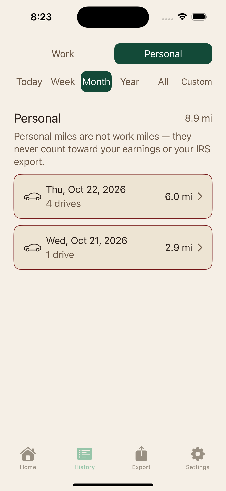
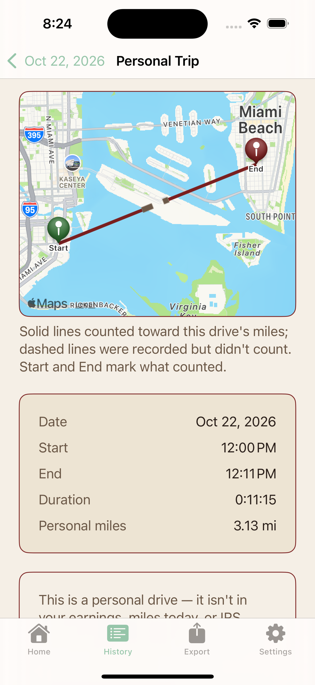

# Earnly Design Lab

**Galeria de referencia: 76 capturas con datos sinteticos e instrucciones para explorar nuevos disenos de Earnly Driver.**

Se puede revisar desde GitHub sin Mac, simulador o acceso al repositorio privado. Las imagenes muestran varias etapas del trabajo: no todas pertenecen a una misma version instalada. Las propuestas nuevas del laboratorio todavia no estan incluidas.

## Empezar desde el trabajo o una sesion en la nube

1. Explora las galerias de abajo. Haz clic en cualquier imagen para verla completa.
2. Lee el [encargo de diseno](DESIGN-BRIEF.md) y sus [limites de cobertura](COBERTURA.md).
3. Para construir con Claude u otro agente en la nube, selecciona este repositorio y usa [PROMPT-CLOUD.md](PROMPT-CLOUD.md). No necesita archivos de un Mac.
4. El prototipo futuro debe vivir en `prototype/`, separado de estas referencias. Nada de aqui se incorpora automaticamente a la app real.

## Galerias

| Grupo | Capturas | Abrir |
|---|---:|---|
| Personales e Historial C34 | 19 | [Ver galeria](screens/01-personales-c34/README.md) |
| Ajustes y cobertura | 3 | [Ver galeria](screens/02-ajustes-c34/README.md) |
| Cierre de turno laboral | 18 | [Ver galeria](screens/03-cierre-laboral/README.md) |
| Completar importes: flujos y estados | 25 | [Ver galeria](screens/04-completar-importes/README.md) |
| Inicio y dinero: correcciones del 24 oct | 8 | [Ver galeria](screens/05-coherencia-corregida/README.md) |
| Documentos ficticios: jerarquia y legibilidad | 3 | [Ver galeria](screens/06-documentos-ejemplo/README.md) |

## Vista rapida

Las pantallas son de pruebas, no datos reales ni promesas de precision. Los mapas tambien son ficticios. Para importes/textos corregidos, la referencia del **24 de octubre** prevalece sobre las capturas del 23.

<table>
<tr>
<td align="center"><strong>Inicio, pago parcial</strong> </td>
<td align="center"><strong>Inicio ES oscuro</strong> </td>
<td align="center"><strong>Historial personal</strong> </td>
</tr>
<tr>
<td align="center"><strong>Detalle personal</strong> </td>
<td align="center"><strong>Resultado del turno</strong> </td>
<td align="center"><strong>Completar importes</strong> </td>
</tr>
</table>

## Datos y alcance

- [Tokens visuales extraidos](TOKENS-BASE.json): base de colores, espacios, radios y bordes para la reconstruccion.
- [Inventario de imagenes](screens.json): procedencia, etapa, dimensiones y huella de cada captura.
- No se publicaron codigo de produccion, registros, datos del telefono, respaldos, credenciales ni motores de millas/impuestos.
- No hay capturas nativas de absolutamente todas las pantallas; `COBERTURA.md` enumera lo que falta. No confundir 76 capturas con 76 pantallas diferentes.
- Este repositorio de referencia no autoriza reutilizar marcas o recursos de terceros fuera de sus terminos. Las capturas de mapas conservan la atribucion visible. No se concede aqui una licencia general del producto.
