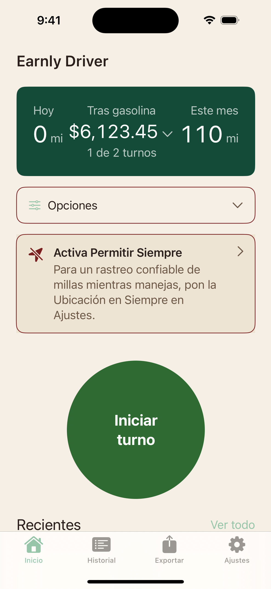

# Home sin título: encargo vigente

Primer cambio aprobado por Liber el 27 de octubre de 2026: **quitar «Earnly Driver» de la parte superior de Home y aprovechar su espacio, manteniendo colores, botón circular y funciones.**

Esta carpeta prepara el encargo; todavía no contiene su implementación. No se alteró la app enviada a Apple.

## Para empezar en Claude Code

Repositorio: https://github.com/LiberVaronaG/earnly-design-lab

Rama preparada: `design/home-sin-titulo-2026-10-27`.

Lee [PROMPT-CLAUDE.md](PROMPT-CLAUDE.md). Trabajar en esta rama o una derivada de sesión, conservando `main` y `claude/prototype-design-lab`.

## Captura principal

Procedencia: captura `07-big-es-L.png` de la candidata 36. Se copia sin editar. El aviso de ubicación es un estado de prueba, no una tarjeta que aparezca siempre. No contiene recorridos ni cifras reales de clientes.

La comparación se construirá dentro del prototipo existente, V0 y sin decoración estacional, con los mismos datos en Original y Sin título. El logo/icono principal de la app queda como trabajo posterior; no reemplazar el rótulo quitado por otro adorno.
