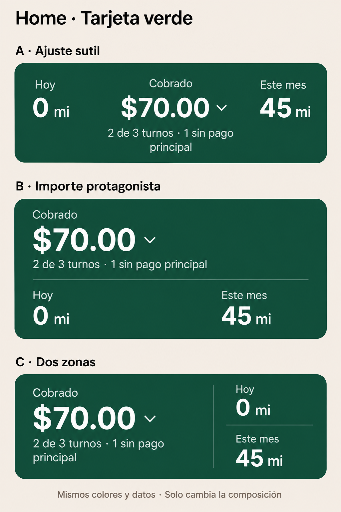

# Siguiente detalle de Home: tarjeta verde

**Seguimos en la tarjeta verde.** Liber prefiere la opción C por su composición sencilla. Quitar el nombre de arriba se conserva como decisión del laboratorio. Ninguno de estos cambios se ha integrado en la app nativa.

Lee [PROMPT-CLAUDE.md](PROMPT-CLAUDE.md). Implementa y revisa C dentro de Home completo; puedes presentar una alternativa propia acotada si aporta una mejora real. La elección final se hará después de ver las capturas comparables.

El PNG es una exploración generada con IA, no una captura de interfaz ni una especificación de medidas o colores. Usa los tokens existentes. Los datos son sintéticos.

Base del siguiente trabajo: `design/home-sin-titulo-2026-10-27`, implementación sin título en `801779393b7e9f32f9ad639dbb41b95e4abe7a07`. El commit que añade este encargo solo incorpora documentación y esta imagen; no modifica el prototipo.
