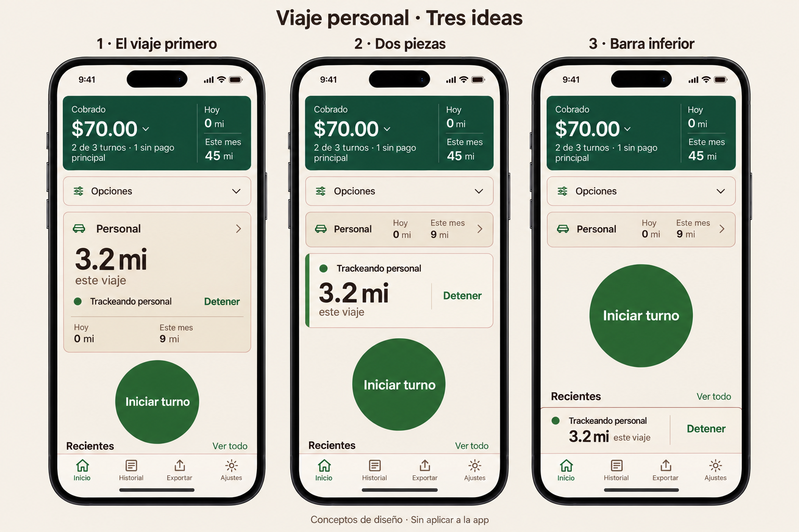

# Elección de Liber: El viaje primero

Liber dijo: **«hacemos el 1 viaje primario. déjale saber a Claude»**.

El 1 corresponde al PNG de Codex incluido aquí, **El viaje primero**. En el laboratorio actual de Claude esa misma dirección se llama **2 · El viaje primero**, parámetro **`vivo=tablero`**. Se elige por nombre y composición; no se elige la antigua «1 · Línea en vivo».

Lee [PROMPT-CLAUDE.md](PROMPT-CLAUDE.md). Reutiliza la variante ya construida, registra la elección y muestra la vista individual. No se inicia otra arquitectura ni se integra nada en la app real.

Imagen generada como concepto, con datos sintéticos. No es una especificación de píxeles ni del tamaño del círculo. Para el prototipo se conservan componentes y tokens actuales.

Base observada: `2f1bc1e676795fc2f1a68fa1903b615885d4af55`, rama `design/home-sin-titulo-2026-10-27`. Este encargo solo incorpora documentación y referencia visual.
