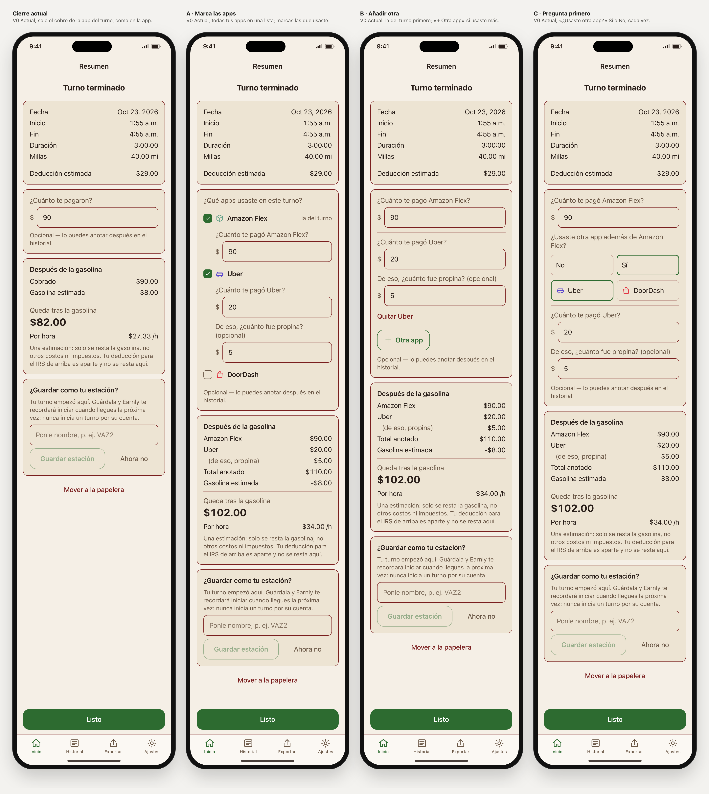

# Cierre del turno: elegida A

Rama `design/home-sin-titulo-2026-10-27`, 6 nov 2026. Es parte de lo que Liber llama «base 1»: lo que se va eligiendo encima de la app actual, la «base 0». En el laboratorio también existe una familia llamada «V1», que es otra cosa. Inicio y el turno en curso no cambian: todo lo elegido sigue igual. **Elegida: A · Marca las apps** (`cierre=a`), con la lista limitada a las apps que se combinan con la del turno ([CIERRE-COMBINACIONES.md](CIERRE-COMBINACIONES.md)).

## El cierre hoy, en la app publicada

Es la 2.0.3 (36), compilada desde `081c436`. Se leyó en `ShiftSummaryView`, `ShiftPayCard` y `ShiftResultCard`.
- **Arriba, «Turno terminado»** y una tarjeta con la fecha, el inicio, el fin, la duración, las millas y la deducción estimada.
- **«¿Cuánto te pagaron?»:** un solo campo, para la plataforma del turno.
  - Si la plataforma tiene propinas (todas menos Amazon Flex), también pregunta «De eso, ¿cuánto fue propina? (opcional)».
  - Si no las tiene, pone «Opcional: lo puedes anotar después en el historial».
- **«Después de la gasolina»:**
  - lo cobrado y la gasolina estimada;
  - «Queda tras la gasolina», el importe por hora y la nota de que es una estimación.
- **Si no hay estación guardada,** ofrece guardar el lugar de inicio.
- **«Mover a la papelera»**, y «Listo» fijo abajo.

**Las otras apps no se preguntan al cerrar.** Para anotar lo que pagó Uber en un turno de Amazon Flex hay que ir después a Historial, editar el turno y usar «¿Usaste otra plataforma?» → «Añadir una plataforma» (`StackedEarningsEditor`). La app ya guarda ese dinero aparte, en `extraEarnings`, y el cierre lo suma si existe.

**El laboratorio no era así:** tenía «Agregar pago de otra plataforma» en el propio cierre. Esa versión se queda como «Antigua del laboratorio» (`cierre=lab`), el valor por defecto, para que los enlaces anteriores no cambien. Se comprobó que sigue idéntica.

**Qué falla hoy:**
1. **Si usaste dos apps en el mismo turno, el cierre no te deja anotar la segunda.** El resultado que ves («Queda tras la gasolina $82.00») es solo de una, y hay que acordarse de ir a Historial.
2. **Nada te recuerda que falta.** Si se te olvida, el turno se queda con menos ingreso del real.

## Las propuestas

Lo que tienen en común:
- **El campo del turno lleva su nombre:** «¿Cuánto te pagó Amazon Flex?».
- **Cada app usada tiene su campo,** y su propina opcional si la plataforma tiene propinas. Son las mismas reglas de la app: el importe tiene que ser válido y la propina no puede ser mayor que el pago.
- **«Después de la gasolina»** lista cada app, el total anotado y lo que queda.
  - Si falta el pago de la app del turno, muestra «Parcial» y no inventa un resultado, como la app.
- **Guardan lo mismo que ya guarda la app** (`grossEarnings`, `tip` y `extraEarnings`). No cambia nada de los datos.
- **Solo ofrecen las plataformas activadas en Ajustes.** En el laboratorio, de ejemplo: Amazon Flex, Uber y DoorDash, las tres de «Iniciar turno en» de la captura real.
- **Con una sola plataforma activada,** no preguntan nada más: queda el campo del turno, como hoy.

### A · Marca las apps (`cierre=a`), elegida

«¿Qué apps usaste en este turno?» y una lista de casillas.
- La del turno ya está marcada y no se puede quitar («la del turno»).
- Al marcar otra, aparece su campo.
- **Solo se ofrecen las apps que se combinan con la del turno** (reglas en [CIERRE-COMBINACIONES.md](CIERRE-COMBINACIONES.md)):
  - primero, las que este conductor ya anotó junto a ella, con «la usaste antes»;
  - después, las de la tabla; por ejemplo, Uber ofrece Lyft, DoorDash y GrubHub;
  - un enlace discreto «+ Otra app» abre el resto de las activadas;
  - **en un turno de Amazon Flex, la tabla no ofrece ninguna:** queda el campo del turno y «+ Otra app».

- **Ventajas:**
  - Pregunta justo lo que pediste, con todas las opciones a la vista.
  - Un toque por cada app más.
- **Costes:**
  - Una combinación rara queda a un toque más, detrás de «+ Otra app».
  - Antes de filtrar era la más alta con una sola app (356 px); filtrada, un turno de Flex mide 222 px.

### B · Añadir otra (`cierre=b`)

Primero el campo de la app del turno. Debajo, «+ Otra app» abre las demás para elegir, y cada una añadida tiene «Quitar». Es como el editor de Historial, pero sin salir del cierre.

- **Ventajas:**
  - La más corta: 230 px con una sola app.
  - Repite lo que ya hace Historial.
- **Costes:**
  - No pregunta: si no te acuerdas, no tocas el botón.
  - Dos toques por app.

### C · Pregunta primero (`cierre=c`)

Después del campo del turno: «¿Usaste otra app además de Amazon Flex?» con No y Sí. Con Sí aparecen las apps para marcar.

- **Ventajas:**
  - La pregunta está ahí en cada cierre, así que es difícil olvidarlo.
  - Con una sola app, basta con no contestar o tocar No.
- **Costes:**
  - Dos toques por app.
  - Con texto grande es la más alta.

## Medidas

Alto de la caja del cobro, en px, a 390 px con texto normal:

| | Hoy | A | B | C |
|---|---|---|---|---|
| Solo Amazon Flex | 162 | **222** | 230 | 286 |
| Solo Amazon Flex, con 5 apps activadas | 162 | **222** | 230 | 286 |
| Turno de Uber con propina, 5 apps activadas | 270 | 546 | **342** | 376 |
| Flex y Uber | — | 562 | **475** | 547 |
| Flex, Uber y DoorDash | — | 760 | **656** | 744 |
| Flex y Uber, texto al 200 % | — | 966 | **814** | 1148 |
| Toques para añadir Uber | no se puede | **1** | 2 | 2 |

El cierre ya se desplaza hoy, y «Listo» va fijo abajo, así que la altura pesa menos que en Inicio.

## Recomendación: A (elegida)

- **Es la que pregunta lo que pediste:** «¿Qué apps usaste en este turno?», con las opciones a la vista.
- **Un toque por app,** frente a dos en B y C.
- **Recuerda la segunda app sin depender de que te acuerdes:** la lista está ahí cada vez.
- **B es la alternativa** si casi siempre usas una sola app y quieres el cierre corto. Pero no pregunta.
- **C** pregunta igual de claro que A, pero con un paso más.

## Decisión

**Liber eligió A · Marca las apps el 6 nov 2026.** Pidió además que la lista no ofrezca apps que no se combinan con la del turno, por ejemplo Instacart en un turno de Amazon Flex. **Ya está construido** (ver A arriba), y Liber aprobó la lista filtrada el mismo día.
- La investigación y las reglas propuestas están en [CIERRE-COMBINACIONES.md](CIERRE-COMBINACIONES.md). Por ejemplo:
  - Flex no ofrece ninguna;
  - Uber ofrece Lyft, DoorDash y Grubhub;
  - lo que anota cada conductor manda sobre la tabla;
  - un enlace discreto «Otra app» deja anotar cualquier otra activada.
- **Construido después de que Liber aceptara las reglas.** Para verlo hay tres estados nuevos:
  - un turno de Uber con cinco apps activadas, con «+ Otra app» abierto y sin abrir;
  - un turno de Flex con las mismas cinco;
  - y, con el escenario «Pago parcial», ese turno de Flex muestra Uber con «la usaste antes», porque ese historial ya tiene un turno de Flex con Uber.
- **De paso se añadió la propina de la app del turno.** Las plataformas con propinas (todas menos Amazon Flex) preguntan «De eso, ¿cuánto fue propina?» y explican que las propinas suelen llegar después, como la app. Antes el laboratorio no lo hacía, porque todos sus cierres eran de Flex.
- **El laboratorio ahora tiene GrubHub,** que estaba en la app y faltaba aquí. La lista de Plataformas de Ajustes la muestra.
- B y C se quedan como referencia; el enlace del cierre elegido lleva `cierre=a`.

## Comprobado

- **Auditoría en WebKit: 2016 renders, 0 fallos.**
  - Combinaciones: 14 estados × 4 variantes × claro y oscuro × ES y EN × 320, 390 y 430 px × texto al 100, 140 y 200 %.
  - Los 9 estados:
    - vacío;
    - solo la del turno;
    - importe inválido;
    - con Uber, con y sin precio de gasolina;
    - solo Uber (parcial);
    - con Uber y DoorDash;
    - propina mayor que el pago;
    - B eligiendo otra app;
    - turno de Uber, con «+ Otra app» abierto y sin abrir;
    - turno de Flex con 5 apps, con y sin historial;
    - vacío con historial.
  - **Qué mira en cada render:**
    - en «Hoy», que no haya otras plataformas, igual que la app;
    - en A, B y C, que el campo nombre la app, que haya un campo por cada app usada y el estado correcto de cada casilla, botón o respuesta;
    - en A, la lista exacta que dan las reglas (calculada por la auditoría por su cuenta), «+ Otra app» solo cuando quedan apps, y «la usaste antes» solo en las del historial;
    - el campo de propina de la app del turno solo en plataformas con propinas;
    - que el resultado nombre cada app y muestre «Total anotado» solo cuando hay otra app;
    - que «Listo» se bloquee mientras un campo tiene un error;
    - que cada campo tenga su etiqueta y cada botón mida al menos 44 px;
    - contraste de 4,5 : 1 como mínimo, texto cortado y desbordamiento horizontal.
  - Antes de dar por buenos los resultados, se comprobó en cada render el tema, el idioma, el ancho, el texto, las variantes y que la pantalla fuera la del cierre: 2016 de 2016.
- **Fallo encontrado y corregido con la propina:** «Total anotado» salía aunque solo hubiera una app, porque la fila de la propina contaba como otra línea. Ahora solo sale con otra app.
- **Fallo encontrado y corregido:** en A, a 320 px con texto al 200 %, la fila «Amazon Flex · la del turno» no bajaba de línea y se salía. Ahora baja, y con texto grande los campos pierden la sangría.
- **Fallo de la propia auditoría:** contaba como recortado el texto oculto para VoiceOver (`.sr-only`), que está oculto a propósito. Se corrigió y se repitió la auditoría completa.
- **Control negativo: 15 de 15 detectados.** Se rompieron a propósito:
  - el contraste;
  - un nombre recortado;
  - el tamaño de los botones;
  - «otra plataforma» devuelta a «Hoy»;
  - un campo de app quitado;
  - una casilla con el estado mal;
  - una app quitada del resultado;
  - «Listo» activo con un error;
  - un campo sin etiqueta;
  - la respuesta de C con el estado mal;
  - Instacart metido en la lista de un turno de Flex;
  - «+ Otra app» quitado;
  - «la usaste antes» en una app sin historial;
  - un campo de propina en Flex;
  - «Total anotado» con una sola app.
- **El cierre antiguo del laboratorio sigue idéntico** al de antes de este trabajo: se comparó su HTML en 4 familias × 4 estados × 2 escenarios, 32 de 32 iguales.
- **Lo de antes sigue igual:**
  - las auditorías de Recientes (1440), avisos (864), turno en curso (720) y espacio de B (540) siguen sin fallos;
  - sus capturas no cambiaron;
  - `check-contrast.mjs`, `build-tokens.mjs --check` y `SHA256SUMS` dan correcto.
- **Sin probar:** iOS, el teclado numérico real, VoiceOver y Dynamic Type real.

## Abrir

- Comparación: **Vista → «Cierre del turno»**, con **Pantalla → «Cierre · con Uber ($90 + $20)»** u otro estado del cierre. Con el escenario «Pagos completos» se ve el resultado tras la gasolina.
  `#view=cierre&family=v0&lang=es&scenario=complete&screen=closeStacked`
- Una variante sola: control **Cierre** o parámetro `cierre=lab|actual|a|b|c`.
- Capturas: `swift prototype/tools/capture-home-webkit.swift cierre`.

## Capturas (`captures/home-cierre/`)

| Archivo | Qué muestra |
|---|---|
| `01-comparar-vacio-es.png` | Recién terminado, sin nada anotado |
| `02-comparar-con-uber-es.png` | Amazon Flex $90 y Uber $20 con $5 de propina |
| `03-comparar-con-uber-oscuro-en.png` | Lo mismo, oscuro, inglés |
| `04-comparar-solo-uber-es.png` | Solo Uber: parcial |
| `05-comparar-dos-apps-es.png` | Con Uber y DoorDash |
| `06-comparar-propina-es.png` | Propina mayor que el pago: error y «Listo» bloqueado |
| `07-comparar-320-texto-200-es.png` | 320 px y texto al 200 % |
| `08-comparar-sin-gasolina-es.png` | Sin precio de gasolina |
| `09`–`12-…-es.png` | Hoy, A, B y C a 390 × 844 |
| `13-a-turno-uber-es.png` | Turno de Uber con 5 apps: A ofrece Lyft y DoorDash |
| `14-a-turno-uber-otra-app-es.png` | Lo mismo con «+ Otra app» abierto |
| `15-a-flex-cinco-apps-es.png` | Turno de Flex con 5 apps: A no ofrece ninguna |
| `16-a-flex-historial-es.png` | El mismo, con historial: Uber con «la usaste antes» |

## Si pasa a la app

- **En `ShiftPayCard`:**
  - el campo con el nombre de la app;
  - la lista de A, filtrada con la tabla de combinaciones y el historial del propio conductor, en el teléfono;
  - un campo por app, que guarde en `extraEarnings` con las mismas reglas de `StackedEarningsEditor` y `MoneyInput`.
- **`ShiftResultCard` ya sabe mostrar varias apps,** así que no cambia.
- **VoiceOver:** cada casilla y cada campo con su nombre.
- **SPEC §4.5 (End Shift Flow)**, PARITY.md y su `docs/parity`, y Android.
- **No cambia el modelo de datos.**

## Siguiente paso

Liber aprobó la lista filtrada el 6 nov (`afcc68a`). Toca la pasada final por Inicio entero, que cierra la base 1. Navidad va después, en la base 2. Nada pasa a SwiftUI.
