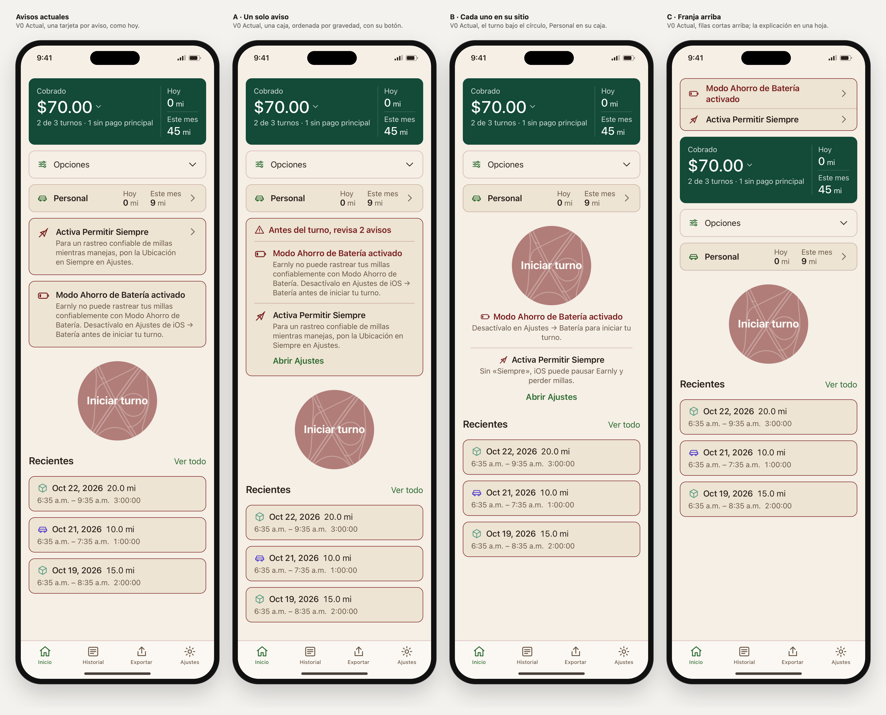

# Avisos de Inicio: tres propuestas

Rama `design/home-sin-titulo-2026-10-27`, 6 nov 2026. Viene después de Iniciar turno. El resto de Inicio no cambia: tarjeta C, Opciones, Personal A, El viaje primero y el círculo con Corte siguen igual.

## Los avisos de hoy (como en la app)

| Aviso | Cuándo sale | Al tocarlo |
|---|---|---|
| Activa Permitir Siempre | Ubicación en «Mientras se usa» | Abre los Ajustes de iOS |
| Ubicación apagada | Ubicación denegada | Abre los Ajustes de iOS |
| Modo Ahorro de Batería activado | Ahorro de batería activo. Además, «Iniciar turno» se desactiva y se rellena de rojo vino al 55 % | Nada: iOS no permite enlazar a Ajustes → Batería |
| El rastreo automático necesita Movimiento y Forma Física | Personal activo, ubicación en Siempre y Movimiento denegado | Abre los Ajustes de iOS |

- La app los muestra en este orden: ubicación, Personal bloqueado y ahorro de batería.
- Dos pueden salir a la vez: ubicación y ahorro de batería. Personal bloqueado solo aparece cuando la ubicación está bien.
- El laboratorio solo tenía el aviso de ubicación; ahora tiene los cuatro.
  - Pantallas nuevas: «Inicio · sin avisos», «aviso: ubicación apagada», «aviso: ahorro de batería», «dos avisos (Siempre y batería)» y «aviso: Personal sin Movimiento».
  - El aviso de ubicación apagada del Inicio V0 ahora usa el texto de la app. Antes decía «Este iPhone no puede detectar trayectos», que en la app corresponde a otro estado.

**Qué falla hoy:**
1. **No parece una alerta.** Lleva el mismo borde rojo vino que las tarjetas de Recientes.
2. **Ocupa mucho.** Cada aviso es un título más tres líneas. Con dos avisos, el círculo «Iniciar turno» ya no cabe entero en la primera pantalla de un iPhone de 390 × 844 (medidas abajo).
3. **Todo pesa lo mismo.** El ahorro de batería impide iniciar el turno y «Siempre» solo puede hacer perder millas, pero los dos avisos se ven iguales.
4. **La acción no se dice.** Solo hay una flecha. El aviso de batería parece tocable y no lo es.

## Las tres propuestas

Lo que tienen en común:
- Ordenan por gravedad: ahorro de batería, ubicación apagada, «Siempre» y Personal.
- No añaden colores. El icono va en el rojo vino de marca, y el título también cuando el aviso impide el turno (batería o ubicación apagada).
- La acción es la misma de hoy: abrir los Ajustes de iOS. En el laboratorio sale el aviso «Demo: abriría los Ajustes de iOS».
- Con ahorro de batería, el círculo desactivado es el de la app. En oscuro, el halo del Corte pasa a rojo vino para no dibujar un borde verde alrededor de las letras.

### A · Un solo aviso (`avisos=a`)

Una sola caja donde estaba el aviso.
- Con dos avisos lleva una cabecera: «Antes del turno, revisa 2 avisos».
- Debajo, cada aviso con su icono, título y el texto completo de la app, separados por una línea fina.
- Cada aviso tiene su botón «Abrir Ajustes», salvo el de batería.

- **Ventajas:**
  - Es el cambio más pequeño, con los mismos textos de la app.
  - Un solo borde aunque haya dos avisos.
  - La acción se dice con palabras.
- **Costes:**
  - Es la más alta: con dos avisos ocupa 58 px más que hoy.
  - Sigue entre Personal y el círculo.

### B · Cada uno en su sitio (`avisos=b`)

Cada aviso va junto a lo que afecta.
- Lo que afecta al turno (batería, ubicación apagada, «Siempre») va justo debajo del círculo: título, una frase corta y «Abrir Ajustes» si se puede arreglar desde ahí.
- Personal bloqueado va dentro de la caja Personal, como una línea bajo Hoy y Este mes, con su «Abrir Ajustes».
- No queda ninguna caja suelta entre Personal y el círculo.

- **Ventajas:**
  - **El círculo nunca se mueve:** está en el mismo sitio con avisos y sin ellos, salvo cuando crece la caja Personal.
  - Con batería, el motivo del círculo desactivado está justo debajo de él.
  - La parte de arriba (tarjeta, Opciones y Personal) no cambia.
  - Con dos avisos, el círculo se ve entero.
- **Costes:**
  - Usa frases cortas nuevas, en español e inglés, que hay que revisar (lista abajo).
  - Recientes baja: con dos avisos, su título queda en el borde de la pantalla.
  - Con texto grande, el texto centrado bajo el círculo se alarga.

### C · Franja arriba (`avisos=c`)

Filas cortas encima de la tarjeta verde: icono, título de la app y flecha. Al tocar una fila se abre una hoja con el texto completo y «Abrir Ajustes».

- **Ventajas:**
  - Es la más compacta: Recientes aparece antes que en las demás en casi todos los estados.
  - Los avisos se ven nada más abrir la app.
- **Costes:**
  - Para saber por qué hay que tocar.
  - La tarjeta verde deja de ser lo primero de Inicio.
  - Con batería, el círculo desactivado queda lejos de su motivo.
  - Añade una hoja nueva.

### Textos nuevos

A usa los textos de la app y C los títulos de la app. B necesita frases nuevas, y en la app habría que añadirlas a Localizable:

| Clave | Español | English |
|---|---|---|
| `alwaysShort` | Sin «Siempre», iOS puede pausar Earnly y perder millas. | Without Always, iOS can pause Earnly and miss miles. |
| `nDeniedShort` | Earnly no puede rastrear tus millas. | Earnly can't track your miles. |
| `nLowShort` | Desactívalo en Ajustes → Batería para iniciar tu turno. | Turn it off in Settings → Battery to start your shift. |
| `nMotionShortTitle` | Necesita Movimiento y Forma Física | Needs Motion & Fitness |
| `nMotionShort` | Tus viajes personales no se están registrando. | Your personal drives aren't being recorded. |
| `nGroupHead` (A) | Antes del turno, revisa {n} avisos | Before your shift, check {n} notices |

## Medidas

Cada celda es dónde empieza el título de Recientes, en px desde arriba del contenido de Inicio: cuanto más bajo el número, antes aparece.
- iPhone de 390 × 844, texto normal, español, claro.
- La pantalla acaba a 717 px, donde empieza la barra de pestañas.
- «cortado» significa que el círculo no cabe entero en la primera pantalla.

| Estado | Hoy | A | B | C |
|---|---|---|---|---|
| Sin avisos | 494 | 494 | 494 | 494 |
| Activa Permitir Siempre | 621 | 653 | 606 | **552** |
| Ubicación apagada | 621 | 634 | 587 | **552** |
| Ahorro de batería | 640 | 632 | **560** | 568 |
| Dos avisos (Siempre y batería) | 767, cortado | 825, cortado | 693 | **612** |
| Personal bloqueado | 681 | 713 | 614 | **568** |

- **Dónde acaba el círculo:**
  - En B acaba a 474 px en todos los estados del turno, igual que sin avisos.
  - En C baja a 532–592 px.
  - En Hoy y en A, a 601–805 px.
- **Texto al 200 % (390 px):**
  - Ninguna variante deja el círculo entero en pantalla, tampoco sin avisos: acaba a 902 px.
  - Con dos avisos, Recientes empieza a 1823 en Hoy, 1942 en A, 1503 en B y 1253 en C.
- **320 px, texto normal:** con dos avisos, el círculo solo cabe entero en B.

## Recomendación: B

- **El círculo no se mueve.** Quien conduce encuentra «Iniciar turno» siempre en el mismo sitio. Los avisos van debajo de él, no lo empujan.
- **El motivo está junto a lo que afecta.** Con batería, el círculo desactivado tiene su explicación justo debajo. Personal bloqueado se ve dentro de Personal, que es lo que no funciona.
- **La parte de arriba de Inicio no cambia** y queda limpia de cajas sueltas.
- **Lo grave se distingue de lo que no lo es.** Lo que impide el turno va en rojo vino; «Siempre» lleva el título en el color normal.
- **Precio:** frases cortas nuevas que hay que revisar, y Recientes un poco más abajo.
- **C es la alternativa** si lo más importante es la altura. Pero pide un toque para entender el aviso y aleja el motivo del círculo desactivado.
- **A** es la más prudente, y la más alta.

## Comprobado

- **Auditoría en WebKit: 864 renders, 0 fallos.**
  - Combinaciones: 6 estados × 4 variantes × claro y oscuro × ES y EN × 320, 390 y 430 px × texto al 100, 140 y 200 %.
  - Además, las 8 hojas de C (4 avisos en ES y EN): título y texto presentes, botón «Abrir Ajustes» en todas menos la de batería.
  - Qué mira en cada render:
    - desbordamiento horizontal y textos recortados;
    - contraste de 4,5 : 1 como mínimo en títulos y textos de los avisos;
    - botones con nombre y de al menos 44 px;
    - el número de avisos esperado para el estado;
    - el círculo desactivado si, y solo si, hay ahorro de batería;
    - que existan los destinos de `aria-describedby`;
    - que no haya halo verde en el círculo desactivado en oscuro.
- **La primera pasada no valía.** WebKit limita `history.replaceState` a 100 llamadas cada 10 segundos, y la mayoría de estados no llegó a aplicarse. Se repitió con pausas, comprobando en cada render que el tema, el idioma, el ancho, el texto y las cuatro variantes eran los pedidos: 864 de 864.
- **Control negativo: 5 de 5 detectados.** Se rompieron a propósito el contraste, el tamaño de un botón, un recorte, un aviso de menos y el halo verde.
  - El primer intento de recorte no valía como control, porque el título cabía de todos modos. Se repitió con un ancho forzado.
- **Fallo encontrado y corregido:** en oscuro, con ahorro de batería, el halo verde del Corte rodeaba el texto del círculo rojo vino.
- `node tools/check-contrast.mjs`: correcto. Solo queda el fallo heredado de V0, ya documentado.
- `tools/check-ui.cjs` no se ejecutó, porque Playwright no está instalado.
- **Sin probar:** iOS, VoiceOver y Dynamic Type reales. Tampoco el contraste del texto blanco sobre el círculo desactivado (rojo vino al 55 %). Un botón desactivado está exento en WCAG, pero en el teléfono hay que comprobar que se lee.

## Cambio en la herramienta de capturas

`tools/capture-home-webkit.swift` ahora oculta la barra de desplazamiento del Mac en todas las capturas. En un iPhone el indicador flota sobre el contenido, pero en el Mac la barra ocupaba 11 px.
- Las capturas hechas antes del 6 nov salieron con 379 px útiles en lugar de 390.
- Las comparaciones lado a lado siguen valiendo, porque los dos lados tenían la barra. Las medidas absolutas de ancho no.
- Esas capturas no se regeneraron.

## Abrir

- Comparación: **Vista → «Avisos»**, y en «Pantalla» elige un estado «Inicio · aviso…» o «Inicio · dos avisos».
  `#view=avisos&family=v0&lang=es&scenario=partial&screen=homeTwoNotices`
- Una variante sola: control **Avisos** o parámetro `avisos=actual|a|b|c`, por ejemplo
  `#view=single&solo=1&family=v0&home=sintitulo&card=c&desglose=propuesta&opciones=propuesta&personal=a&vivo=tablero&circulo=fondo-corte&avisos=b&lang=es&scenario=partial&screen=homeTwoNotices`
- Capturas: `swift prototype/tools/capture-home-webkit.swift avisos`.

## Capturas (`captures/home-avisos/`)

| Archivo | Qué muestra |
|---|---|
| `01-comparar-siempre-claro-es.png` | Activa Permitir Siempre |
| `02-comparar-dos-avisos-claro-es.png` | Siempre y ahorro de batería a la vez |
| `03-comparar-bateria-claro-es.png` | Ahorro de batería |
| `04-comparar-ubicacion-apagada-claro-es.png` | Ubicación apagada |
| `05-comparar-personal-movimiento-claro-es.png` | Personal sin Movimiento y Forma Física |
| `06-comparar-dos-avisos-oscuro-en.png` | Dos avisos, oscuro, inglés |
| `07-comparar-320-texto-200-dos-avisos-es.png` | Dos avisos, 320 px y texto al 200 % |
| `08`–`11-…-dos-avisos-es.png` | Hoy, A, B y C a 390 × 844 sin alargar: lo que cabe en la primera pantalla |
| `12-c-hoja-bateria-es.png` | C: la hoja del aviso de batería |

## Si pasa a la app

- SPEC §4.3 (Inicio), PARITY.md y `docs/parity/`.
- Los textos nuevos de B en Localizable, en español e inglés.
- Android.
- No cambia nada de cómo se detecta cada estado ni cuándo se desactiva «Iniciar turno».

## Siguiente paso

Liber elige A, B, C o ninguna. Nada pasa a SwiftUI.
