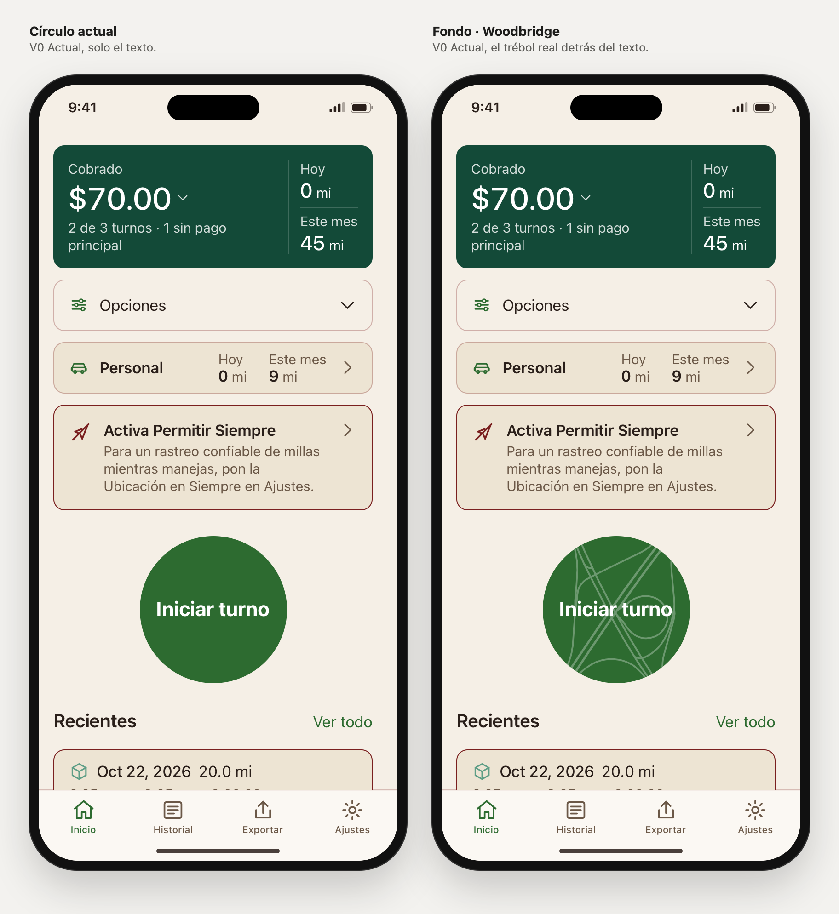

# Iniciar turno: el trébol de Woodbridge de fondo

Rama `design/home-sin-titulo-2026-10-27`, 28 oct 2026. Viene después de El viaje primero; el resto de Inicio no cambia.

## Qué es

El círculo «Iniciar turno» lleva detrás de su texto el dibujo real del trébol de Woodbridge, en Nueva Jersey: el primer trébol de carreteras de EE. UU. (1929), en el cruce de la US 1/9 con la NJ 35. Son líneas blancas finas al 30 % sobre el verde de acción. El texto, el tamaño, el color y la acción del botón no cambian.

Recorrido hasta aquí, todo con Liber el 27 y 28 oct:

1. Se buscaron cruces de carreteras conocidos en el mundo y Liber eligió Woodbridge.
2. Un trébol genérico dibujado a mano no le convenció: «no es idéntico a la calle».
3. Se pasó al trazado real de OpenStreetMap, comprobado carril a carril sobre el satélite.
4. Entre «Sello» (el cruce dentro de un aro, encima del texto) y «Fondo» (el cruce ocupa todo el botón), **Liber eligió Fondo**.

Hoy el cruce es un trébol parcial: lo rehicieron hacia 2004–2006 y le queda un solo lazo. Por eso, al ser idéntico a la calle, se lee como una X con un lazo, no como cuatro hojas.

## Abrir

- Elegido, a pantalla completa: `prototype/index.html#view=single&solo=1&family=v0&home=sintitulo&card=c&desglose=propuesta&opciones=propuesta&personal=a&vivo=tablero&circulo=fondo&lang=es&scenario=partial&screen=home`.
- Comparación: **Vista → «Iniciar turno»** (`#view=iniciar&family=v0&lang=es&scenario=partial&screen=home`). Los dos marcos llevan todo lo elegido en Inicio y solo cambia el círculo.
- En cualquier vista, el control **Círculo → Actual / Fondo · Woodbridge** y el parámetro `circulo`. Sin `circulo`, el prototipo se comporta como antes.

## Datos y licencia

- Fuente: extracto de la API de OpenStreetMap, `bbox=-74.2972,40.5683,-74.2882,40.5751`, guardado a mano el 28 oct 2026. Se usan las 64 vías de tipo trunk y secondary y sus enlaces. Proyección local con el norte arriba, centro en 40.5717, −74.2927 y radio de 170 m.
- `tools/build-start-map.cjs <map.osm>` genera `js/start-map.js`, unos 3 KB de trazos. No descarga nada; el extracto no se guarda en el repositorio.
- Licencia: datos © colaboradores de OpenStreetMap, ODbL 1.0. Con `circulo=fondo`, Ajustes → Acerca de muestra el crédito. **Si pasa a la app, ese crédito tiene que ir en Acerca de.**
- El satélite (Esri World Imagery) solo sirvió para comprobar el trazado. No forma parte del dibujo ni del laboratorio.

## Archivos

- `js/start-map.js` (generado) y `tools/build-start-map.cjs`.
- `js/screens.js`: `startBlock()` añade el mapa y la clase `start-circle-map` con `circulo=fondo`. Acerca de añade el crédito.
- `css/app.css`: cinco reglas para el fondo (`.start-circle-map`, `.start-map`) y una corrección (ver abajo).
- `js/i18n.js`: `startMapCredit` en EN y ES.
- `js/app.js`, `js/lab.js`, `index.html`: parámetro `circulo`, control «Círculo» y vista «Iniciar turno».
- `tools/capture-home-webkit.swift`: conjuntos `iniciar-turno` y `contraste-oscuro`. Capturas en `captures/home-iniciar-turno/` y `captures/home-contraste-oscuro/`.
- Corte y Tenue: dos reglas en `css/app.css`, la clase en `startBlock()` y la vista «Contraste en oscuro» en `js/lab.js` e `index.html`.

**Corrección que ya existía:** el anillo de foco compartido (`.app :focus-visible`) pone `border-radius: 6px`. Con el teclado, el círculo «Iniciar turno» se volvía un cuadrado redondeado, también en el círculo actual. Con el fondo asomaban las esquinas del mapa. Una regla mantiene el círculo redondo con foco.

## Comprobado

En el navegador del entorno (Chromium):

- **Auditoría en la vista «Iniciar turno», en los dos marcos.** Es la misma comprobación de `tools/check-ui.cjs`: desbordes, controles sin nombre y áreas táctiles de menos de 24 px. Combinaciones: Inicio, desglose abierto, Opciones abiertas, viaje personal trackeando y en pausa × claro/oscuro × EN/ES × los 8 escenarios × 390, 320, 320 con texto al 200 %, 430 y 390 con texto al 135 %. En total, 1600 renders y 0 fallos.
- **En esas 800 parejas:**
  - El texto del área desplazable es idéntico.
  - El círculo tiene el mismo diámetro, posición, nombre accesible y número de líneas de texto en los dos marcos.
  - El mapa cubre el círculo entero.
  - El texto queda siempre dentro del círculo.
- **Accesibilidad:** el nombre del botón sigue siendo «Iniciar turno» / «Start shift». El mapa es `aria-hidden` y `focusable="false"`.
- **Teclado:** el Tab llega al círculo después del aviso, con contorno de 3 px, y el círculo sigue redondo. Pulsarlo abre «Turno en curso».
- **Acerca de** muestra el crédito en EN y ES solo con `circulo=fondo`.

## Contraste (medido, no visto en un teléfono)

| Tema | Texto sobre verde | Texto donde pasa una línea | Línea sobre verde |
|---|---|---|---|
| Claro (`#2D6B30`) | 6,45 : 1 | 3,34 : 1 | 1,93 : 1 |
| Oscuro (`#3F9442`) | 3,80 : 1 | **2,43 : 1** | 1,56 : 1 |

El rótulo es texto grande (22 px, negrita): pide 3 : 1. En claro se cumple incluso donde una línea pasa por detrás de una letra. En oscuro no se cumple en esos píxeles, y las líneas se ven menos. Los trazos son finos (unos 2,4 px a 160 px), así que solo afecta a pocos píxeles de cada letra. Las dos correcciones propuestas están en la sección siguiente.

(Hasta el 28 oct este documento decía «los 5 escenarios»; la auditoría recorrió los 8.)

## Contraste en oscuro: Corte y Tenue (28 oct)

Liber pidió probar las dos salidas y verlas. Las dos cambian solo el modo oscuro; en claro el Fondo sigue igual.

- **Corte** (`circulo=fondo-corte`): un halo del mismo verde del círculo rodea cada letra, así que las líneas se paran unos 2,6 px antes del texto (0,12 em; crece con el tamaño del texto). El mapa sigue al 30 %.
- **Tenue** (`circulo=fondo-tenue`): el mapa baja del 30 % al 12 %. Al 14 % daba 3,08 : 1 en teoría, pero en píxeles los bordes suavizados quedaban por debajo de 3 : 1; por eso es 12 %.

Abrir: **Vista → «Contraste en oscuro»** con **Tema → Oscuro** (`#view=contraste&family=v0&theme=dark&lang=es&scenario=partial&screen=home`). Los tres marcos llevan todo lo elegido en Inicio y el Fondo; solo cambia cómo se cruzan las líneas con el texto. También están en el control «Círculo».

### Contraste

| Oscuro | Texto donde pasa una línea (calculado) | Línea sobre verde | Medido junto a las letras |
|---|---|---|---|
| Fondo, como está | 2,43 : 1 | 1,56 : 1 | 2,37 : 1; unos 600 píxeles de línea tocan las letras |
| Corte | No hay: las líneas no llegan a las letras. El texto queda sobre el verde, a 3,80 : 1 | 1,56 : 1 | 0 píxeles de línea tocan las letras, en ES y en EN |
| Tenue (12 %) | 3,16 : 1 | 1,20 : 1 | 3,04 : 1 (ES) y 3,12 : 1 (EN), en los bordes suavizados |

Cómo se midió:

- Capturas de WebKit a 3×, a pantalla completa, de cada variante en ES y EN. Cada una se capturó otra vez con el mapa oculto para marcar qué píxeles son letra.
- Se miró el anillo de 1 px (3 píxeles de captura) alrededor de las letras, que es lo que tiene el texto justo al lado.
- Un píxel cuenta como línea si se aparta más de 6 niveles del verde.
- El script fue de un solo uso y no está en el repositorio.
- En Corte, el peor píxel del anillo da 3,64 : 1. Es verde con un poco de suavizado, por encima de 3 : 1.

### Qué se gana y qué se pierde

- **Corte:** el mapa se ve igual que ahora y el texto queda limpio. Donde una línea llega en ángulo a una letra (en «Iniciar turno», entre la «r» y la «t») el corte hace un pequeño escalón: el halo son 12 sombras sin desenfoque. En SwiftUI sería otra técnica (una máscara hecha con el propio texto), no se ha probado.
- **Tenue:** es un solo número y fácil de llevar a iOS. A cambio, en oscuro el mapa casi desaparece (1,20 : 1 contra el verde).
- Recomendación de Claude: **Corte**, porque el fondo existe para que se vea el trébol y Tenue lo borra en oscuro.

### Comprobado

- **Auditoría en la vista «Contraste en oscuro», en los tres marcos.** Las mismas combinaciones de arriba (5 pantallas × claro/oscuro × EN/ES × 8 escenarios × 5 tamaños): 2400 renders, 0 fallos.
  - El texto, el círculo (diámetro, posición, nombre y líneas) y el mapa son iguales en los tres marcos.
  - El halo y el 12 % solo se aplican en oscuro. En claro, los tres marcos son idénticos.
- **Una incidencia:** la primera pasada marcó «Inicio · opciones» en oscuro (160 vistas): ninguno de los tres marcos tenía el estilo de oscuro aplicado. No se reprodujo ni paso a paso ni en una segunda pasada completa, que además comprueba el tema de cada marco. No se encontró la causa.
- **Acerca de** muestra el crédito de OpenStreetMap con Fondo, Corte y Tenue, y no con el círculo actual.
- «Iniciar turno» sigue comparando solo Actual y Fondo.

## Capturas

`swift prototype/tools/capture-home-webkit.swift iniciar-turno`, WebKit de macOS:

| Archivo | Qué muestra |
|---|---|
| `01-actual-claro-es.png`, `02-fondo-claro-es.png`, `03-fondo-oscuro-es.png` | A pantalla completa, 1170 × 2532, para verlas en el teléfono |
| `04-comparar-claro-es.png` | Comparación, claro, ES, 390 px |
| `05-comparar-oscuro-en.png` | Comparación, oscuro, EN |
| `06-comparar-320-texto-200-es.png` | 320 px y texto al 200 %, Inicio entero |
| `07-comparar-viaje-en-curso-es.png` | Con El viaje primero trackeando |

`swift prototype/tools/capture-home-webkit.swift contraste-oscuro`, en `captures/home-contraste-oscuro/`:

| Archivo | Qué muestra |
|---|---|
| `01-corte-oscuro-es.png`, `02-tenue-oscuro-es.png` | A pantalla completa, 1170 × 2532. El Fondo tal cual en oscuro es `home-iniciar-turno/03-fondo-oscuro-es.png` |
| `03-comparar-oscuro-es.png`, `04-comparar-oscuro-en.png` | Fondo, Corte y Tenue, oscuro, 390 px |
| `05-comparar-320-texto-200-oscuro-es.png` | 320 px y texto al 200 %, Inicio entero |
| `06-comparar-claro-es.png` | En claro: los tres iguales |

## Límites

- Un navegador no es iOS. No se probaron VoiceOver de iPhone, Dynamic Type nativo ni el pulso del círculo en reposo (SPEC §4.3), que el prototipo no tiene.
- El círculo de V0 en el prototipo mide 160 px; en el SPEC son 200 pt. A 200 pt las líneas serían algo más gruesas en proporción.
- Con las decoraciones de Navidad, incluida la elegida (solo gorrito), el círculo lo dibuja la decoración y no muestra el mapa. Falta decidir cómo se combinan.
- Llevarlo a la app exige cambiar SPEC §4.3, actualizar PARITY.md y añadir el crédito de OpenStreetMap. Nada de eso se ha hecho.
