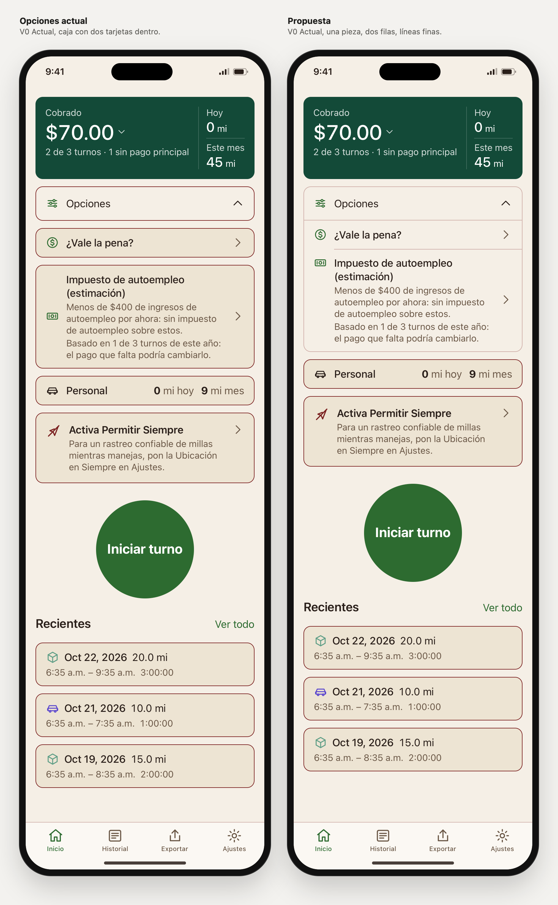

# Opciones de Inicio: actual y propuesta

Rama `design/home-sin-titulo-2026-10-27`, 27 oct 2026. Encargo: [briefs/home-opciones/PROMPT-CLAUDE.md](../briefs/home-opciones/PROMPT-CLAUDE.md). Se conservan Inicio sin título, la tarjeta C y su desglose propuesto. **Opciones está pendiente de elección.** Nada de esto está en la app.

## Abrir la comparación

- `prototype/index.html#view=opciones&family=v0&lang=es&scenario=partial&screen=homeOptions` (abierta) o `…&screen=home` (cerrada). En la barra del laboratorio: **Vista → «Opciones»**. Los dos marcos llevan Inicio sin título, C y el desglose propuesto, con los mismos datos y estado: abrir Opciones en uno la abre en el otro.
- Pantalla «Inicio · desglose y opciones abiertos» (`screen=homeBoth`) abre a la vez el desglose verde y Opciones.
- Para ver una sola: Vista «Una familia», Inicio «Sin título», Tarjeta «C», Desglose «Propuesta» y **Opciones → Actual / Propuesta**. A pantalla completa: `solo=1&home=sintitulo&card=c&desglose=propuesta&opciones=propuesta&screen=homeOptions`.

## Qué cambia

**Hoy:** «Opciones» es una caja con contorno rojo. Al abrirla aparecen debajo dos cajas más, también con contorno, separadas por huecos. Justo después vienen Personal y el aviso, de nuevo en caja: con Opciones abierta se encadenan cinco contornos bajo la tarjeta verde.

**Propuesta:** una sola pieza.

- **Un contenedor** con el borde tenue que ya existe en los tokens (`--color-card-border-subtle`), en lugar del rojo fuerte. Cerrada, Opciones se queda en segundo plano frente a Personal, el aviso y, sobre todo, Iniciar turno. Sigue reconocible por su icono, su nombre y su flecha.
- **Al abrir**, las dos herramientas aparecen dentro del mismo contenedor, bajo una línea fina, sin cajas propias. Entre ellas, otra línea fina que empieza donde empieza el texto.
- **Columnas alineadas:** los iconos y los títulos de las filas caen en la misma columna que el icono y la palabra «Opciones».
- En la fila de autoempleo, que tiene varias líneas, el icono se alinea con la primera línea del título en vez de flotar a media altura. La flecha sigue centrada.

Se conservan exactamente:
- el nombre «Opciones», su icono, la flecha y la acción de abrir y cerrar;
- `aria-expanded`;
- los dos accesos, su orden, sus iconos, sus títulos y todas las notas de autoempleo de cada escenario;
- los destinos: ¿Vale la pena? abre la calculadora y autoempleo abre su hoja.

Sin rótulos, insignias ni movimiento nuevos. La cabecera solo abre y cierra; nunca activa una herramienta.

Archivos:
- `js/screens.js`: `optionsBlock()` con la variante «propuesta», solo en V0. El botón de autoempleo se comparte entre las dos versiones.
- `css/app.css`: estilos `.opts*`, locales a la variante. No cambia ningún token ni regla compartida.
- `js/app.js`: la variante de Opciones viaja con cada marco, y hay una nueva pantalla de laboratorio `homeBoth`.
- `js/lab.js` e `index.html`: vista «Opciones», control «Opciones» y parámetro `opciones`.
- `tools/capture-home-webkit.swift`: juego `opciones`.

## Medidas

Altura del bloque Opciones en px, escenario de pago parcial, medida en Chromium. Lo que sigue (Personal, aviso, Iniciar turno, Recientes) se desplaza lo mismo.

| | 390 px | 320 px | 430 px | 390 px, 135 % | 320 px, 200 % |
|---|---|---|---|---|---|
| Cerrada | 56 → 56 | 56 → 56 | 56 → 56 | 56 → 56 | 56 → 56 |
| Abierta | 319 → 292 (−27) | 380 → 353 (−27) | 300 → 273 (−27) | 466 → 439 (−27) | 903 → 876 (−27) |

Cerrada mide lo mismo. Abierta ahorra 27 px en todos los tamaños, porque desaparecen los dos huecos entre cajas y sus bordes. El ahorro es un efecto secundario: lo que se busca es que se lea como un solo grupo.

## Comprobado

En el navegador del entorno (Chromium):

- **Auditoría.** La misma de `tools/check-ui.cjs` (desbordes, controles sin nombre, áreas menores de 24 px), más una comprobación nueva: que todo control de Opciones mida al menos 44 px de alto. Combinaciones: claro/oscuro × ES/EN × los 7 escenarios × 390, 320, 320 con texto al 200 %, 430 y 390 con texto al 135 % × cerrada, abierta y abierta con el desglose verde abierto. En total, 840 renders y 0 fallos.
- **Mismo contenido.** En las 420 parejas:
  - el texto de Opciones es idéntico;
  - la tarjeta verde es idéntica en HTML, cerrada y abierta;
  - el resto de Inicio no cambia;
  - `aria-expanded` coincide con el estado;
  - con Opciones cerrada, las filas no existen y no entran en el recorrido de foco.
- **Notas cortas y largas**, todas con fixtures existentes:

  | Escenario | Notas de autoempleo |
  |---|---|
  | Pago parcial | Dos notas, la más larga |
  | Sin datos | «Anota el pago de un turno…» |
  | Cifras demasiado grandes | Sin estimar |
  | Importe largo | Nota de demo por encima de $400 |
  | Pagos completos | — |

- **Navegación:**
  - «¿Vale la pena?» abre la calculadora, y al volver Opciones sigue abierta.
  - Autoempleo abre su hoja, y al cerrarla (botón o Escape) Opciones sigue abierta.
- **Teclado** con pulsaciones reales:
  - Con Opciones abierta, el Tab entra en «¿Vale la pena?» con contorno visible de 3 px.
  - Mayús+Tab vuelve a la cabecera.
  - Intro cierra Opciones: el foco se queda en la cabecera, que pasa a `aria-expanded=false`, y el siguiente Tab va a Personal.
- `build-tokens.mjs --check`, `check-contrast.mjs` y `shasum -a 256 -c SHA256SUMS`: ver el commit.

## Capturas

En `captures/home-opciones/`, generadas con `swift prototype/tools/capture-home-webkit.swift opciones` (WebKit de macOS). **Todas están alargadas para mostrar Inicio entero**, con Recientes y la barra inferior: no aparentan caber en un teléfono.

| Archivo | Qué muestra |
|---|---|
| `01-actual-cerrada-claro-es.png` / `02-propuesta-cerrada-claro-es.png` | Inicio completo, Opciones cerrada |
| `03-actual-abierta-claro-es.png` / `04-propuesta-abierta-claro-es.png` | Inicio completo, Opciones abierta |
| `05-comparar-cerrada-claro-es.png` | Comparación cerrada |
| `06-comparar-abierta-claro-es.png` | Comparación abierta |
| `07-comparar-abierta-oscuro-en.png` | Comparación abierta, oscuro, EN |
| `08-comparar-320-texto-200-nota-larga-es.png` | 320 px, texto al 200 %, nota de autoempleo más larga |
| `09-comparar-sin-datos-es.png` | Sin datos |
| `10-comparar-sin-estimar-es.png` | Cifras demasiado grandes: sin estimar |
| `11-comparar-desglose-y-opciones-es.png` | Desglose verde y Opciones abiertos a la vez |

## Recomendación

**Elegiría la propuesta.**
- **Cerrada**, Opciones deja de competir con lo importante: el borde tenue la convierte en un acceso secundario y la jerarquía pasa a ser tarjeta verde, Personal y aviso, e Iniciar turno.
- **Abierta**, se lee como un pequeño menú de herramientas, alineado y sin cajas dentro de la caja. Además ocupa 27 px menos.
- **El coste:** la pieza cerrada tiene menos contraste de borde, que en claro con texto grande se ve muy suave. Se reconoce por su icono, su nombre y su flecha, y su área táctil es la misma.

Es criterio de diseño con medidas del prototipo, no preferencia de clientes.

No hice una segunda alternativa. Lo que valoré tenía costes claros:

| Opción valorada | Por qué la descarté |
|---|---|
| Opciones sin contenedor, como fila suelta | Al abrirla, las filas quedarían flotando entre cajas |
| Fondo de superficie | La convertiría en otra tarjeta, como Personal |

## Límites y sugerencias para después

- Un navegador no es iOS: no se probaron VoiceOver ni Dynamic Type nativos. El 200 % es la aproximación del prototipo.
- Capturas de WebKit de macOS; auditoría y medidas de Chromium. `check-ui.cjs` sigue sin ejecutarse aquí (no hay Playwright).
- **Foco al volver.** Al volver de la calculadora o cerrar la hoja, el foco va al encabezado de Inicio, no a la fila que se pulsó. Pasa igual en la versión actual, porque es la lógica general de navegación del prototipo. En iOS, VoiceOver suele volver al elemento anterior. Si se quiere replicar en la maqueta, es un cambio de navegación global y queda como sugerencia, no aplicada.
- **Nombre.** «Opciones» describe poco lo que contiene: una calculadora y una estimación fiscal. «Herramientas» lo describiría mejor. Es solo una sugerencia, no se aplicó.

## Siguiente paso

Liber elige entre Opciones actual y la propuesta con `01`–`04`, `06`, `07` y `08`. Hasta entonces no se avanza a otro bloque de Inicio, ni a la app real.
