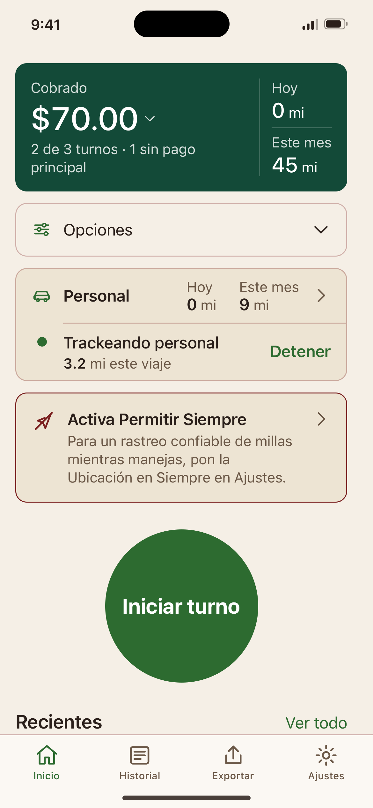

# Personal en marcha: la caja A con una línea en vivo

Rama `design/home-sin-titulo-2026-10-27`, 27 oct 2026. Petición de Liber: la misma caja Personal, pero mientras conduce en personal. Entre tres ideas eligió la 1: la misma caja con una línea en vivo. **Pendiente de que Liber la revise.** Nada de esto está en la app.

## Qué hace hoy la app real

Lo saco del código de iOS, no del laboratorio (el laboratorio no tenía este estado):

- Mientras hay un viaje personal abierto, `HomeView` muestra `PersonalTrackingBanner` **arriba del todo**, aparte de la caja Personal.
- El banner tiene un estado, las millas del viaje con un decimal y un botón **Detener**. Hay cuatro estados, cada uno con su motivo:

  | Estado | Motivo |
  |---|---|
  | Trackeando personal | — |
  | Buscando tu ubicación | esperando GPS |
  | Sin señal GPS | en pausa, sin señal |
  | Viaje en pausa | se reanuda si vuelves a conducir |

- **Hoy** y **Este mes** de la caja Personal solo suman viajes terminados (`endTime != nil`). El viaje en curso no cuenta hasta que se cierra.

## La propuesta

El banner de arriba desaparece y su contenido pasa dentro de la caja A elegida:

- **Arriba**, la fila A sin cambios: coche, Personal, Hoy, Este mes y la flecha. Sigue siendo el botón que abre Historial → Personal.
- **Debajo**, tras una línea fina que empieza en la columna del título (como las filas de Opciones), va la **línea en vivo**:
  - **En la columna del coche**, una marca de estado:
    - trackeando: un punto verde fijo;
    - buscando ubicación: la flecha de ubicación;
    - sin señal: una antena tachada en el color de aviso;
    - en pausa: el símbolo de pausa.
  - **En la columna del título:**
    - el estado, con el texto de la app;
    - debajo, «**3.2** mi este viaje»;
    - el motivo en su propia línea cuando lo hay. La app lo une con « · »; aquí va aparte para que el punto no quede colgando al final de una línea.
  - **Detener** a la derecha, en verde y semibold como en la app. Su texto termina en el mismo borde que la flecha de arriba.
- Con texto grande, Detener baja debajo del texto, alineado con él.
- Al pulsar Detener, la línea desaparece y el foco vuelve a la fila Personal. En el laboratorio, el viaje se suma a Hoy (0 → 3 mi) y a Este mes (9 → 12 mi).

Texto nuevo, solo uno: «este viaje» / «this drive». Así no parece que esas millas ya estén en Hoy, porque no lo están. Sin animaciones: el punto no parpadea.

Archivos:
- `js/screens.js`: `liveLine()`, y la caja A envuelta en `.pv-box` cuando hay viaje.
- `css/app.css`: estilos `.pv-box` y `.pv-live*`.
- `js/i18n.js`: textos de estado y motivo, copiados de `Localizable.xcstrings`, más «este viaje».
- `js/icons.js`: iconos `pause` y `signalOff`.
- `js/app.js`: acción `stopPersonalTrip` y cuatro pantallas de laboratorio.
- `js/lab.js`: esas cuatro pantallas en el selector.
- `tools/capture-home-webkit.swift`: juego `personal-en-marcha`.

## Abrir

`prototype/index.html#solo=1&family=v0&home=sintitulo&card=c&desglose=propuesta&opciones=propuesta&personal=a&lang=es&scenario=partial&screen=homeLive`

Cambia `screen` a `homeLiveAcquiring`, `homeLiveNoSignal` o `homeLivePaused`. En la barra: **Pantalla → «Inicio · viaje personal: …»**. La línea solo existe con Personal A.

## Medidas

Altura de la caja Personal en px, en español, medida en Chromium. Sin viaje, la caja mide 56 a 390 y 430 px, y 94 a 320 px.

| Estado | 390 px | 320 px | 430 px | 390 px, 135 % | 320 px, 200 % |
|---|---|---|---|---|---|
| Trackeando | 118 | 179 | 118 | 225 | 477 |
| Buscando ubicación | 138 | 199 | 138 | 251 | 555 |
| Sin señal GPS | 138 | 194 | 138 | 218 | 555 |
| En pausa | 157 | 213 | 138 | 244 | 594 |

A 390 px, la línea en vivo añade 62 px trackeando y hasta 101 px en pausa. Es más de los ~40 px que estimé al proponerla. A cambio desaparece el banner de arriba, que hoy ocupa su propio espacio más su margen.

## Comprobado

En Chromium, sobre los cuatro estados:

- **Combinaciones:** claro/oscuro × ES/EN × pago parcial y millas personales largas × 390, 320, 320 al 200 %, 430 y 390 al 135 %. En total, **160 renders y 0 fallos**.
- **Qué se revisó:**
  - nada se sale de la caja ni del scroll;
  - las cifras no se parten;
  - Detener mide al menos 44 × 44 px y no pisa la fila;
  - el texto en vivo empieza en la columna del título;
  - Detener termina en el borde de la flecha (con texto normal);
  - hay exactamente dos botones, sin anidar;
  - no queda ningún « · » colgando;
  - no hay botones sin nombre ni menores de 24 px en Inicio.
- **Teclado** con pulsaciones reales: desde la fila, el Tab entra en Detener con el contorno de foco de 3 px. Su descripción accesible es la de la app: «Detiene el viaje personal que se está trackeando». Intro detiene, la línea desaparece, Hoy y Este mes suben y el foco vuelve a la fila.
- **Navegación:** con el viaje abierto, la fila sigue abriendo Historial con Personal seleccionado.
- **WebKit:** las capturas se revisaron una a una. Así salió un fallo de la primera tanda: en «Sin señal GPS», el icono era el mismo que el del aviso de ubicación de debajo. Se cambió por la antena tachada que usa la app.
- `build-tokens.mjs --check` correcto; `check-contrast.mjs` correcto; `shasum -a 256 -c SHA256SUMS` con 91 OK; `node --check` en todos los JS.

## Capturas

En `captures/home-personal-en-marcha/`, con `swift prototype/tools/capture-home-webkit.swift personal-en-marcha`. Inicio a 390 × 844 sin alargar, ES, claro, pago parcial y Opciones cerrada:

- `01-trackeando-claro-es.png`
- `02-buscando-ubicacion-claro-es.png`
- `03-sin-senal-claro-es.png`
- `04-en-pausa-claro-es.png`

## Límites

- **Sin comparación con hoy.** El laboratorio no reproduce el banner de arriba de la app, así que no hay captura del «antes». Lo de hoy está descrito desde el código.
- **Detener en el laboratorio es una aproximación.** Suma el viaje solo si tiene millas. Las reglas reales de cierre de la app no están modeladas, y las millas no se mueven solas.
- **Título repetido.** «Trackeando personal» dentro de la caja «Personal» repite la palabra. Se mantuvo el texto de la app; acortarlo a «Trackeando» sería una decisión de texto aparte.
- **Seguridad.** La línea está pensada para mirarse parado o al llegar, no para tocarse en marcha. Detener funciona como hoy, sin confirmación.
- **Texto grande.** Al 200 % la caja llega a 477–594 px. Todo se lee y nada se corta, pero ocupa media pantalla.
- **Solo en el navegador.** Un navegador no es iOS: no se probaron VoiceOver, Dynamic Type nativo ni el comportamiento en un viaje real.

## Siguiente paso

Liber revisa las cuatro capturas. Si la aprueba, queda como el estado en marcha de Personal A en el laboratorio. Nada pasa a la app real sin otra decisión.
