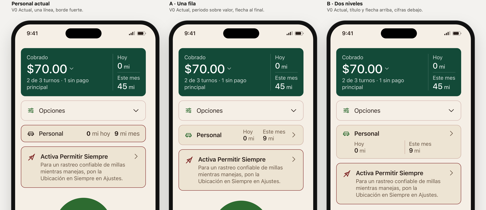

# Personal en Inicio: actual, A y B

Rama `design/home-sin-titulo-2026-10-27`, 27 oct 2026. Encargo: [briefs/home-personal/PROMPT-CLAUDE.md](../briefs/home-personal/PROMPT-CLAUDE.md). Se conserva todo lo elegido: Inicio sin título, tarjeta C con su desglose propuesto y Opciones agrupada. **Decisión de Liber (27 oct): A.** Nada de esto está en la app.

## Abrir la comparación

- `prototype/index.html#view=personal&family=v0&lang=es&scenario=partial&screen=home`. En la barra del laboratorio: **Vista → «Personal»**, y **Marcos** para ver «Actual, A y B», «Actual y A» o «A y B». Todos los marcos llevan lo ya elegido, con los mismos datos y el mismo estado.
- Para ver una sola: Vista «Una familia», con Inicio «Sin título», Tarjeta «C», Desglose y Opciones «Propuesta», y **Personal → Actual / A / B**. A pantalla completa: `solo=1&home=sintitulo&card=c&desglose=propuesta&opciones=propuesta&personal=a&screen=home` (o `personal=b`).
- Cifras largas: escenario «Millas personales largas (prueba de diseño)» (`scenario=personalLong`).
- Las dos cifras a cero: escenario «Sin datos», con el seguimiento personal activado en Ajustes.

## Qué cambia

**Hoy:** «Personal · 0 mi hoy · 9 mi mes» va en una línea con borde fuerte, como el aviso. Los periodos y las cifras se leen casi como una frase. Nada indica que la fila se abre, y a 320 px las cifras ya bajan a una segunda línea sin orden.

**Lo común a A y B:**
- Una sola superficie con el borde tenue que ya existe, el mismo de Opciones. Así queda por debajo del aviso, que conserva su borde fuerte, y de Iniciar turno.
- El icono de coche existente, en el verde de acción, como los iconos de Opciones. «Personal» va en semibold, para leerse primero.
- Las etiquetas existentes **Hoy** y **Este mes**, encima de su valor. Valor y unidad nunca se separan.
- Una flecha al final que solo indica navegación. La fila entera es un único botón que abre **Historial → Personal**, como hoy.

**A · Una fila.** Coche y Personal a la izquierda; a la derecha, Hoy y Este mes alineados, y la flecha. Mide 56 px, lo mismo que Opciones cerrada. Si las cifras no caben al lado del título, por estrechez, texto grande o cifras largas, A pasa a dos niveles: título y flecha arriba, cifras debajo alineadas con el texto del título. Es lo que hace `ViewThatFits` en SwiftUI. En el prototipo, `fitPersonal()` mide si la fila cabe sin partir nada.

**B · Dos niveles.** Siempre dos niveles. Arriba van coche, Personal y la flecha; debajo, Hoy y Este mes en dos columnas iguales, desde el texto del título hasta el borde. Entre ellas hay una sola línea fina, la misma gramática que las millas de la tarjeta C. Cuando no caben lado a lado se apilan, y la línea pasa a ser horizontal.

Sin textos nuevos, insignias, tendencias ni animación. Las cifras, el redondeo, las unidades, la condición de aparición y el destino son los de hoy.

Archivos:
- `js/screens.js`: `personalRow()` con las variantes `a` y `b`, solo en V0.
- `css/app.css`: estilos `.pv*`, locales a las variantes. No cambia ningún token ni regla compartida.
- `js/app.js`: la variante viaja con cada marco; `fitPersonal()` elige entre una fila y dos niveles en A.
- `js/lab.js` e `index.html`: vista «Personal», controles «Personal» y «Marcos», parámetros `personal` y `personales`.
- `js/fixtures.js`: escenario `personalLong`. Son los mismos datos de trabajo que «Pago parcial», solo con trayectos personales de 1,248 mi hoy y 12,486 mi en el mes. No toca ningún otro escenario.
- `tools/capture-home-webkit.swift`: juego `personal`, más dos opciones nuevas, `setup` (JavaScript tras cargar) y `detail` (recorte a 3×).

## Medidas

Altura de la fila Personal en px, medida en Chromium. Lo que viene debajo (aviso, Iniciar turno, Recientes) baja exactamente lo mismo; también con Opciones abierta. La «s» indica que A está en dos niveles.

**Referencia: 0 mi hoy, 9 mi este mes.**

| | 390 px | 320 px | 430 px | 390 px, 135 % | 320 px, 200 % |
|---|---|---|---|---|---|
| Actual | 48 | 82 | 48 | 98 | 183 |
| A | 56 (+8) | 94s (+12) | 56 (+8) | 116s (+18) | 240s (+57) |
| B | 94 (+46) | 94 (+12) | 94 (+46) | 116 (+18) | 240 (+57) |

**Otros casos:**

| | Actual / A / B |
|---|---|
| EN a 390 px | 48 / 56 / 94 |
| Cifras largas a 390 px | 82 / 94s / 94 |
| Cifras largas a 430 px | 48 / 56 / 94 |
| Ceros | 48 / 56 / 94 |

Comienzo del aviso a 390 px: 292 / 300 / 338 px. Ninguna propuesta ahorra espacio:
- **A** cuesta 8 px donde hay sitio. Donde no lo hay, mide lo mismo que B, nunca más.
- **B** cuesta 46 px en el tamaño más común.
- Con texto grande o a 320 px, las dos miden igual.

## Comprobado

En el navegador del entorno (Chromium):

- **Auditoría de la fila.** Comprueba:
  - que valor y unidad no se parten y nada se sale de la fila;
  - que nada se recorta;
  - que la flecha queda en el borde;
  - que la fila mide al menos 44 px de alto;
  - que el texto es exactamente «Personal Hoy 0 mi Este mes 9 mi» en cada caso;
  - que hay un solo botón sin controles anidados, sin `aria-label` y con iconos `aria-hidden`.
- **Auditoría general** de `tools/check-ui.cjs`: desbordes, controles sin nombre, áreas menores de 24 px.
- **Combinaciones:** claro/oscuro × ES/EN × pago parcial, pagos completos, turno sin cerrar, importe largo, millas personales largas y ceros × 390, 320, 320 al 200 %, 430 y 390 al 135 % × Opciones cerrada, abierta y abierta con el desglose. En total, **1080 renders y 0 fallos de Personal**.
  - Único aviso: en «Sin datos», a 320 px con texto al 200 %, la flecha del aviso de ubicación denegada sobresale 15 px. Ya existía: pasa igual en Actual, A y B y sin la fila Personal. No se tocó, porque el aviso conserva su tratamiento.
- **Resto de Inicio idéntico.** En 60 combinaciones (5 escenarios × ES/EN × 3 estados × claro/oscuro), Inicio sin la fila Personal es idéntico en HTML en los tres marcos. V1–V3 no cambian con la variante.
- **Seguimiento apagado:** en «Cifras demasiado grandes», «Sin datos» y «Cobrado $0» no aparece ninguna fila.
- **Navegación** con teclado y ratón:
  - A y B abren Historial con la pestaña Personal en `aria-selected=true` y Trabajo en `false`.
  - Al volver a Inicio, la fila muestra las mismas cifras y Opciones sigue abierta si lo estaba.
- **Teclado** con pulsaciones reales: el Tab desde Opciones entra en la fila con el contorno de foco de 3 px; Intro la abre.
- **WebKit.** La primera captura mostró un defecto de B que Chromium no tenía: el botón en columna no estiraba sus líneas, y la flecha quedaba pegada a «Personal». Se corrigió maquetando B como bloque. Las capturas finales son de después del arreglo.
- `build-tokens.mjs --check` correcto; `check-contrast.mjs` correcto (el único aviso es el heredado y documentado de V0 oscuro); `shasum -a 256 -c SHA256SUMS` con 91 OK; `node --check` en todos los JS.

## Capturas

En `captures/home-personal/`, generadas con `swift prototype/tools/capture-home-webkit.swift personal` (WebKit de macOS). Están alargadas para mostrar Inicio entero, salvo `06`, que es un recorte a 3× de la parte superior.

| Archivo | Qué muestra |
|---|---|
| `01-actual-claro-es.png` / `02-a-claro-es.png` / `03-b-claro-es.png` | Inicio completo con cada versión |
| `04-comparar-actual-a-claro-es.png` | Actual frente a A |
| `05-comparar-a-b-claro-es.png` | A frente a B |
| `06-detalle-actual-a-b-claro-es.png` | Detalle a 3× de Opciones, Personal y el aviso |
| `07-comparar-actual-a-b-oscuro-en.png` | Oscuro, EN |
| `08-comparar-320-texto-200-cifras-largas-es.png` | 320 px, texto al 200 %, 1,248 / 12,486 mi |
| `09-comparar-cifras-largas-en.png` | Cifras largas a 390 px: A pasa a dos niveles |
| `10-comparar-320-es.png` | 320 px, texto normal |
| `11-comparar-ceros-es.png` | 0 mi y 0 mi |
| `12-comparar-opciones-abierta-es.png` | Con Opciones abierta |

## Recomendación

**Elegiría A.**

- **Claridad.** Se lee en el orden que pide el encargo: coche y Personal, luego Hoy y Este mes, y la flecha dice que se abre. Periodo encima y valor debajo es la misma gramática que las millas de la tarjeta C, así que no hay que aprender nada nuevo.
- **Altura.** Donde hay sitio cuesta 8 px y mide lo mismo que Opciones cerrada, así que las dos piezas forman una serie tranquila bajo la tarjeta verde. B cuesta 46 px en el caso más común y empuja Iniciar turno hacia abajo.
- **Texto grande.** A no se fuerza: cuando no cabe, adopta los dos niveles de B con la misma altura, sin letra pequeña ni cortes. B no gana nada en texto grande; solo cuesta más en el tamaño normal.
- **El coste de A.** Cambia de forma según el ancho (una fila o dos niveles), y eso es algo más de lógica al pasarlo a SwiftUI. A 320 px con texto normal ya va en dos niveles: 12 px más que hoy.

B tiene una lectura más tranquila, una forma fija y la línea fina que la emparenta con la tarjeta C. Pero con 94 px se acerca a una tarjeta protagonista, justo lo que el encargo quería evitar.

Es criterio de diseño con medidas del prototipo, no una predicción sobre el uso de los clientes.

## Límites

- Un navegador no es iOS: no se probaron VoiceOver ni Dynamic Type nativos. El 200 % aproxima AX. La lectura accesible se comprobó por el texto del botón, no con un lector de pantalla.
- Capturas de WebKit de macOS; auditoría y medidas de Chromium. `check-ui.cjs` sigue sin ejecutarse aquí (no hay Playwright).
- **Foco al volver.** El foco vuelve al encabezado de Inicio, no a la fila, igual que hoy. Es la lógica general de navegación del prototipo, ya anotada en Opciones.
- **Redondeo distinto, sin tocar.** Inicio muestra 9 mi (entero) e Historial → Personal 8.9 mi (un decimal). No se cambió.
- **Etiquetas en inglés.** Hoy, en EN, la fila dice «mi today / mi mo.». Las propuestas usan las etiquetas existentes «Today / This Month» de la tarjeta C.

## Decisión y siguiente paso

Liber eligió **A**, con caja y en una fila, tras ver las capturas. Antes vio una prueba de A «Sin caja» (sin rectángulo, solo una línea inferior) y la descartó; no se guardó. La fila actual y B quedan en el laboratorio como referencia. El siguiente detalle de Inicio lo elige Liber; hasta entonces no se toca el resto de Inicio ni la app real.
