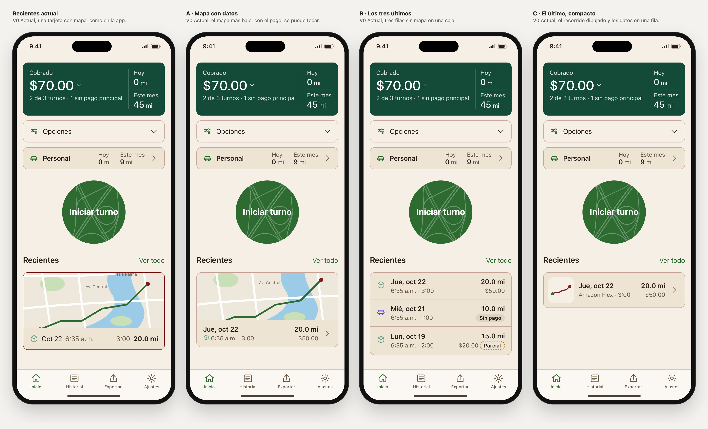

# Recientes de Inicio: tres propuestas

Rama `design/home-sin-titulo-2026-10-27`, 6 nov 2026. Viene después de los avisos. El resto de Inicio no cambia: todo lo elegido sigue igual, avisos B incluidos.

## Recientes hoy, en la app

Desde el 18 de mayo de 2026, la app muestra en Recientes una sola tarjeta con el último turno (`RecentShiftCard`):
- **Arriba, el mapa de la ruta** (Apple Maps), de 140 pt de alto. La ruta va en verde, con un punto verde al inicio y uno rojo vino al final.
- **Debajo, una sola fila:** el icono de la plataforma, la fecha corta, la hora de inicio, la duración en h:mm y las millas en negrita.
- **La tarjeta no se puede tocar.** VoiceOver lee una sola frase: «Último turno, {fecha}, {millas} millas».
- **Si el turno no tiene puntos GPS**, ocupa el lugar del mapa una caja de 140 pt que dice «Sin ruta».
- **Si todavía no hay turnos guardados**, la sección no aparece.

Esa tarjeta sustituyó a una lista de tres filas, según el comentario del código «para que Inicio tenga menos ruido y se vea al instante dónde manejaste». El SPEC §4.3 todavía describe la lista de tres, así que el SPEC y la app no coinciden.

**Error del laboratorio, corregido:** hasta hoy, el laboratorio dibujaba Recientes como tres tarjetas de texto, que son las filas de Historial. No es lo que muestra la app, y ninguna captura de referencia llega hasta Recientes, por eso no se notó.
- Esa versión se queda como «Antigua del laboratorio», con el parámetro `recientes=lab`. Es el valor por defecto, para que las vistas y enlaces anteriores no cambien.
- La vista nueva usa como «Hoy» la tarjeta de la app.
- El mapa del laboratorio es inventado. No se usa ningún servicio de mapas.

**Qué falla hoy:**
1. **La fila se corta.** Se cortó algún dato en 184 de los 288 estados auditados. A 320 px con texto al 200 % solo se lee «20.0 mi»; la fecha, la hora y la duración se quedan en un carácter (captura 05). El laboratorio imita el corte con puntos suspensivos; SwiftUI puede repartir el espacio de otra forma.
2. **No se puede tocar.** Para ver ese turno hay que ir a Historial y buscarlo.
3. **No dice nada del pago,** aunque la tarjeta verde avisa «1 sin pago principal».
4. **Sin ruta, queda una caja vacía de 140 pt** (captura 03).
5. **El borde rojo vino fuerte es el mismo de los avisos,** así que contenido y alertas se confunden.

## Las tres propuestas

Lo que tienen en común:
- **Borde suave,** como Opciones y Personal: es contenido, no una alerta.
- **Toda la tarjeta o fila abre el turno.** En el laboratorio lleva a un detalle aproximado.
- **Ningún dato se corta:** cuando no cabe, baja a la línea siguiente.
- **El pago se ve,** o en su lugar la etiqueta «Sin pago» o «Parcial». Es la misma regla de Historial, y no cambia ningún dato.
- **Se mantiene lo que la app ya hace bien:** si no hay turnos, la sección no aparece; y siguen la hora de inicio, la duración y las millas.

### A · Mapa con datos (`recientes=a`)

La misma tarjeta, con el mapa a 120 pt.
- Debajo, dos líneas: la fecha con el día de la semana y las millas; y luego el icono, la hora de inicio, la duración y el pago.
- Una flecha indica que se puede tocar.
- Sin ruta, no hay caja vacía: la tarjeta queda solo con los datos.

- **Ventajas:**
  - Conserva el mapa real, la razón del cambio del 18 de mayo.
  - Arregla el corte, el toque, el pago y la caja vacía.
  - Es la más parecida a la app.
- **Costes:**
  - Sigue mostrando un solo turno.
  - Sigue cargando un mapa en Inicio.
  - Con texto grande pasa de 218 a 319 px, porque deja de cortar.

### B · Los tres últimos (`recientes=b`)

Los tres últimos turnos en una caja, separados por líneas finas, sin mapa. Es lo que describe el SPEC §4.3.
- Cada fila lleva el icono, la fecha, la hora de inicio y la duración, las millas y el pago (o «Sin pago» / «Parcial»).
- Cada fila abre su turno.

- **Ventajas:**
  - Muestra qué turno no tiene pago, al lado de la tarjeta verde que lo avisa, y se abre con un toque.
  - Inicio deja de cargar un mapa.
- **Costes:**
  - **Deshace la decisión del 18 de mayo:** desaparece el mapa y vuelven tres filas.
  - Es la más alta: 209 px a 390 px y 590 px con texto al 200 %.

### C · El último, compacto (`recientes=c`)

Una sola fila con el último turno.
- A la izquierda, el recorrido dibujado sin calles ni servicio de mapas, en 64 × 64. Usa la misma línea fina del trébol de «Iniciar turno».
- Después, la fecha, las millas, la plataforma con la duración y el pago.

- **Ventajas:**
  - Es la más baja: 90 px a 390 px. Sin avisos cabe entera en la primera pantalla.
  - Inicio no carga un mapa.
  - El dibujo sigue la identidad del círculo.
- **Costes:**
  - El dibujo muestra la forma del recorrido, pero no dónde fue: no hay calles ni lugares.
  - Muestra un solo turno.

## Medidas

iPhone de 390 × 844, texto normal, español, claro. Sin avisos, la cabecera «Recientes» empieza a 494 px y la pantalla acaba a 717 px.

| | Hoy | A | B | C |
|---|---|---|---|---|
| Alto del bloque, sin la cabecera | 196 | 190 | 209 | **90** |
| Lo que se ve en la primera pantalla, sin avisos | 171 de 196 | 171 de 190 | 171 de 209 | **90 de 90, entero** |
| Con un aviso B | 59 | 59 | 59 | 59 |
| Con dos avisos | 0 | 0 | 0 | 0 |
| A 320 px (fuera de la primera pantalla) | 196 | 190 | 299 | 114 |
| Con texto al 200 %, 390 px | 218, cortado | 319 | 590 | 270 |

## Recomendación: A

- **Respeta la decisión del 18 de mayo.** El mapa real se queda: tu forma de elegir el trébol («idéntico a la calle») dice que la geografía real importa.
- **Arregla lo que está mal medido hoy:**
  - el texto cortado en 184 de 288 estados;
  - la tarjeta que no se puede tocar;
  - el pago que no se ve;
  - la caja vacía de 140 pt sin ruta.
- **Ocupa lo mismo que hoy** con texto normal, con 6 px menos.
- **C es la alternativa** si pesa más lo compacto y la identidad que ver las calles: cabe entera en pantalla y no carga mapa.
- **B solo tiene sentido** si importa más ver en Inicio qué turnos faltan por cobrar que el mapa. Pero deshace una decisión ya tomada.

## Comprobado

- **Auditoría en WebKit: 1152 renders, 0 fallos en las propuestas.**
  - Combinaciones: 8 estados × 4 variantes × claro y oscuro × ES y EN × 320, 390 y 430 px × texto al 100, 140 y 200 %.
  - Los 8 estados:
    - sin avisos, con un aviso y con dos;
    - último turno sin ruta;
    - importe largo;
    - sin datos;
    - cifras demasiado grandes;
    - pagos completos.
  - Qué mira en cada render:
    - desbordamiento horizontal;
    - texto cortado (en «Hoy» se cuenta, porque es lo que hace la app);
    - contraste de 4,5 : 1 como mínimo;
    - que cada tarjeta o fila se pueda tocar, tenga nombre y mida al menos 44 px;
    - que «Ver todo» mida al menos 44 px y no se parta;
    - el número de turnos esperado;
    - el mapa o la caja «Sin ruta» según el caso;
    - que no haya sección sin turnos.
  - Antes de dar por buenos los resultados, se comprobó que cada render tenía el tema, el idioma, el ancho, el texto, el escenario y las variantes pedidas: 1152 de 1152.
- **Fallo encontrado y corregido:** en B, a 320 px con texto al 140 % y un importe largo, se cortaban la fecha y el horario. Ahora las millas y el pago bajan debajo de la fecha cuando no caben.
- **Fallo de la auditoría, encontrado con el control negativo:** la comprobación de «"Ver todo" partido» contaba cajas, y un botón en línea siempre da una. Ahora cuenta líneas de texto, y se repitió la auditoría completa.
- **Control negativo: 6 de 6 detectados.** Se rompieron a propósito el contraste, un recorte, el tamaño de una fila, una fila de menos, una tarjeta sin acción y «Ver todo» partido.
- `check-contrast.mjs` correcto, igual que `build-tokens.mjs --check` y `SHA256SUMS`. `check-ui.cjs` no se ejecutó, porque Playwright no está instalado.
- **Sin probar:** iOS, Apple Maps real, VoiceOver y Dynamic Type real.

## Abrir

- Comparación: **Vista → «Recientes»**, por ejemplo con **Pantalla → «Inicio · sin avisos»** o «Inicio · último turno sin ruta».
  `#view=recientes&family=v0&lang=es&scenario=partial&screen=homeNoNotice`
- Una variante sola: control **Recientes** o parámetro `recientes=lab|actual|a|b|c`.
- Capturas: `swift prototype/tools/capture-home-webkit.swift recientes`.

## Capturas (`captures/home-recientes/`)

| Archivo | Qué muestra |
|---|---|
| `01-comparar-claro-es.png` | Sin avisos |
| `02-comparar-oscuro-en.png` | Sin avisos, oscuro, inglés |
| `03-comparar-sin-ruta-es.png` | Último turno sin puntos GPS |
| `04-comparar-importe-largo-en.png` | Importe largo, inglés |
| `05-comparar-320-texto-200-es.png` | 320 px y texto al 200 %: la fila de la app se corta |
| `06-comparar-con-aviso-es.png` | Con el aviso «Siempre» (B) |
| `07-comparar-sin-datos-es.png` | Sin turnos: no hay sección |
| `08`–`11-…-es.png` | Hoy, A, B y C a 390 × 844 sin alargar |

## Si pasa a la app

- **A:**
  - en `RecentShiftCard`: el mapa a 120 pt, los datos en dos líneas que bajan en vez de cortarse, el pago, el toque que abre el turno y quitar la caja «Sin ruta»;
  - una etiqueta de VoiceOver que incluya el pago.
- **B:** quitar el mapa de Inicio y volver a la lista que ya describe el SPEC.
- **C:** dibujar el recorrido como una línea simple con los puntos del turno, sin mapa en Inicio.
- **En las tres:** actualizar el SPEC §4.3, que ya hoy no coincide con la app; PARITY.md y `docs/parity/home-screen.md`; y Android.

## Siguiente paso

Liber elige A, B, C o ninguna. Nada pasa a SwiftUI.
