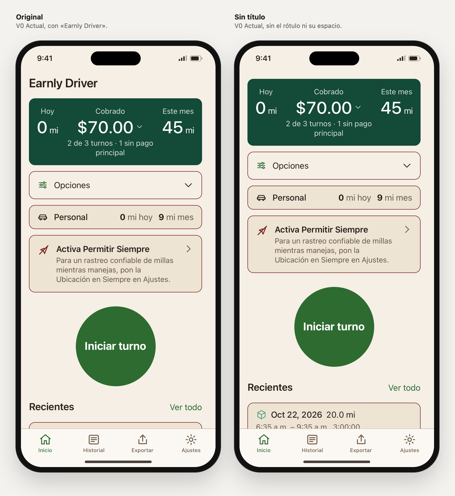
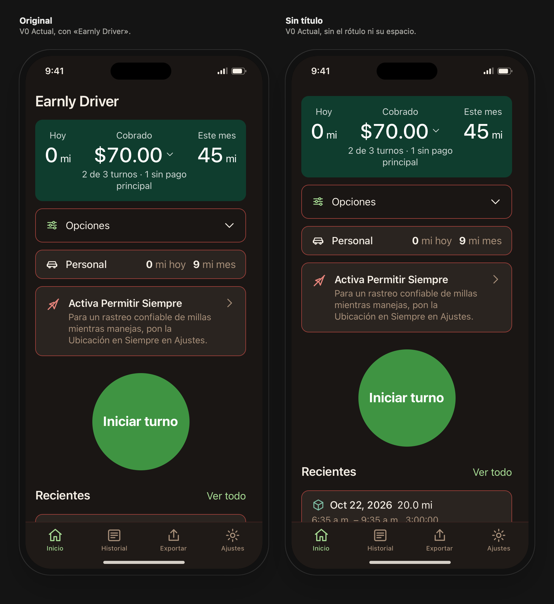

# Inicio sin título: primer cambio de Home

Rama `design/home-sin-titulo-2026-10-27`, 27 oct 2026. Encargo: [briefs/home-sin-titulo/PROMPT-CLAUDE.md](../briefs/home-sin-titulo/PROMPT-CLAUDE.md).

## Abrir la comparación

- Directo: abre `prototype/index.html#view=sintitulo&family=v0&lang=es&scenario=partial&screen=home` en un navegador (funciona desde `file://`).
- Con servidor local: `python3 -m http.server 8000` desde la raíz del repo y `http://localhost:8000/prototype/index.html#view=sintitulo&family=v0&lang=es&scenario=partial&screen=home`.
- En la barra del laboratorio, **Vista → «Original y Sin título»** muestra los dos marcos lado a lado. El resto de controles (tema, idioma, escenario, ancho, texto) se aplica a los dos a la vez y los dos comparten estado: abrir Opciones o el desglose en uno lo abre en el otro.
- Para ver solo una versión, usa Vista «Una familia» y el control **Inicio → Original / Sin título**. A pantalla completa: añade `solo=1&home=sintitulo` al enlace.

## Cambio elegido e implementado

En «Sin título» desaparece el rótulo visible «Earnly Driver» de la parte superior de Inicio **y la barra que lo contenía**. El contenido empieza justo debajo de la zona segura (la barra de estado), con un margen de 16 px, el mismo que los márgenes laterales. No hay hueco reservado ni nada que lo sustituya: ni fecha, ni logo, ni saludo.

Se mantiene todo lo demás: colores y tokens de V0, círculo «Iniciar turno» (tamaño, texto y acción simulada), tarjeta financiera con desglose, Opciones, fila Personal, aviso de ubicación cuando corresponde, Recientes, barra inferior y navegación.

Para lectores de pantalla, Inicio conserva un encabezado `h1` «Earnly Driver» oculto visualmente. Así el foco tras navegar sigue cayendo en el encabezado de la pantalla, como en Original, y la semántica no cambia.

| Medida (V0, 390 × 844, texto 100 %) | Original | Sin título |
|---|---|---|
| Barra de estado → tarjeta financiera | 56 px | 16 px |
| Lo mismo con texto al 135 % | 67 px | 16 px |
| Lo mismo con texto al 200 % (el nombre ocupa dos líneas) | 170 px | 16 px |

Efecto en el conjunto: todo sube 40 px a tamaño normal. Con aviso, bajo Recientes asoma la primera línea del primer turno, en vez de solo su borde. Sin aviso, además de dos turnos completos aparece parte de un tercero. Con texto al 200 % se ven la tarjeta financiera entera y Opciones. En Original, el nombre ocupa dos líneas y la cifra del mes queda fuera de la vista inicial.

### Archivos

- `js/screens.js`: `home()` devuelve el encabezado oculto en lugar de `largeTitle` cuando la variante es «sintitulo». `largeTitle` no cambia, así que Historial, Exportar y Ajustes conservan sus cabeceras.
- `js/app.js`: cada marco lleva su variante (`data-home`) al contexto de render.
- `css/app.css`: una regla, `padding-top: var(--space-md)` en el desplazamiento de Inicio sin título.
- `js/lab.js`, `index.html`: vista «Original y Sin título», control «Inicio» y parámetro `home` en la URL. Sin `home` el prototipo se comporta como antes.
- `tools/capture-home-webkit.swift` (antes `capture-home-sin-titulo.swift`): capturas de este bloque (ver Límites).
- `captures/home-sin-titulo/`: capturas nuevas. Las anteriores no se tocaron.

No cambian tokens, colores, cifras, escenarios, textos de la app ni otras pantallas.

## Comprobado

En el navegador del entorno (Chromium) y en WebKit de macOS para las capturas:

- **Auditoría de `tools/check-ui.cjs` sobre Home, en los dos marcos.** Se ejecutó la misma función `audit()` dentro del navegador: desbordes horizontales, controles sin nombre y áreas táctiles por debajo de 24 px. Combinaciones: Inicio, desglose abierto y Opciones abiertas × claro/oscuro × EN/ES × los 5 escenarios × 390, 320, 320 con texto al 200 %, 430 y 390 con texto al 135 %. En total, 600 renders y 0 fallos.
- En las mismas 300 parejas, el texto del área desplazable es idéntico en Original y Sin título (mismas cifras, avisos y filas). Original conserva su título, Sin título no lo muestra y tiene el encabezado oculto.
- Flujos en el marco Sin título, en ES y EN: desplegar Opciones, abrir el desglose, Iniciar turno → «Turno en curso» → volver a Inicio, Historial/Exportar/Ajustes (mismo marcado de cabecera que en Original) y vuelta a Inicio.
- Teclado con pulsaciones reales: el Tab recorre desglose, Opciones, Personal, aviso, Iniciar turno, Ver todo, recientes y pestañas, con contorno de foco visible de 3 px. Al volver a Inicio, el foco va al encabezado oculto, y el siguiente Tab llega a «Mostrar desglose».
- Desplazamiento: el contenido se corta en el borde inferior de la barra de estado, igual que en Original bajo el título, y el último reciente queda entero por encima de la barra inferior. Con movimiento reducido no hay animaciones activas en Inicio.
- Aviso de ubicación: presente en «Pago parcial» (capturas 01, 02, 04 y 05) y ausente en «Pagos completos» (03).
- `build-tokens.mjs --check`: ok. `check-contrast.mjs`: ok (solo la excepción heredada y ya documentada de V0 oscuro). `shasum -a 256 -c SHA256SUMS`: 91/91.

## Capturas

Están en `captures/home-sin-titulo/`. Son renders reales del prototipo con el mismo viewport, escenario y estado en cada pareja, sin retoques. Se regeneran con `swift prototype/tools/capture-home-webkit.swift sin-titulo`.

| Archivo | Qué muestra |
|---|---|
| `01-comparar-claro-es.png` | Comparación, claro, ES, 390 px, con aviso |
| `02-comparar-oscuro-es.png` | Comparación, oscuro, ES, 390 px, con aviso |
| `03-comparar-sin-aviso-claro-en.png` | Comparación, claro, EN, 390 px, pagos completos (sin aviso) |
| `04-comparar-320-texto-200-claro-es.png` | Comparación, 320 px y texto al 200 % |
| `05-comparar-320-oscuro-en.png` | Comparación, 320 px, oscuro, EN |
| `06`/`07-…-claro-es.png`, `08`/`09-…-oscuro-es.png` | Original y Sin título a pantalla completa, 1170 × 2532, para verlas en el teléfono |

## Diferencias con C36 que no se tocaron

La V0 reproduce la referencia del 24 oct, no la captura de C36 (`briefs/home-sin-titulo/home-c36-es.png`):

- En C36, la cifra central se rotula «Tras gasolina» y debajo pone «1 de 2 turnos». En V0, «Pago parcial» muestra «Cobrado» y «2 de 3 turnos · 1 sin pago principal».
- La captura de C36 no muestra la fila Personal. V0 la muestra porque su escenario tiene activas las millas personales.
- En C36 el nombre es algo mayor y ocupa unos 50 pt sobre la tarjeta. En el prototipo ocupa 40 px. En la app, quitarlo ganaría algo más de espacio que aquí.

No se corrigieron porque el encargo es solo el título y no se cambian cifras ni semántica.

## Límites

- Un navegador no es iOS. Las capturas son de WebKit de macOS: el motor de Safari, con la fuente del sistema. La barra de estado del prototipo mide 50 px, mientras que la zona segura real de un iPhone con isla es de unos 59 pt. No se probaron VoiceOver de iPhone ni Dynamic Type nativo. El 200 % es la aproximación del prototipo.
- En iOS, al desplazar, el sistema aplica su propio efecto bajo la barra de estado. El prototipo solo corta el contenido.
- `check-ui.cjs` y `capture-home.cjs` necesitan Playwright, que no está instalado en este Mac. No se instaló porque el encargo excluye instalaciones grandes. Por eso la auditoría se ejecutó en el navegador del entorno y las capturas con WebKit. Las capturas de este bloque, por tanto, no son de Chromium como las anteriores. `check-ui.cjs` no se modificó y, sin el parámetro `home`, el prototipo queda como antes.
- La variante se revisó en V0. El control también funciona con V1–V3, pero esas familias no se revisaron en este bloque.
- Las decoraciones que viven en la barra del título (Halloween y Navidad · ramita) no aparecen en Sin título, porque esa barra ya no existe. La comparación se hizo con la decoración apagada.

## Conclusión

Según esta revisión, quitar el nombre mejora el equilibrio de Inicio. La pantalla empieza por lo que el conductor viene a mirar, sus cifras, y el espacio recuperado se reparte sin huecos: más Recientes a la vista con texto normal y la tarjeta financiera entera con texto grande, que es donde el nombre más estorbaba. La identidad de la app deja de estar en esta pantalla hasta que exista el icono reconocible previsto. Es la pérdida de este paso.

Esto es criterio de diseño, no preferencia medida de clientes: falta verlo en el iPhone de Liber.

## Sugerencias todavía no elegidas (no implementadas)

1. **Importe partido en pantallas estrechas.** A 320 px, en ambos lados, «$70.00» se parte en «$70.» / «00» (captura 05). Es un defecto previo de V0, no de este cambio. *Beneficio:* la cifra principal siempre se lee de una pieza. *Coste:* hay que decidir qué cede cuando falta ancho, por ejemplo apilar las columnas antes, como ya se hace con texto al 200 %, sin ocultar decimales ni reducir la cobertura de pagos. También hay que comprobar 375 pt (iPhone SE actual), que el laboratorio no ofrece.
2. **Línea de estado del héroe a todo el ancho.** «2 de 3 turnos · 1 sin pago principal» queda encajada bajo la columna central y en español ocupa dos líneas (captura 01), mientras las columnas laterales quedan vacías debajo. Si ocupara todo el ancho de la tarjeta, bajo las tres cifras, cabría en una línea. *Beneficio:* tarjeta unos 20 px más baja y lectura más limpia. *Coste:* cambia la composición interna del héroe respecto a C36 y hay que revisarla en EN, ES y con texto grande.
3. **Peso de los bordes.** Opciones (un control), Personal (un dato) y el aviso (una alerta) llevan el mismo borde de 1 px en el rojo oscuro de marca (captura 07), así que el aviso no destaca y los tres compiten. Una opción sería reservar ese borde para el aviso y usar en las demás el borde sutil que ya existe en los tokens, sin colores nuevos. *Beneficio:* jerarquía más clara. *Coste:* es una regla del sistema de diseño compartido (`earnlyBorder`) y afectaría a otras pantallas. Habría que decidirla para toda la app, no solo para Inicio.

## Siguiente paso

Liber mira `07-sin-titulo-claro-es.png` frente a `06-original-claro-es.png` en el teléfono, o la vista «Original y Sin título», y decide si se queda «Sin título». Si se aprueba, el siguiente detalle de Home se elige entre las tres sugerencias. La integración en SwiftUI queda para un encargo posterior: ocultar el título, mantener un título accesible y empezar el contenido 16 pt bajo la zona segura.
