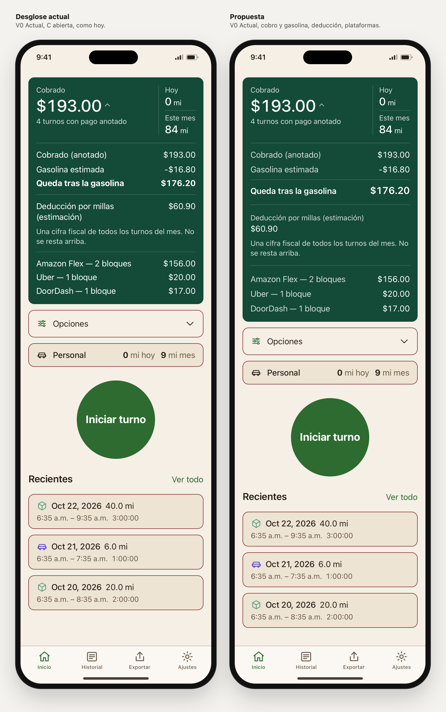

# Tarjeta C abierta: desglose actual y propuesta

Rama `design/home-sin-titulo-2026-10-27`, 27 oct 2026. Encargo: [briefs/home-tarjeta-abierta/PROMPT-CLAUDE.md](../briefs/home-tarjeta-abierta/PROMPT-CLAUDE.md). Se conservan Inicio sin título y la C cerrada elegida. **Decisión de Liber (27 oct): la propuesta.** Nada de esto está en la app.

## Abrir la comparación

- `prototype/index.html#view=abierta&family=v0&lang=es&scenario=complete&screen=homeBreakdown`. En la barra del laboratorio, **Vista → «Tarjeta abierta»**. Los dos marcos llevan Inicio sin título y C, con los mismos datos y estado; la flecha del importe abre o cierra el desglose en los dos.
- Para ver una sola: Vista «Una familia», Inicio «Sin título», Tarjeta «C · Dos zonas» y **Desglose → Actual / Propuesta**. A pantalla completa: `solo=1&home=sintitulo&card=c&desglose=propuesta&screen=homeBreakdown`.
- Escenarios que cambian el desglose:

| Escenario | Qué muestra |
|---|---|
| Pagos completos | Resultado positivo |
| Pago parcial | Notas de cobro y de gasolina desconocida |
| Cobrado $0 | Resultado negativo |
| Turno sin cerrar | Gasolina conocida, sin resultado porque falta un pago |
| Cifras demasiado grandes | Nota de totales |
| Importe largo | Cifras de seis dígitos |
| Sin datos | Cobrado — |

Todos existían ya: no hizo falta crear fixtures.

## Qué cambia en la propuesta

El mismo contenido, en el mismo orden, organizado en tres grupos separados por una línea fina y algo más de aire:

1. **Cobro y gasolina**, como un pequeño estado de cuentas:
   - Las etiquetas pasan a gris claro (el tono apagado que ya existe) y los importes siguen en blanco, alineados a la derecha. Así se leen primero las cifras.
   - Las notas sobre turnos sin pago quedan colgadas de «Cobrado (anotado)», con una raya vertical a la izquierda, porque explican esa cifra.
   - La nota de gasolina desconocida va donde iría la línea de gasolina.
   - «Queda tras la gasolina» cierra el grupo con una raya de subtotal encima, etiqueta e importe en seminegrita, y el importe a 20 px (`title3`) en vez de 17. Destaca sin competir con los 34 px de la cabecera.
2. **Deducción fiscal**, fuera de la columna de la resta:
   - Etiqueta encima en tamaño de nota y gris, la cifra debajo a la izquierda, y la explicación vigente.
   - Es el mismo patrón etiqueta-sobre-cifra de «Cobrado» en la cabecera.
   - Al no compartir la columna de la derecha con gasolina y resultado, no se lee como otro paso de la cuenta. Tampoco gana peso de «ahorro»: la cifra queda en tamaño normal y sin negrita.
3. **Plataformas**, como detalle final: las mismas filas, con etiqueta en gris e importe en blanco. Sin cajas, logotipos ni colores nuevos.

Con texto grande, cada fila pasa a etiqueta encima e importe debajo, igual que hoy. Además, la propuesta separa más una fila de la siguiente (12 px) que la etiqueta de su importe, para que se vea qué cifra va con qué etiqueta.

Archivos:
- `js/screens.js`: `breakdownGrouped()`. Además, `breakdownLines()` devuelve también las notas separadas por lo que explican (cobro, gasolina, totales), con las mismas condiciones y el mismo orden. La lista `notes` de siempre no cambia.
- `css/app.css`: estilos `.bdp-*`.
- `js/app.js`: la variante del desglose viaja con cada marco.
- `js/lab.js` e `index.html`: vista «Tarjeta abierta», control «Desglose» y parámetro `desglose`.
- `tools/capture-home-webkit.swift`: juego `tarjeta-abierta` y opción para alargar el marco y mostrar todo Inicio.

## Qué se conserva

- **Todo el texto, en el mismo orden.** Comprobado en 140 parejas: el texto del desglose (etiquetas, cifras, signos, notas y explicación fiscal) es idéntico carácter por carácter en el actual y en la propuesta. No hay datos duplicados ni ocultos.
- Las condiciones de aparición: notas según el escenario; gasolina y resultado solo cuando ya se mostraban; la deducción siempre; las plataformas solo si existen. No se añadieron rótulos de grupo: el espacio y el peso resuelven la jerarquía.
- «Cobrado (anotado)» repite el importe de la cabecera, como hoy, porque es el punto de partida de la resta.
- Ausente sigue siendo —, nunca $0.00. Sin gasolina conocida no aparece ningún resultado. El negativo solo vive en «Queda tras la gasolina».
- La C cerrada es idéntica en los dos marcos (mismo HTML). La cabecera C abierta, el resto de Inicio y las otras familias no cambian.
- Abrir y cerrar sigue siendo el mismo botón dentro de la tarjeta: sin modal, pantalla nueva ni animaciones.

## Medidas

Altura de la tarjeta abierta en px (la cabecera es la misma, así que la diferencia es del desglose). Opciones y todo lo que sigue se desplaza lo mismo. Medidas de Chromium.

| | 390 px ES | 390 px EN | 320 px, 200 % ES | 320 px, 200 % EN |
|---|---|---|---|---|
| Pagos completos | 466 → 502 (+36) | 444 → 502 (+58) | 1544 → 1542 (−2) | 1512 → 1511 (−1) |
| Pago parcial | 525 → 539 (+14) | 503 → 539 (+36) | 1755 → 1718 (−37) | 1772 → 1776 (+4) |
| Cobrado $0 (negativo) | 438 → 472 (+34) | 415 → 472 (+57) | 1451 → 1443 (−8) | 1420 → 1412 (−8) |
| Gasolina sin resultado | 410 → 425 (+15) | 388 → 425 (+37) | 1260 → 1222 (−38) | 1233 → 1235 (+2) |
| Importe largo | 576 → 589 (+13) | 576 → 589 (+13) | 1841 → 1804 (−37) | 1756 → 1760 (+4) |
| Sin datos | 304 → 312 (+8) | 282 → 312 (+30) | 868 → 821 (−47) | 925 → 878 (−47) |

**La propuesta no ahorra altura con texto normal: añade entre 8 y 58 px.** Sale de tres sitios:

| Origen | Altura |
|---|---|
| Aire entre grupos (16 px a cada lado de la línea, frente a 12 hoy) | +16 |
| Raya de subtotal sobre el resultado y su cifra de 20 px | unos +13, solo cuando hay resultado |
| Deducción con la etiqueta encima de la cifra | unos +20, cuando hoy cabe en una fila |

Lo último pasa en inglés y a 430 px, donde la etiqueta actual cabe junto a su cifra. Por eso inglés suma más.

Con texto al 200 % la propuesta es igual o más corta (hasta −47 px), porque la etiqueta de la deducción, en tamaño de nota, ocupa menos líneas.

Si al verlo en el teléfono sobra altura, la palanca es el aire entre grupos: de 16 a 12 px recorta 16 px sin tocar la jerarquía. Mi recomendación es mantenerlo: el desglose se abre para leerlo con calma.

## Comprobado

En el navegador del entorno (Chromium):

- **Auditoría.** La misma de `tools/check-ui.cjs` para desbordes, controles sin nombre y áreas pequeñas, más dos comprobaciones nuevas: que ninguna etiqueta se solape con su importe y que ningún importe se parta en dos líneas. Combinaciones: claro/oscuro × ES/EN × los 7 escenarios × 390, 320, 320 con texto al 200 %, 430 y 390 con texto al 135 %, con el desglose abierto. En total, 280 renders y 0 fallos.
- **Mismo contenido.** En las 140 parejas, el texto del desglose es idéntico y en el mismo orden, la cabecera C es idéntica y el resto de Inicio también. Con el desglose cerrado, el HTML de la tarjeta es el mismo en los dos marcos.
- **Teclado** con pulsaciones reales en la propuesta: Intro cierra y abre. `aria-expanded` pasa de `true` a `false` y vuelve, y el nombre cambia entre «Ocultar desglose» y «Mostrar desglose». El foco se queda en el botón con contorno visible de 3 px, y el siguiente Tab va a Opciones.
- `build-tokens.mjs --check`, `check-contrast.mjs` y `shasum -a 256 -c SHA256SUMS`: ver el commit. Los colores son tokens existentes: no hay pares de color nuevos.

## Capturas

En `captures/home-tarjeta-abierta/`, generadas con `swift prototype/tools/capture-home-webkit.swift tarjeta-abierta` (WebKit de macOS). **Los marcos están alargados para mostrar todo Inicio con el desglose abierto:** no se recorta ninguna fila. Las de texto al 200 % son muy altas por ese motivo.

| Archivo | Qué muestra |
|---|---|
| `01-actual-claro-es.png` / `02-propuesta-claro-es.png` | Inicio completo, pago parcial (referencia), a pantalla completa |
| `03-comparar-pagos-completos-claro-es.png` | Resultado positivo, claro |
| `04-comparar-pagos-completos-oscuro-en.png` | Lo mismo, oscuro, EN |
| `05-comparar-parcial-claro-es.png` | Notas de cobro y gasolina desconocida |
| `06-comparar-cero-negativo-claro-es.png` | $0.00 y −$8.00 tras gasolina |
| `07-comparar-320-texto-200-parcial-es.png` | 320 px, texto al 200 %, parcial |
| `08-comparar-320-texto-200-negativo-oscuro-en.png` | 320 px, texto al 200 %, negativo, oscuro, EN |
| `09-comparar-gasolina-sin-resultado-es.png` | Gasolina conocida, sin resultado porque falta un pago |
| `10-comparar-importe-largo-en.png` | $123,456.78 |
| `11-comparar-sin-datos-es.png` | Cobrado — y deducción $0.00 |
| `12-comparar-demasiado-grande-es.png` | Nota de totales demasiado grandes |

## Alternativa

No hago una segunda. Las opciones que valoré tenían un coste claro:

| Opción valorada | Por qué la descarté |
|---|---|
| Rótulos de grupo («Fiscal», «Por plataforma») | Añadirían texto sin aportar lo que ya dan el espacio y el peso |
| Deducción en una caja | Rompería la «única superficie verde» |
| Deducción al final | Cambiaría el orden lógico |

## Recomendación

**Elegiría la propuesta.** Al abrir la tarjeta:
- se reconoce de un vistazo el resultado de la resta, sobre todo cuando es negativo;
- la deducción ya no parece un paso más de la cuenta;
- las notas se ven ligadas a la cifra que explican;
- con texto grande se empareja mejor cada etiqueta con su importe.

El coste es altura con texto normal: 8 a 36 px en español y hasta 58 px en inglés. Es criterio de diseño con medidas del prototipo, no preferencia de clientes.

## Límites

- Un navegador no es iOS: no se probaron VoiceOver ni Dynamic Type nativos. El 200 % es la aproximación del prototipo.
- Capturas de WebKit de macOS; auditoría y medidas de Chromium.
- `check-ui.cjs` sigue sin ejecutarse aquí (no hay Playwright): se usó su auditoría dentro del navegador.
- La propuesta solo existe con C en V0. El desglose de la tarjeta de tres columnas y el de V1–V3 no cambian.
- Queda pendiente lo que el documento de C anotó: el botón se llama «Mostrar desglose» y un lector de pantalla puede no leer el importe que contiene.

## Decisión y siguiente paso

Liber eligió **la propuesta** tras ver las capturas, aceptando su altura extra con texto normal. El desglose actual queda en el laboratorio como referencia. El siguiente detalle de Inicio lo elige Liber; hasta entonces no se toca el resto de Inicio ni la app real.
