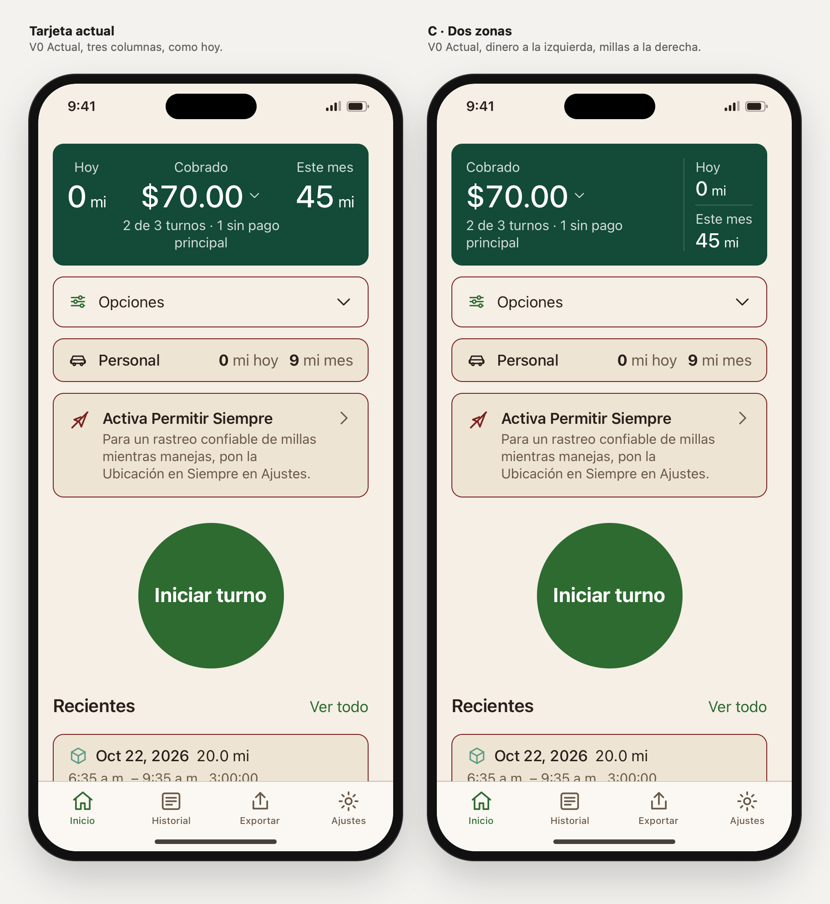

# Tarjeta verde de Inicio: actual y C

Rama `design/home-sin-titulo-2026-10-27`, 27 oct 2026. Encargo: [briefs/home-tarjeta-verde/PROMPT-CLAUDE.md](../briefs/home-tarjeta-verde/PROMPT-CLAUDE.md). **Seguimos decidiendo la tarjeta verde.** Nada de esto está en la app.

## Abrir la comparación

- `prototype/index.html#view=tarjeta&cards=actual,c&family=v0&lang=es&scenario=partial&screen=home`. En la barra del laboratorio, **Vista → «Tarjeta verde»**. Los dos marcos llevan Inicio sin título y comparten datos y estado: abrir el desglose en uno lo abre en el otro.
- Para ver una sola: Vista «Una familia», **Inicio → Sin título** y **Tarjeta → Actual / C · Dos zonas**. A pantalla completa: `solo=1&home=sintitulo&card=c`.
- Escenarios útiles: «Pago parcial (24 oct)» es la referencia. «Importe largo (prueba de diseño)» tiene $123,456.78 y 9,876 mi. «Cobrado $0, negativo tras gasolina (prueba de diseño)», «Sin datos» y «Cifras demasiado grandes» cubren cero y ausencia.

## Qué es C

Una sola superficie verde con dos zonas:

- **Izquierda:** «Cobrado», el importe con su flecha de desglose y la cobertura de pagos.
- **Derecha:** «Hoy» y sus millas, un separador fino, y «Este mes» y sus millas.

Una línea vertical discreta separa las zonas. No hay cajas anidadas ni elementos nuevos.

- El importe conserva el tamaño actual (34 px). Las millas pasan a 22 px, el tamaño `title2` que ya existe, para que el dinero mande y la columna derecha no crezca.
- Mismos textos, cifras, colores y tokens de V0. El desglose y su botón son los mismos de hoy, y el importe aparece una sola vez en el orden de lectura: Cobrado, importe, cobertura, Hoy, Este mes.
- **Cuando no cabe, se reorganiza en lugar de romperse.** Si el importe y la columna de millas no caben lado a lado, las millas pasan debajo, separadas por una línea horizontal, y se ponen una junto a otra si caben. El importe nunca se parte. Solo si ni siquiera cabe en el ancho completo de la tarjeta (texto al 200 % con un importe muy largo), su cifra se reduce lo justo para caber en una línea, como haría `minimumScaleFactor` en SwiftUI. No pierde decimales.
- El botón del desglose mide 37 px a la vista, pero se activa en unos 49 px de alto gracias a un área táctil ampliada que no cambia el dibujo.

Archivos: `js/screens.js` (marcado de C), `css/app.css` (estilos `.hero-c`, `.c-*`), `js/app.js` (variante por marco y ajuste de importes largos), `js/lab.js` e `index.html` (vista «Tarjeta verde», controles «Tarjeta» y «Tarjetas», parámetros `card` y `cards`), y `js/fixtures.js` (dos escenarios de prueba, solo de presentación). El script de capturas se renombró a `tools/capture-home-webkit.swift` y ahora genera ambos juegos.

## Medidas: ¿ahorra espacio?

Altura de la tarjeta en px, con Inicio sin título. La tarjeta empieza siempre a 66 px de la parte superior del marco y Opciones, 12 px por debajo de su borde, así que la diferencia se traslada tal cual a todo lo que sigue. Las medidas son de Chromium. Las capturas, hechas con WebKit, coinciden a la vista.

| Ancho y texto | Escenario | ES actual → C | EN actual → C |
|---|---|---|---|
| 390 px, 100 % | Pago parcial (referencia) | **136 → 136** | **136 → 136** |
| 390 px, 100 % | Pagos completos | 116 → 135 (+19) | 116 → 135 (+19) |
| 390 px, 100 % | Cobrado $0 | 136 → 135 | 116 → 135 (+19) |
| 390 px, 100 % | Sin datos | 116 → 135 (+19) | 116 → 135 (+19) |
| 390 px, 100 % | Importe largo | 230 → 186 (−44) | 230 → 186 (−44) |
| 430 px, 100 % | Pago parcial / completos | 136 → 135 / 116 → 135 | igual |
| 320 px, 100 % | Pago parcial | 173 → 136 (−37) | 193 → 136 (−57) |
| 320 px, 100 % | Pagos completos | 173 → 136 (−37) | 173 → 186 (+13, C se apila) |
| 320 px, 100 % | Importe largo | 568 → 186 | 588 → 186 |
| 390 px, 135 % | Pago parcial | 220 → 169 (−51) | 246 → 169 (−77) |
| 390 px, 135 % | Pagos completos | 220 → 169 (−51) | 220 → 228 (+8, C se apila) |
| 320 px, 200 % | Pago parcial | 439 → 330 (−109) | 439 → 432 (−7) |
| 320 px, 200 % | Importe largo | 498 → 416 | 498 → 416 |

**Resultado:** a 390 px con texto normal, C **no ahorra altura**. En el escenario de referencia mide lo mismo. Cuando la cobertura cabe en una línea («4 turnos con pago anotado», sin datos), es 19 px más alta, porque su columna de millas (cuatro líneas) es más alta que el bloque del importe. Ese hueco se ve bajo la cobertura en la captura 08.

Donde C gana claramente es en los casos difíciles: pantallas estrechas, texto grande e importes largos. Ahí la tarjeta actual parte el importe («$70.» / «00», «$12 / 3,45 / 6.78») y se estira hasta casi 600 px, mientras C se reorganiza sin romper nada. Las dos excepciones en las que C mide más son en inglés: «This Month» es más ancho y C se apila antes.

## Legibilidad

- En ningún render de C el importe se parte en líneas ni desborda la tarjeta.
- Con texto normal la cifra nunca se reduce. Al 200 % se reduce solo en tres casos: «$193.00» a 320 px (de 54 a 51 px) y «$123,456.78» a 320 y 390 px (a 33 y 45 px). En todos sigue siendo la cifra más grande de la pantalla, en una línea y con sus decimales.
- **Cero y ausencia se distinguen.** «Cobrado $0, negativo tras gasolina» muestra **$0.00** y «2 turnos con pago anotado». Con el desglose abierto aparece «Queda tras la gasolina −$8.00» (captura 09). «Sin datos» muestra **—** y «Aún no hay turnos este mes» (captura 10). «Cifras demasiado grandes» muestra — y «Demasiado grande para sumar». En ningún caso la ausencia se convierte en cero.
- Ninguna de las dos tarjetas cambia «Cobrado» por «Tras gasolina» ni mezcla esos conceptos. El negativo solo existe en «Queda tras la gasolina», dentro del desglose, que es donde ya estaba.

## Comprobado

En el navegador del entorno (Chromium):

- **Auditoría de `tools/check-ui.cjs` sobre Home, en las dos tarjetas.** Desbordes, controles sin nombre y áreas táctiles menores de 24 px. Combinaciones: Inicio, desglose abierto y Opciones abiertas × claro/oscuro × EN/ES × los 7 escenarios × 390, 320, 320 con texto al 200 %, 430 y 390 con texto al 135 %. En total, 840 renders y 0 fallos.
- En esas mismas 420 parejas, la tarjeta actual y C contienen exactamente las mismas palabras, el resto de Inicio es idéntico, y el importe de C nunca ocupa más de una línea ni es más ancho que la tarjeta.
- Escenario de referencia, en las dos: Cobrado $70.00; Hoy 0 mi; Este mes 45 mi; «2 de 3 turnos · 1 sin pago principal».
- Teclado con pulsaciones reales en C: el Tab llega al botón del desglose con contorno visible de 3 px que no queda recortado. Intro abre el desglose en los dos marcos y el foco se queda en el botón, que pasa a «Ocultar desglose». El siguiente Tab va a Opciones.
- Área táctil: un toque 5 px por encima o por debajo del botón, o 6 px a su izquierda, sigue activándolo.
- `build-tokens.mjs --check`, `check-contrast.mjs` y `shasum -a 256 -c SHA256SUMS` (ver el commit).

## Capturas

En `captures/home-tarjeta-verde/`, generadas con `swift prototype/tools/capture-home-webkit.swift tarjeta-verde` (WebKit de macOS). Cada pareja tiene el mismo viewport, escenario y estado.

| Archivo | Qué muestra |
|---|---|
| `01-actual-claro-es.png` / `02-c-claro-es.png` | Inicio completo a pantalla completa, escenario de referencia |
| `03-comparar-claro-es.png` / `04-comparar-oscuro-es.png` | Comparación clara y oscura, referencia |
| `05-comparar-320-texto-200-importe-largo-es.png` | 320 px, texto al 200 %, $123,456.78 |
| `06-comparar-importe-largo-en.png` | 390 px, $123,456.78: C pone las millas debajo, en fila |
| `07-comparar-320-oscuro-en.png` | 320 px, oscuro: la actual parte «$70.» / «00»; C no |
| `08-comparar-cobertura-corta-en.png` | Pagos completos: aquí C es 19 px más alta |
| `09-comparar-cero-negativo-desglose-es.png` | $0.00 con el desglose abierto (−$8.00 tras gasolina) |
| `10-comparar-sin-datos-es.png` | Sin datos: — en vez de $0.00 |

## Alternativa propia: probada y descartada

Probé **una** alternativa en el prototipo, «C compacta», pensada para atacar el único punto débil medido de C: crecer 19 px cuando la cobertura es corta. Era C con cada milla en una sola línea, etiqueta junto a la cifra («Hoy 0 mi», «Este mes 45 mi»), para que la columna derecha no fuera más alta que el importe. Las medidas en las mismas condiciones no la respaldaron:

- En español no gana nada. Al ser más ancha la columna de millas, la cobertura pasa a dos líneas: en «Pagos completos» mide 136 frente a 135 de C, y en «Sin datos» 136 frente a 135.
- Solo gana en inglés con cobertura corta: 116 frente a 135.
- Se apila antes: a 320 px mide 165 frente a 136 de C, y con texto al 135 % 200 frente a 169.
- Mezcla dos estilos tipográficos: etiqueta encima del importe y etiqueta al lado de las millas.

Como C funciona mejor, retiré la variante del prototipo para no ofrecer una opción peor.

## Recomendación

**Mantener C.** No por espacio a 390 px, donde no ahorra, sino porque:

1. agrupa el dinero y las millas, en lugar de intercalar millas, dinero y millas;
2. alinea las tres etiquetas arriba;
3. y, sobre todo, aguanta importes largos, pantallas estrechas y texto grande sin partir la cifra, mientras la tarjeta actual se rompe.

Su coste son 19 px extra cuando la cobertura cabe en una línea. Si ese crecimiento molesta al verlo en el teléfono, la palanca más simple es el tamaño de las millas. Sería un ajuste fino de C, no otra composición.

Es criterio de diseño con medidas del prototipo, no preferencia de clientes.

## Límites

- Un navegador no es iOS: no se probaron VoiceOver ni Dynamic Type nativos. El 200 % es la aproximación del prototipo, y en iOS los tamaños AX llegan más lejos.
- Las capturas son de WebKit de macOS. La auditoría y las medidas, de Chromium. Las alturas coinciden a simple vista, pero un px de diferencia entre motores es posible.
- `check-ui.cjs` sigue sin poder ejecutarse aquí (no hay Playwright). Se usó su misma auditoría dentro del navegador.
- Los dos escenarios nuevos son pruebas de diseño con valores sintéticos extremos, no casos esperables. No tienen captura nativa de referencia.
- C solo existe para V0. En V1–V3 el control «Tarjeta» no cambia nada.

## Sugerencias para después (no aplicadas)

1. **Periodo de «Cobrado».** Las millas dicen «Hoy» y «Este mes», pero el importe no dice su periodo, y en el prototipo es del mes. Una etiqueta como «Cobrado este mes» aclararía la lectura. Es un cambio de texto, y además la app real usa otra cifra («Tras gasolina» en C36), así que hay que decidirlo con esa diferencia delante.
2. **Nombre accesible del importe.** En las dos tarjetas el botón del desglose se llama «Mostrar desglose», y un lector de pantalla puede no leer el importe que lleva dentro. Sería mejor anunciar «Cobrado, $70.00» como nombre y dejar el desglose como acción o pista. Es un cambio de función accesible: se decide aparte.

## Siguiente paso

Liber compara `01-actual-claro-es.png` y `02-c-claro-es.png` en el teléfono y mira las capturas 05 a 08, donde están los casos difíciles y el coste de C, antes de elegir la tarjeta. No se avanza a Opciones, Personal, bordes, icono ni otras pantallas hasta entonces.
