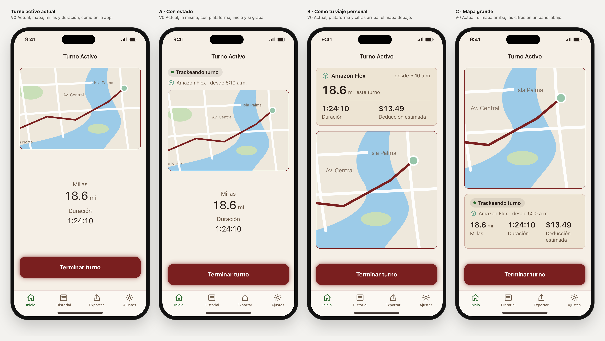

# Turno en curso: elegida B

Rama `design/home-sin-titulo-2026-10-27`, 6 nov 2026. Es el paso 3 del orden propuesto para Inicio, después de Recientes. **Elegida: B · Como tu viaje personal** (`turno=b`), sin la ficha «Trackeando turno». Inicio no cambia: todo lo elegido sigue igual, Recientes D incluido.

## Lo que se encontró antes de construir

El paso se llamaba «turno activo» porque en Inicio la app cambia «Iniciar turno» por un círculo «Turno activo» (`ResumeShiftButton`). Leyendo el código, ese círculo casi nunca se ve:
- **Con un turno en marcha, Inicio salta solo a la pantalla de seguimiento** (`redirectIfActiveShift`). Esa pantalla no tiene botón para volver.
- **Si cambias de pestaña y vuelves, Inicio sigue mostrando el seguimiento.**
- No se probó en el iPhone.

Por eso Liber eligió rehacer la pantalla del turno en curso igual que la app y proponer tres versiones. Es donde pasa las horas del turno.

## La pantalla hoy, en la app (`ActiveTrackingView`)

Se comprobó con el código y con la captura real `AppStore/screenshots/source-en-2.0.2/02-active-shift.png`.
- **Arriba, el título** «Turno Activo», pequeño y centrado, sin botón para volver.
- **Si el Modo Ahorro de Batería se activa durante el turno**, aparece encima del mapa un aviso con un texto propio de este momento.
- **El mapa** (Apple Maps) mide 240 pt. Sigue al conductor, no se puede mover y dibuja la ruta en rojo vino.
- **En el centro, dos contadores:** «Millas», con la cifra en título grande, y «Duración» en h:mm:ss. Sobre y bajo ellos hay espacio vacío.
- **Abajo, «Terminar turno»:** un botón rojo con resplandor. Pregunta «¿Terminar turno?» y ofrece «Guardar turno» o «Cancelar».
- **La plataforma se elige antes,** en Inicio, en «Iniciar turno en». No aparece durante el turno.
- **La barra de pestañas sigue a la vista.**
- **La pantalla no se desplaza:** es una sola columna fija.

**Lo que antes tenía el laboratorio no era así:** elegía la plataforma dentro de la pantalla, tenía botón para volver y no tenía mapa. Esa versión se queda como «Antigua del laboratorio» (`turno=lab`), que es el valor por defecto, para que los enlaces anteriores no cambien.

**Qué falla hoy:**
1. **No dice si está grabando, en qué plataforma ni desde qué hora.** Si elegiste mal la plataforma, no lo ves hasta el final.
2. **Con poco espacio, «Terminar turno» se sale de la pantalla.** Queda oculto en 80 de los 180 estados auditados:
   - a 390 px con texto normal, solo con el aviso de batería: faltan 64 px;
   - a 320 px, que es el iPhone SE con zoom de pantalla, siempre: faltan 99 px sin aviso y 328 con él;
   - en el laboratorio la pantalla se desplaza, pero en la app no puede. SwiftUI tendrá que recortar algo, quizá el texto del aviso o el botón. No se probó en el iPhone.
3. **Con texto normal a 390 px, un tercio de la pantalla queda vacío.**
4. **Mientras busca la primera ubicación, solo muestra «0.0 mi».** Nada dice que aún no graba.

## Las propuestas

Lo que tienen en común:
- **«Terminar turno» siempre a la vista,** encima de la barra de pestañas. Si el contenido no cabe, se desplaza lo demás.
- **Una línea de estado:**
  - «Trackeando turno», o «Buscando tu ubicación» mientras no llega el primer punto;
  - la plataforma y la hora de inicio.
  - La ficha es la misma de «El viaje primero».
  - B, tal como la eligió Liber, no lleva la ficha mientras graba (ver B).
- **El aviso de batería es corto:** el título y «Tus millas pueden quedarse cortas. Desactívalo en Ajustes de iOS → Batería.». Es la frase que la app ya lee en VoiceOver.
- **El mapa encoge,** hasta 140 px, antes de que se tape una cifra.
- **No cambia lo que ya funciona:**
  - «Terminar turno» sigue rojo, con el resplandor fijo que pide el SPEC §4.4, y pregunta antes de guardar;
  - no hay botón para volver;
  - la barra de pestañas sigue.

**Frente al SPEC §4.4,** que pide el mapa arriba ocupando un tercio de la pantalla:
- **A** lo cumple.
- **B** lo pone debajo de las cifras.
- **C** lo hace más grande.

Si se elige B o C, hay que cambiar esa línea del SPEC.

### A · Con estado (`turno=a`)

La misma pantalla, con la línea de estado encima del mapa.
- El mapa mide 240 px mientras quepa.
- Los contadores siguen centrados en el espacio que sobra.

- **Ventajas:**
  - Es el cambio más pequeño.
  - Arregla el estado, la plataforma y el botón oculto.
- **Costes:**
  - El espacio vacío sigue.
  - Las millas quedan fuera de la pantalla en 52 de 180 estados (a 320 px, con texto grande o con el aviso).

### B · Como tu viaje personal (`turno=b`)

El mismo lenguaje de «El viaje primero», que Liber eligió para el viaje personal.
- **Una caja con:**
  - arriba, la plataforma y la hora de inicio, como en la tarjeta de Recientes D: «Amazon Flex» a la izquierda y «desde 5:10 a. m.» a la derecha;
  - sin la ficha «Trackeando turno»: Liber la quitó al elegir B. Solo aparece «Buscando tu ubicación» mientras no llega el primer punto, para que «0.0 mi» no quede sin explicar;
  - las millas de este turno en grande;
  - debajo, la duración y la deducción estimada hasta ahora.
- **Luego el mapa,** que ocupa lo que sobra.

- **Ventajas:**
  - **Las millas se ven sin desplazar en los 180 estados.** Es la única propuesta que lo consigue, porque las cifras van primero.
  - Un solo lenguaje para lo que está en marcha, sea personal o de trabajo.
  - Muestra la deducción estimada mientras manejas.
- **Costes:**
  - El mapa es más pequeño en pantallas pequeñas.
  - Cambia el SPEC §4.4: el mapa deja de estar arriba.

### C · Mapa grande (`turno=c`)

- El mapa arriba, con todo el espacio que sobra.
- Debajo, un panel con:
  - la línea de estado;
  - tres cifras con su etiqueta: millas, duración y deducción estimada. Es el mismo formato de Recientes D.

- **Ventajas:**
  - El mapa más grande: 358 px a 390 px y 446 px a 430 px.
  - Las cifras repiten el formato que elegiste para Recientes.
- **Costes:**
  - Las millas quedan fuera de la pantalla en 38 de 180 estados.
  - Las cifras están abajo, lejos de la vista si el móvil va en el soporte.
  - Cambia el SPEC §4.4: el mapa pasa de un tercio a casi la mitad de la pantalla.

## Medidas

En los casos de 390 × 844 px y 430 × 932 px, el texto es normal. La altura del mapa está en px.

| | Hoy | A | B | C |
|---|---|---|---|---|
| Mapa, 390 px | 240 | 240 | 315 | 358 |
| Mapa, 430 px | 240 | 240 | 403 | 446 |
| Mapa, 390 px con el aviso | 240 | 164 | 203 | 246 |
| «Terminar turno» oculto (de 180 estados) | **80** | 0 | 0 | 0 |
| Millas fuera de la pantalla (de 180 estados) | 22 | 52 | **0** | 38 |
| Cabe sin desplazar, 390 px con el aviso | no, faltan 64 | sí | sí | sí |

## Recomendación: B (elegida el 6 nov)

- **Es la única en la que las millas, lo que importa durante el turno, se ven siempre sin desplazar.** También «Terminar turno» se ve siempre.
- **Repite «El viaje primero»,** que ya elegiste para el viaje personal: la misma ficha de estado, las cifras primero y luego el mapa.
- **Responde a lo que falla hoy:**
  - dice si graba, en qué plataforma y desde qué hora;
  - mantiene el botón a la vista;
  - avisa mientras busca la ubicación.
- **Su coste es cambiar el SPEC §4.4:** el mapa deja de estar arriba.
- **C es la alternativa** si pesa más ver el mapa grande que tener las millas siempre a la vista.
- **A** es la opción si se quiere tocar lo mínimo y no cambiar el SPEC.

## Decisión

**Liber eligió B el 6 nov 2026, sin la ficha «Trackeando turno» con el punto verde.** Arriba quedan solo la plataforma y la hora de inicio.
- **Se mantiene «Buscando tu ubicación»** antes del primer punto GPS, porque es lo único que explica «0.0 mi» al empezar. Si Liber también lo quiere fuera, se quita.
- **Liber notó que la pantalla tiene mucho espacio.** Pensaba que casi no se ve, pero la que casi nunca se ve es el círculo «Turno activo» de Inicio: esta pantalla está delante todo el turno. Ajustar ese espacio queda pendiente.
- A y C se quedan como referencia, con la ficha, y la app de hoy como «Hoy».
- El enlace del Inicio elegido ahora lleva `turno=b`.

## Lo que no se propone, y por qué

- **«Sin señal GPS» durante el turno.** La app pide la ubicación con un filtro de 10 m (`distanceFilter = 10`), así que parado en un semáforo o en la estación no llegan puntos. Deducir «sin señal» del último punto daría falsas alarmas en cada parada. Haría falta un estado nuevo en el motor de seguimiento, y eso no se toca aquí.
- **Volver a Inicio durante el turno.** Cambiaría cómo navega la app. El círculo «Turno activo» de Inicio queda como código que casi nunca se ve; conviene revisarlo aparte.
- **La pregunta «Iniciar turno en» de Inicio, la Live Activity y la Dynamic Island** no se dibujan en el laboratorio.

## Comprobado

- **Auditoría en WebKit: 720 renders, 0 fallos en las propuestas.**
  - Combinaciones: 5 estados × 4 variantes × claro y oscuro × ES y EN × 320, 390 y 430 px × texto al 100, 140 y 200 %.
  - Los 5 estados: en marcha, buscando ubicación, ahorro de batería, turno largo (10:24:10 y 312.4 mi) y la pregunta «¿Terminar turno?».
  - **Qué mira en cada render:**
    - que la pantalla sea la del turno, con el título de la app y sin botón para volver;
    - que «Terminar turno» pregunte antes, mida al menos 44 px y se vea encima de la barra (en «Hoy» se cuenta, porque es lo que hace la app);
    - el mapa con nombre, y la ruta solo cuando ya hay puntos;
    - el aviso de batería solo cuando toca;
    - en A, B y C, la ficha de estado correcta, la plataforma y el número de cifras;
    - que ninguna cifra se salga de su caja ni se corte;
    - contraste de 4,5 : 1 como mínimo y desbordamiento horizontal;
    - en la pregunta, el título, los dos botones de 44 px, «Guardar turno» y la pantalla de detrás bloqueada.
  - Además mide si las millas se ven sin desplazar; es una medida, no un fallo.
  - Antes de dar por buenos los resultados, se comprobó en cada render el tema, el idioma, el ancho, el texto, las variantes y que la pantalla fuera la del turno: 720 de 720.
- **Fallos encontrados y corregidos durante el trabajo:**
  - B tenía un «Terminar turno» suave y C uno sin resplandor, y los dos se saltaban el SPEC §4.4; ahora las tres usan el botón del SPEC;
  - el mapa de A no encogía, porque el navegador lo contaba siempre con 240 px;
  - con el aviso largo, A no cabía a 390 px; ahora usa el aviso corto;
  - en los mapas altos, el punto del conductor quedaba fuera del mapa; ahora el mapa muestra el lado donde acaba la ruta, como la app, que sigue al conductor;
  - «18.6mi» salía sin espacio en B y C.
- **Al registrar B sin la ficha,** la auditoría se repitió: 720 de 720 sin fallos. Comprueba que en B la ficha solo sale mientras busca ubicación y que la hora de inicio está.
- **Fallo de la propia auditoría:** comprobaba el contraste del icono de la plataforma, que no tiene texto, en vez del nombre. Se corrigió y se repitió la auditoría completa.
- **Control negativo: 13 de 13 detectados.** Se rompieron a propósito:
  - el contraste;
  - una cifra recortada;
  - «Terminar turno» fuera de la pantalla, y también demasiado pequeño;
  - la ficha de estado quitada;
  - un botón para volver;
  - la ruta quitada;
  - el aviso quitado;
  - una cifra de menos;
  - una cifra fuera de su caja;
  - un «Terminar turno» que no pregunta;
  - en B, la ficha mientras graba y la hora de inicio quitada.
- **Lo de antes sigue igual:**
  - las auditorías de Recientes (1440 de 1440) y de avisos (864 de 864) siguen sin fallos;
  - sus capturas no cambiaron ni un byte;
  - `check-contrast.mjs` y `build-tokens.mjs --check` dan correcto.
- **Sin probar:** iOS, Apple Maps real, VoiceOver, Dynamic Type real y el móvil en el soporte del coche. En el laboratorio las cifras no avanzan.

## Abrir

- Comparación: **Vista → «Turno activo»**, con **Pantalla → «Turno en curso»** o uno de sus estados.
  `#view=turno&family=v0&lang=es&scenario=partial&screen=active`
- Una variante sola: control **Turno** o parámetro `turno=lab|actual|a|b|c`.
- Capturas: `swift prototype/tools/capture-home-webkit.swift turno-activo`.

## Capturas (`captures/home-turno-activo/`)

| Archivo | Qué muestra |
|---|---|
| `01-comparar-claro-es.png` | En marcha |
| `02-comparar-oscuro-en.png` | En marcha, oscuro, inglés |
| `03-comparar-buscando-es.png` | Antes del primer punto GPS |
| `04-comparar-ahorro-es.png` | Con el Modo Ahorro de Batería: en la app, «Terminar turno» queda debajo de la barra |
| `05-comparar-largo-en.png` | Turno largo, inglés |
| `06-comparar-320-texto-200-es.png` | 320 px y texto al 200 % |
| `07-comparar-320-texto-200-ahorro-es.png` | Lo mismo con el aviso de batería |
| `08-comparar-terminar-es.png` | La pregunta «¿Terminar turno?» (aproximada) |
| `09`–`12-…-es.png` | Hoy, A, B y C a 390 × 844 |

## Si pasa a la app

- **En las tres:**
  - la línea de estado, a partir de datos que la app ya tiene: hay puntos o no, la plataforma y la hora de inicio;
  - «Terminar turno» fuera de la columna fija, para que nunca se salga;
  - un `ScrollView` para lo demás;
  - el aviso corto.
- **B y C:** la deducción estimada en vivo se calcularía con la tarifa del IRS que ya usa el turno. Es solo mostrarla, pero conviene que Codex lo revise.
- **Lo de siempre:**
  - una etiqueta de VoiceOver por bloque;
  - SPEC §4.4 (Active Tracking Screen), PARITY.md y su `docs/parity`;
  - Android.

## Siguiente paso

Que Liber diga si ajustamos el espacio de B o elige el próximo detalle de Inicio; en el orden propuesto toca Navidad. Nada pasa a SwiftUI.
