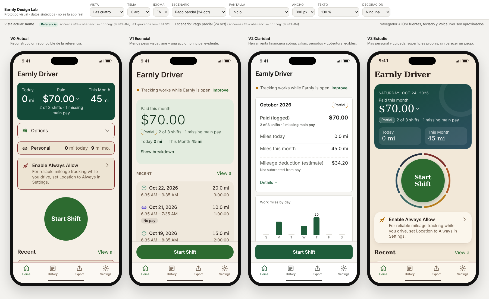

# Prototipo visual de Earnly Driver

Este es un laboratorio navegable en HTML, CSS y JavaScript con datos sintéticos. **No es la app real.** No tiene backend, GPS, motor de millas ni motor fiscal, y no usa servicios externos. Las cifras son ejemplos fijados en `js/fixtures.js`.



## Abrirlo

- **Opción directa:** abre `prototype/index.html` en un navegador. Funciona desde `file://` porque no carga JSON ni módulos.
- **Servidor local opcional:** ejecuta `python3 -m http.server 8000` desde la raíz del repo y abre `http://localhost:8000/prototype/`. Solo sirve archivos estáticos: no es un backend.

## Controles del laboratorio (fuera del marco del teléfono)

| Control | Qué hace |
|---|---|
| Vista | Muestra una familia, compara dos lado a lado, enseña las cuatro con la misma pantalla y los mismos datos, «Original y Sin título»: la misma familia dos veces, con y sin el rótulo de Inicio, «Tarjeta verde»: la tarjeta actual y C, «Tarjeta abierta»: el desglose de C actual y la propuesta, «Opciones»: Opciones actual y la propuesta, «Personal»: la fila Personal actual, A y B, «Personal en marcha»: tres formas de mostrar un viaje personal en curso, «Iniciar turno»: el círculo actual y el Fondo, o «Contraste en oscuro»: el Fondo, Corte y Tenue |
| Familia / Comparar con | V0 Actual, V1 Esencial, V2 Claridad, V3 Estudio |
| Inicio | Original o Sin título (sin «Earnly Driver» arriba). Solo afecta a Inicio; ver [HOME-SIN-TITULO.md](HOME-SIN-TITULO.md) |
| Tarjeta / Tarjetas | Tarjeta verde de Inicio: la actual o C · Dos zonas (solo V0). La vista «Tarjeta verde» las pone lado a lado con Inicio sin título; ver [HOME-TARJETA-VERDE.md](HOME-TARJETA-VERDE.md) |
| Desglose | Composición del desglose al abrir C: actual o propuesta; ver [HOME-TARJETA-ABIERTA.md](HOME-TARJETA-ABIERTA.md) |
| Opciones | Bloque Opciones de Inicio: actual o propuesta (una pieza con dos filas); ver [HOME-OPCIONES.md](HOME-OPCIONES.md) |
| Personal / Marcos | Fila Personal de Inicio: actual, A · Una fila o B · Dos niveles (solo V0). La vista «Personal» las pone lado a lado; ver [HOME-PERSONAL.md](HOME-PERSONAL.md) |
| En marcha | Con Personal A y un viaje personal en curso: 1 · Línea en vivo, 2 · El viaje primero o 3 · Barra fija abajo; ver [HOME-PERSONAL-EN-MARCHA.md](HOME-PERSONAL-EN-MARCHA.md) |
| Círculo | «Iniciar turno» actual o con el trébol real de Woodbridge de fondo (OpenStreetMap), y las dos correcciones del Fondo en oscuro: Corte (elegida) y Tenue; ver [HOME-INICIAR-TURNO.md](HOME-INICIAR-TURNO.md) |
| Tema, Idioma | Claro u oscuro; EN o ES. El idioma también se cambia desde Ajustes → Idioma, dentro de la app |
| Escenario | Pago parcial (24 oct), pagos completos, cifras demasiado grandes, sin datos (aproximación), turno sin cerrar y tres pruebas de diseño: importe largo, cobrado $0 y millas personales largas |
| Pantalla | Salta a uno de los estados de ejemplo, incluidos los cuatro de viaje personal en marcha (con Personal A). Después se puede navegar normalmente por la app |
| Ancho | 320, 390 o 430 px |
| Texto | 100 %, 135 % o 200 %. Aproxima Dynamic Type/AX; no equivale a iOS |
| Decoración | Muestra opcional de Halloween o Navidad. Está apagada por defecto y no tapa controles |

La línea bajo los controles indica si la vista actual se reconstruyó **a partir de una captura** (con su ruta) o es una **aproximación** sin captura nativa.

El estado se guarda en la URL. Por ejemplo, `index.html#view=compare&family=v0&b=v2&screen=closeResult&scenario=complete&lang=es`. Hay dos parámetros más:

- `solo=1` muestra solo la app a pantalla completa, sin marco ni controles. Se usa para las pruebas a 320 px.
- `tall=1` alarga los marcos para revisar una pantalla entera de una vez.

## Estructura

```
prototype/
  design-tokens.json       maestro editable: base (= TOKENS-BASE.json) + diferencias por familia
  css/tokens.css           GENERADO desde design-tokens.json
  css/app.css              componentes; solo consumen variables de tokens
  css/lab.css              controles del laboratorio
  js/families.generated.js GENERADO: nombres y flags de composición por familia
  js/i18n.js               textos EN/ES y formato de números/fechas
  js/fixtures.js           escenarios sintéticos y sumas/conteos (sin tasas ni fórmulas fiscales)
  js/components.js         piezas reutilizables (tarjetas, filas, campos, mapa SVG ficticio, gráfico)
  js/screens.js            pantallas y hojas
  js/app.js                estado compartido, acciones, render, foco
  js/lab.js                controles, URL y marcos
  tools/                   generador de tokens, contraste, pruebas en navegador y capturas
  captures/                capturas reales del prototipo (Chromium)
```

Cada familia hereda la base y guarda solo sus diferencias: colores, radios, tamaños y sombras en `override`, y estructura en `composition`. Al cambiar un rol compartido en `base`, el cambio llega a todas las pantallas que lo usan.

## Editar tokens y volver a comprobar

```sh
node prototype/tools/build-tokens.mjs          # regenera css/tokens.css y js/families.generated.js
node prototype/tools/build-tokens.mjs --check  # falla si lo generado está desactualizado o V0 se aparta de TOKENS-BASE.json
node prototype/tools/check-contrast.mjs        # contraste WCAG de los pares de color usados, por familia y tema
node prototype/tools/check-ui.cjs              # pruebas en Chromium (Playwright): 1000 renders + flujos
node prototype/tools/capture.cjs               # regenera captures/
swift prototype/tools/capture-home-webkit.swift sin-titulo     # regenera captures/home-sin-titulo/ con WebKit de macOS (sin Playwright)
swift prototype/tools/capture-home-webkit.swift tarjeta-verde  # regenera captures/home-tarjeta-verde/
swift prototype/tools/capture-home-webkit.swift tarjeta-abierta  # regenera captures/home-tarjeta-abierta/
swift prototype/tools/capture-home-webkit.swift opciones         # regenera captures/home-opciones/
swift prototype/tools/capture-home-webkit.swift personal         # regenera captures/home-personal/
swift prototype/tools/capture-home-webkit.swift personal-en-marcha  # regenera captures/home-personal-en-marcha/
swift prototype/tools/capture-home-webkit.swift personal-en-marcha-tres  # regenera captures/home-personal-en-marcha-tres/
```

`check-ui.cjs` y `capture.cjs` usan el paquete `playwright` con el Chromium que ya tenga instalado el entorno.

## Documentos

- [PANTALLAS.md](PANTALLAS.md): qué pantallas existen, de qué captura salen y qué es aproximación.
- [DECISIONES.md](DECISIONES.md): familias, decisiones de diseño, desviaciones de la referencia y la recomendación.
- [PRUEBAS.md](PRUEBAS.md): qué se ejecutó, qué falló y se corrigió, y qué no se pudo probar.
- [HANDOFF.md](HANDOFF.md): estado por fases y cómo continuar.
- [HOME-SIN-TITULO.md](HOME-SIN-TITULO.md): primer cambio de Inicio, comparación Original / Sin título.
- [HOME-TARJETA-VERDE.md](HOME-TARJETA-VERDE.md): tarjeta verde, actual frente a C, con medidas.
- [HOME-TARJETA-ABIERTA.md](HOME-TARJETA-ABIERTA.md): desglose de C abierta, actual frente a propuesta.
- [HOME-OPCIONES.md](HOME-OPCIONES.md): Opciones de Inicio, actual frente a propuesta.
- [HOME-PERSONAL.md](HOME-PERSONAL.md): fila Personal de Inicio, actual frente a A y B.
- [HOME-PERSONAL-EN-MARCHA.md](HOME-PERSONAL-EN-MARCHA.md): la caja Personal A durante un viaje personal, en tres formas.
- [HOME-INICIAR-TURNO.md](HOME-INICIAR-TURNO.md): el círculo «Iniciar turno» con el trébol de Woodbridge de fondo.
