# Personales e Historial C34

[Volver al indice](../../README.md) · [Encargo](../../DESIGN-BRIEF.md) · [Cobertura](../../COBERTURA.md)

Personales: referencia AX-3 de C34, datos sinteticos.

Todas las capturas usan datos sinteticos. AX5/AXL son estados de texto grande; algunas imagenes son continuaciones desplazadas de una pantalla.

<table>
<tr>
<td align="center"><strong>01 home normal</strong> <a href="01-home-normal.png">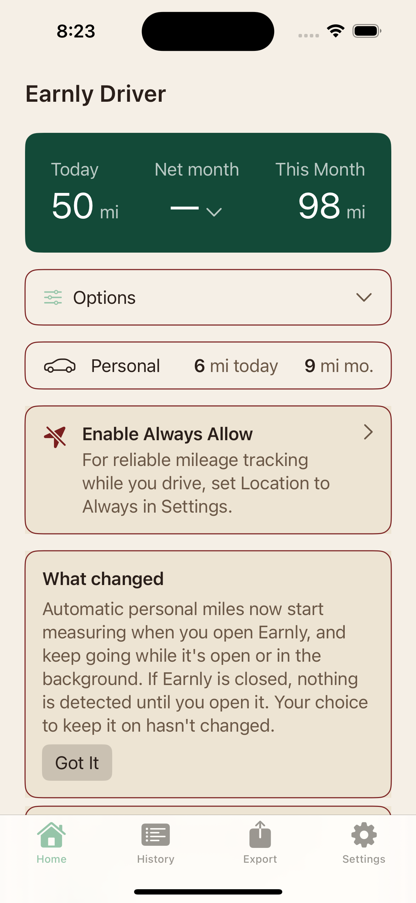</a></td>
<td align="center"><strong>02 history work normal</strong> <a href="02-history-work-normal.png">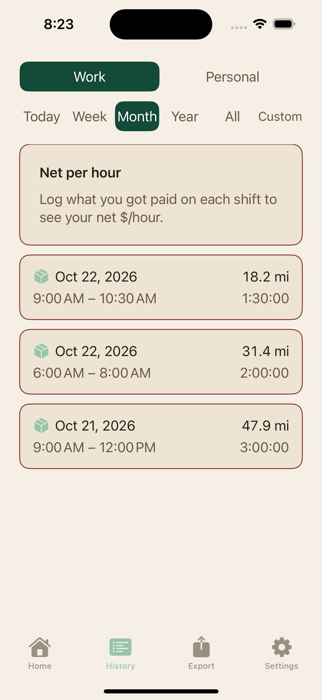</a></td>
<td align="center"><strong>03 personal days normal</strong> </td>
</tr>
<tr>
<td align="center"><strong>04 day normal</strong> <a href="04-day-normal.png">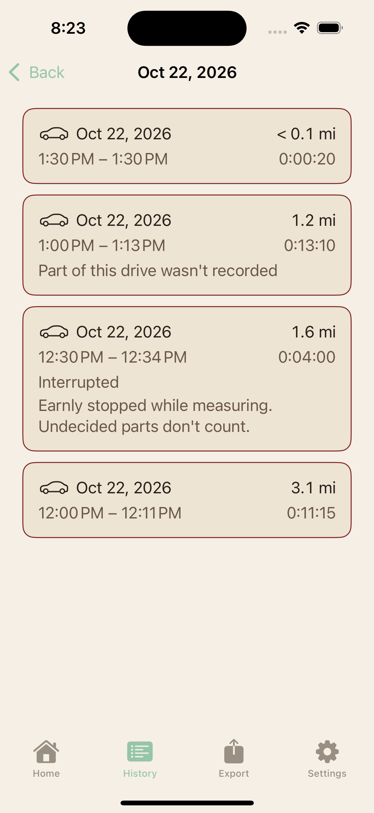</a></td>
<td align="center"><strong>05 detail normal</strong> </td>
<td align="center"><strong>06 detail gap normal</strong> <a href="06-detail-gap-normal.png">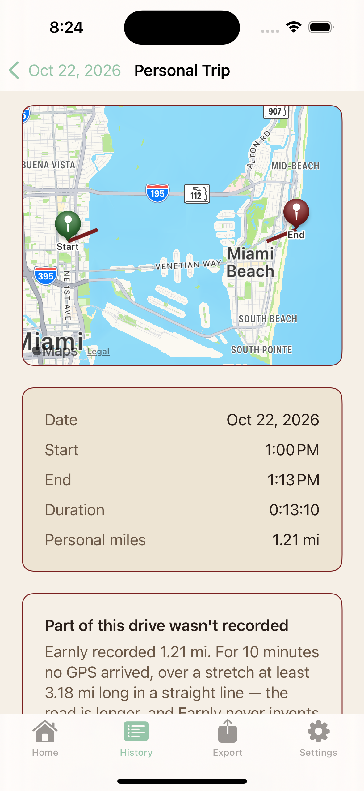</a></td>
</tr>
<tr>
<td align="center"><strong>07 ax5 day 1</strong> <a href="07-ax5-day-1.png">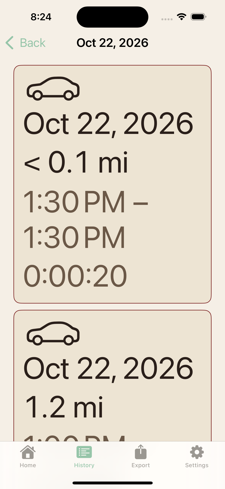</a></td>
<td align="center"><strong>08 ax5 day 2</strong> <a href="08-ax5-day-2.png">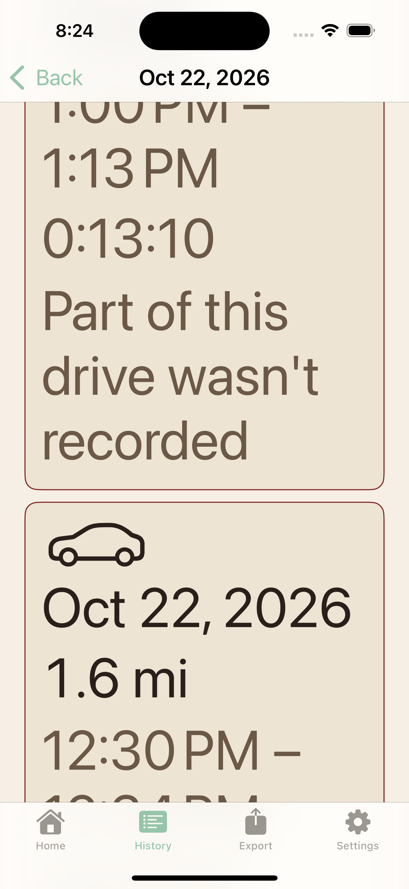</a></td>
<td align="center"><strong>09 ax5 day 3 width fixed</strong> <a href="09-ax5-day-3-width-fixed.png">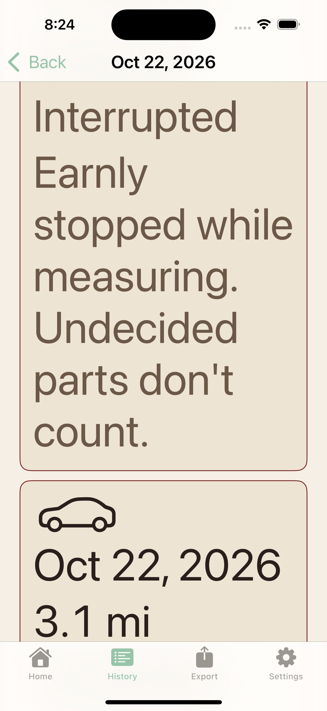</a></td>
</tr>
<tr>
<td align="center"><strong>10 ax5 day 4 compare ax2 17</strong> <a href="10-ax5-day-4-compare-ax2-17.png">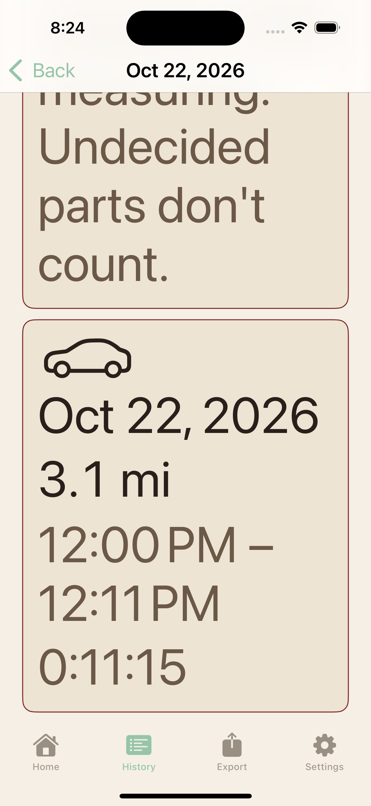</a></td>
<td align="center"><strong>11 ax5 detail 1</strong> <a href="11-ax5-detail-1.png">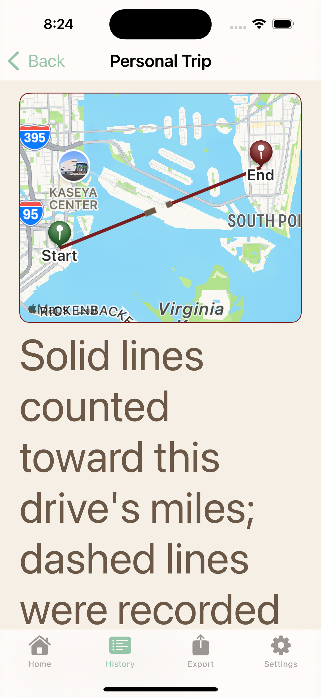</a></td>
<td align="center"><strong>12 ax5 detail 2 summaryrow preexisting</strong> <a href="12-ax5-detail-2-summaryrow-preexisting.png">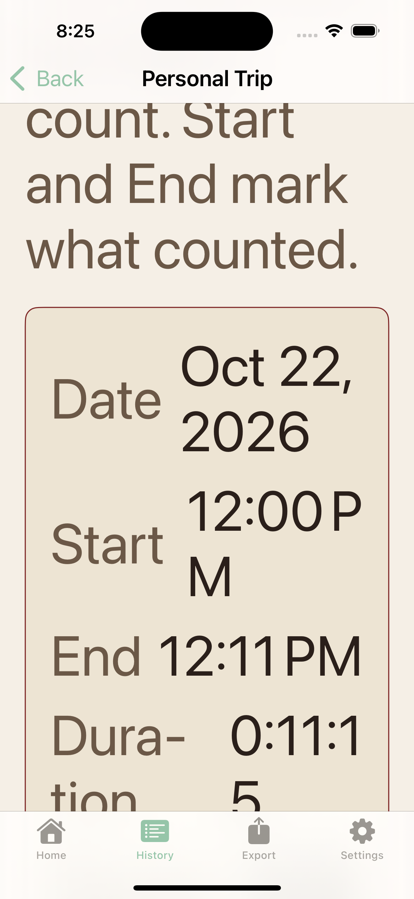</a></td>
</tr>
<tr>
<td align="center"><strong>13 ax5 detail 3 summaryrow preexisting</strong> <a href="13-ax5-detail-3-summaryrow-preexisting.png">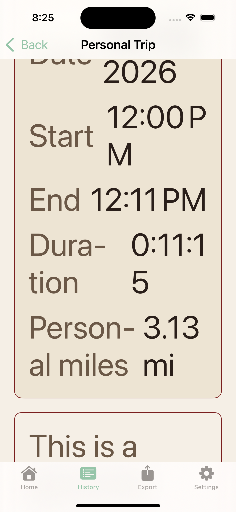</a></td>
<td align="center"><strong>14 ax5 detail 4 bottom</strong> </td>
<td align="center"><strong>15 ax5 detail interrupted</strong> <a href="15-ax5-detail-interrupted.png">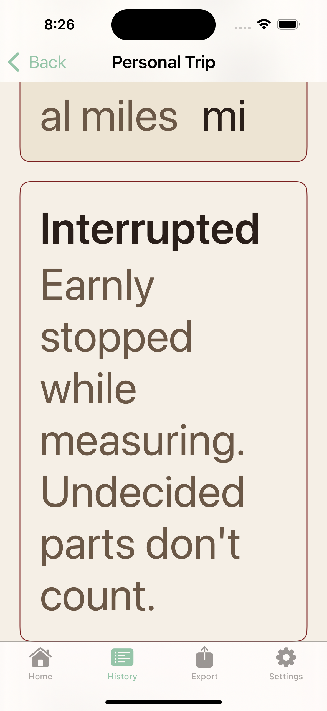</a></td>
</tr>
<tr>
<td align="center"><strong>16 ax5 detail gap</strong> </td>
<td align="center"><strong>17 ax5 personal top</strong> <a href="17-ax5-personal-top.png">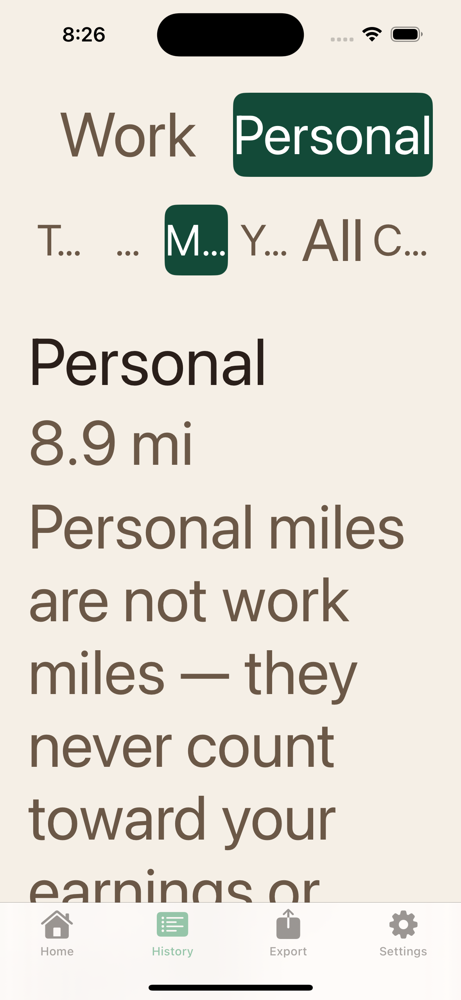</a></td>
<td align="center"><strong>18 ax5 personal day rows</strong> <a href="18-ax5-personal-day-rows.png">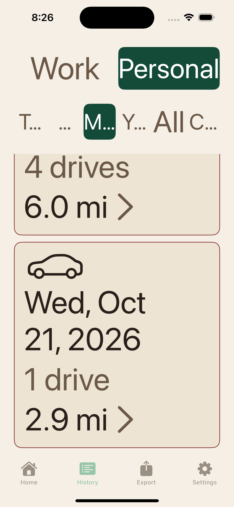</a></td>
</tr>
<tr>
<td align="center"><strong>19 ax5 day oct21</strong> <a href="19-ax5-day-oct21.png">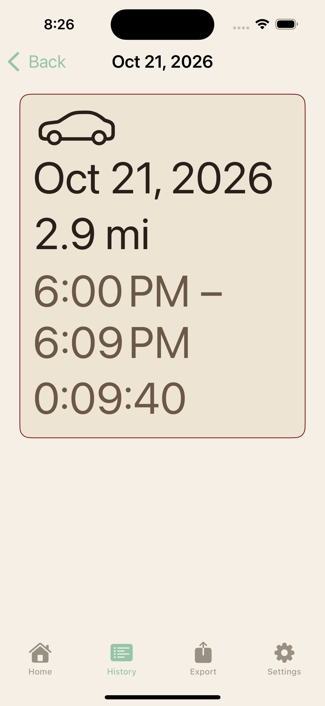</a></td>
</tr>
</table>
