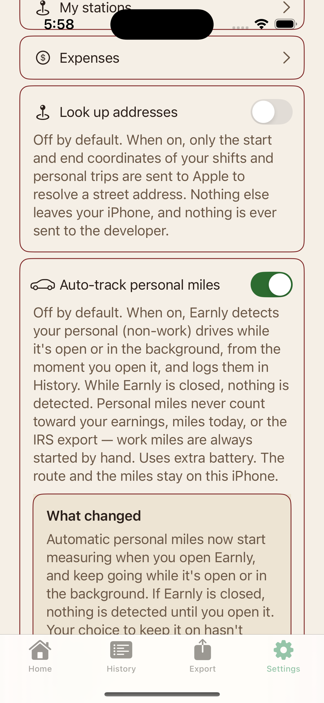
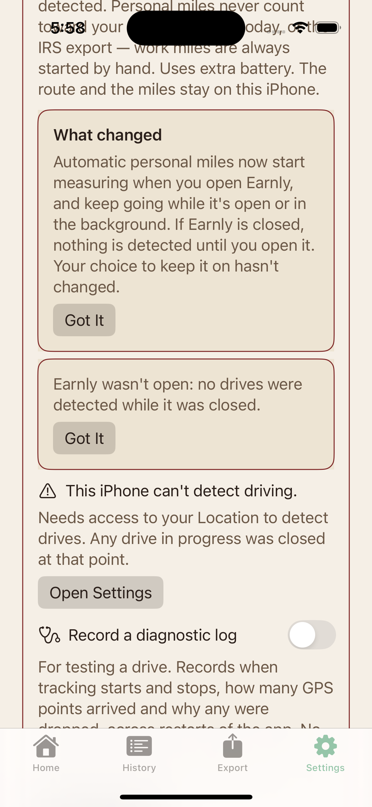
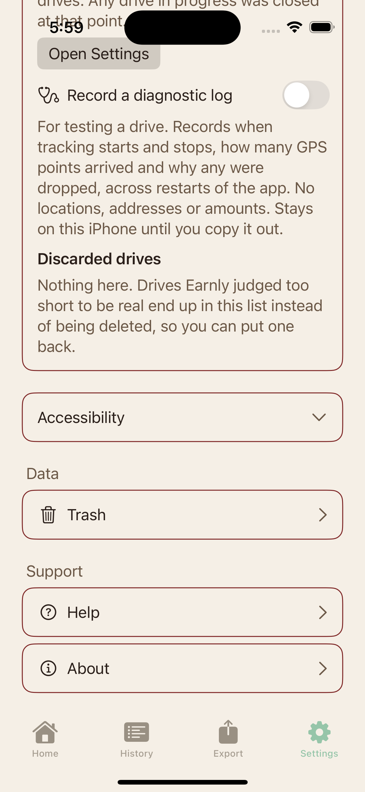

# Ajustes y cobertura

[Volver al indice](../../README.md) · [Encargo](../../DESIGN-BRIEF.md) · [Cobertura](../../COBERTURA.md)

Ajustes C34: captura de referencia previa a AX-3; seccion de ajustes.

Todas las capturas usan datos sinteticos. AX5/AXL son estados de texto grande; algunas imagenes son continuaciones desplazadas de una pantalla.

<table>
<tr>
<td align="center"><strong>09 settings status</strong> </td>
<td align="center"><strong>10 settings status row</strong> </td>
<td align="center"><strong>11 settings bottom no internal</strong> </td>
</tr>
</table>
