# Cierre de turno laboral

[Volver al indice](../../README.md) · [Encargo](../../DESIGN-BRIEF.md) · [Cobertura](../../COBERTURA.md)

Cierre laboral del checkpoint 9b72388; no integrado en C34.

Todas las capturas usan datos sinteticos. AX5/AXL son estados de texto grande; algunas imagenes son continuaciones desplazadas de una pantalla.

<table>
<tr>
<td align="center"><strong>00 en light route orphan sheet</strong> <a href="00-en-light-route-orphan-sheet.png">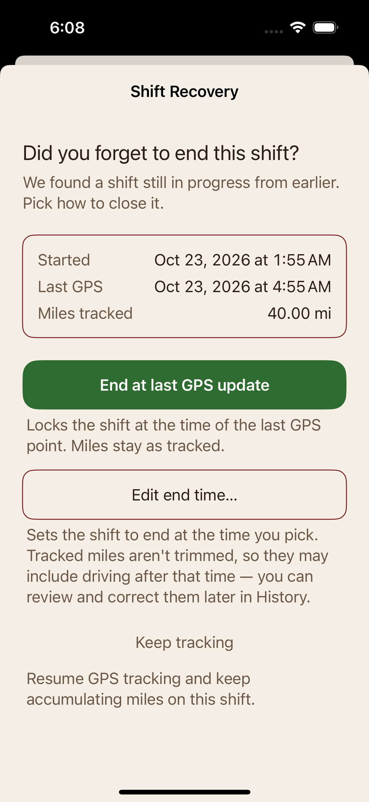</a></td>
<td align="center"><strong>01 en light summary open</strong> <a href="01-en-light-summary-open.png">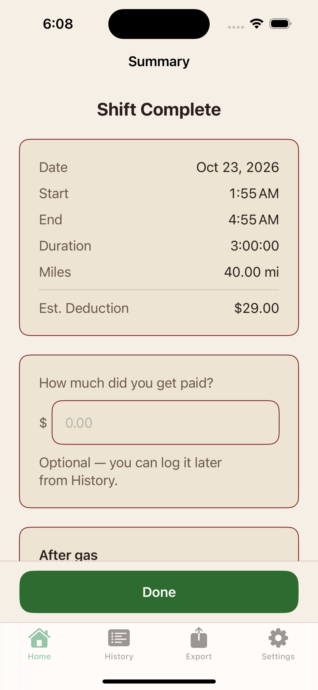</a></td>
<td align="center"><strong>02 en light keyboard field focused</strong> <a href="02-en-light-keyboard-field-focused.png">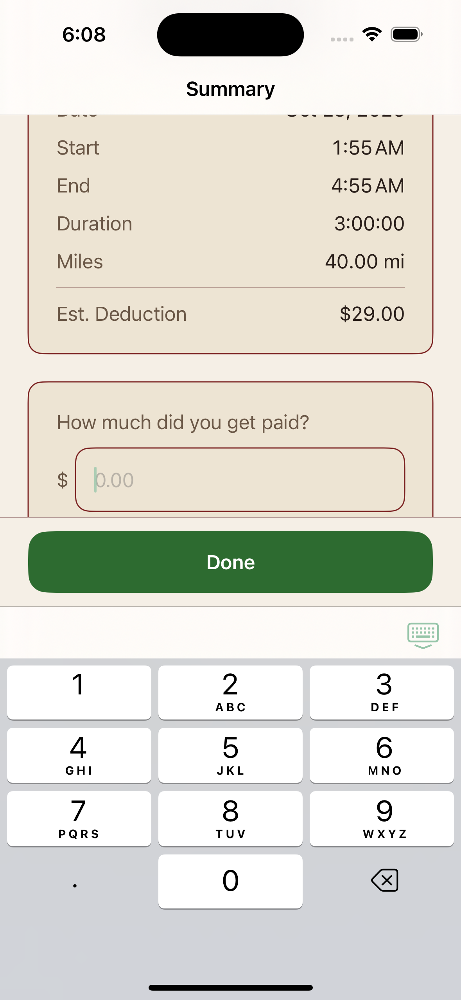</a></td>
</tr>
<tr>
<td align="center"><strong>03 en light keyboard typed 90</strong> <a href="03-en-light-keyboard-typed-90.png">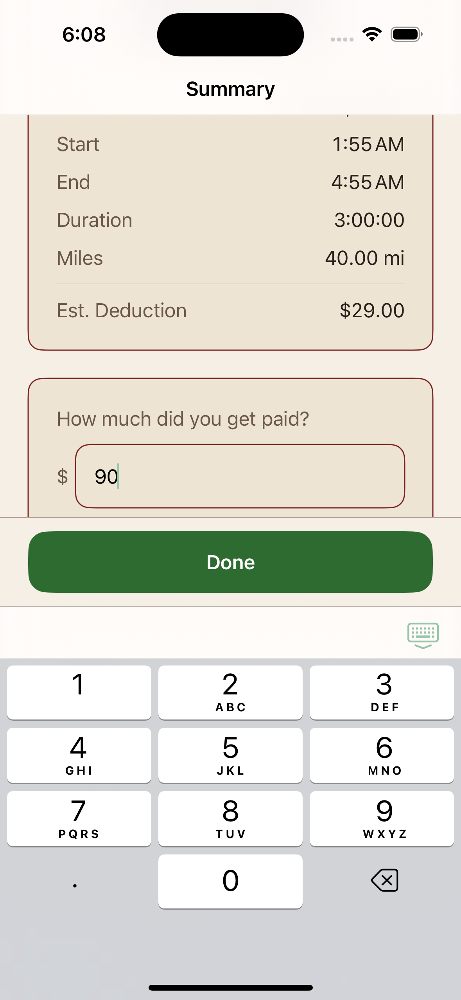</a></td>
<td align="center"><strong>04 en light keyboard refusal visible</strong> <a href="04-en-light-keyboard-refusal-visible.png">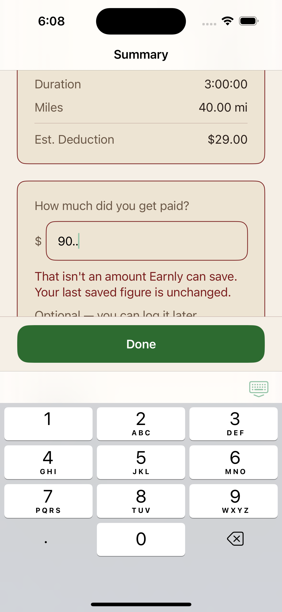</a></td>
<td align="center"><strong>05 en light result 82 and 27_33</strong> <a href="05-en-light-result-82-and-27_33.png">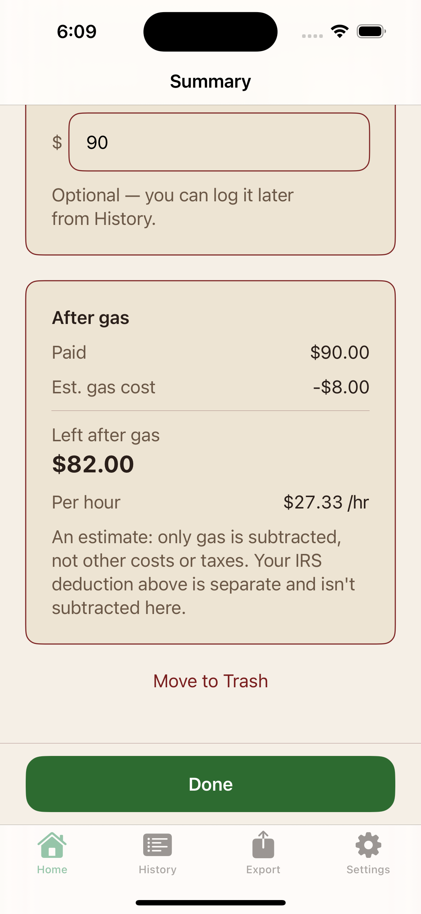</a></td>
</tr>
<tr>
<td align="center"><strong>06 en light done returns home</strong> <a href="06-en-light-done-returns-home.png">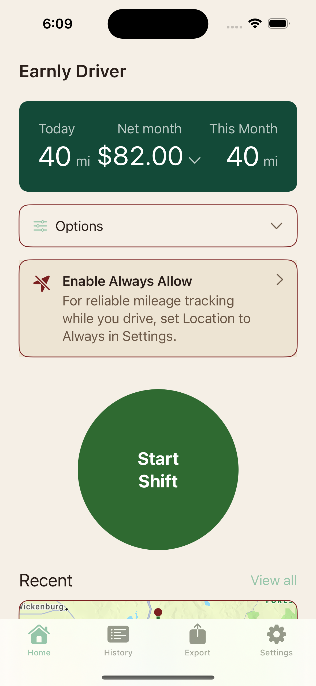</a></td>
<td align="center"><strong>07 es dark keyboard typed 90</strong> <a href="07-es-dark-keyboard-typed-90.png">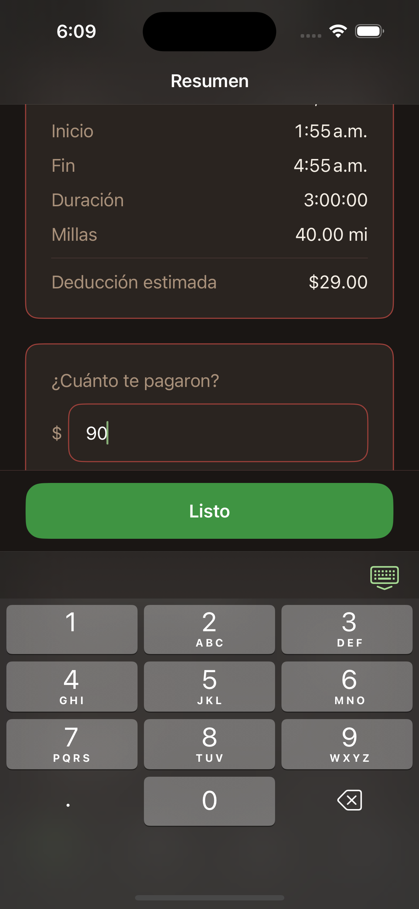</a></td>
<td align="center"><strong>08 es dark result</strong> <a href="08-es-dark-result.png">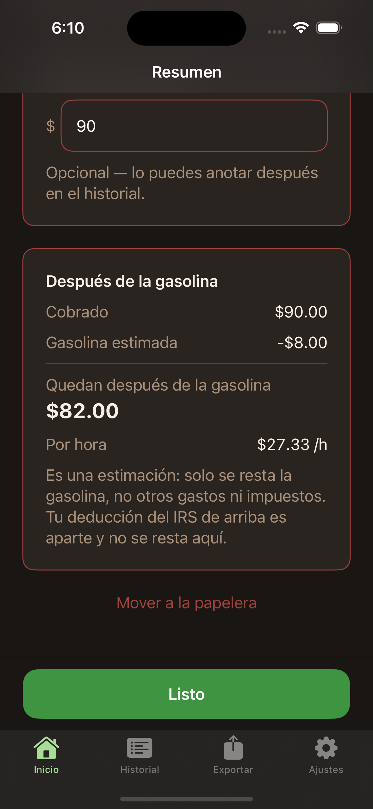</a></td>
</tr>
<tr>
<td align="center"><strong>09 en ax5 summary lines stacked</strong> <a href="09-en-ax5-summary-lines-stacked.png">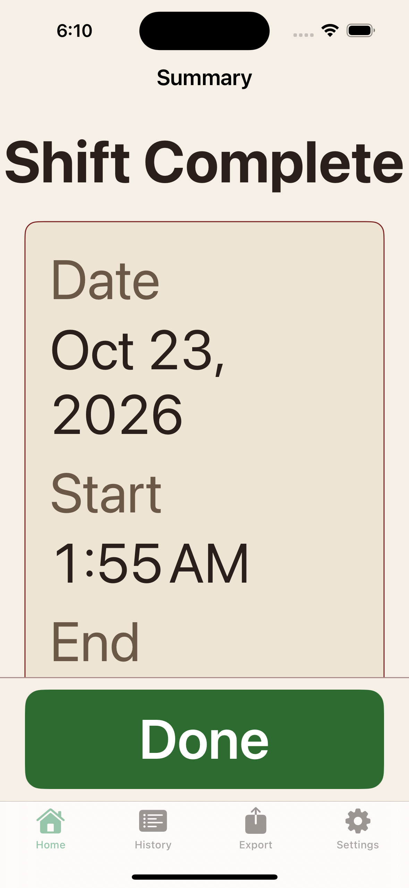</a></td>
<td align="center"><strong>10 en ax5 keyboard field and done</strong> <a href="10-en-ax5-keyboard-field-and-done.png">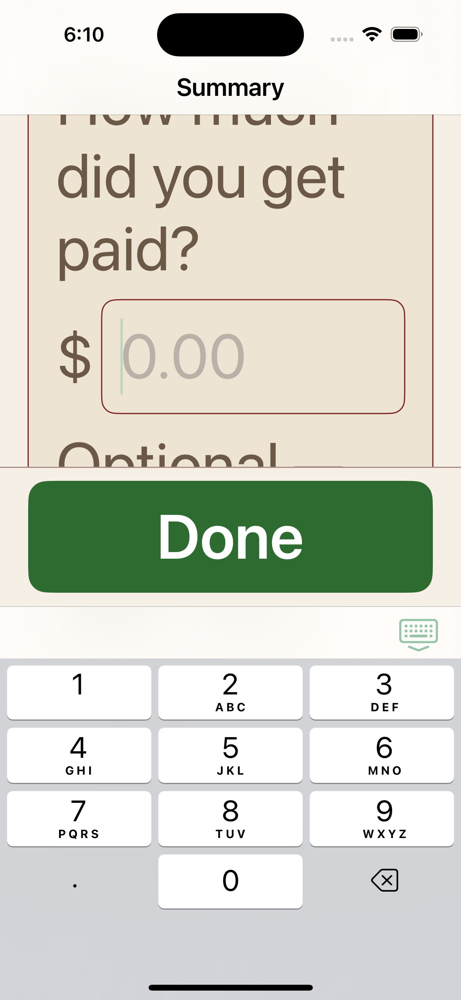</a></td>
<td align="center"><strong>11 en ax5 keyboard refusal</strong> <a href="11-en-ax5-keyboard-refusal.png">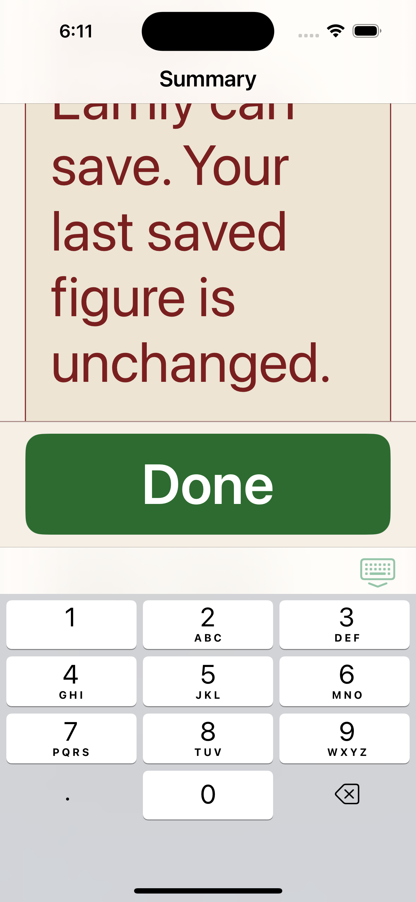</a></td>
</tr>
<tr>
<td align="center"><strong>12 en ax5 result stacked</strong> <a href="12-en-ax5-result-stacked.png">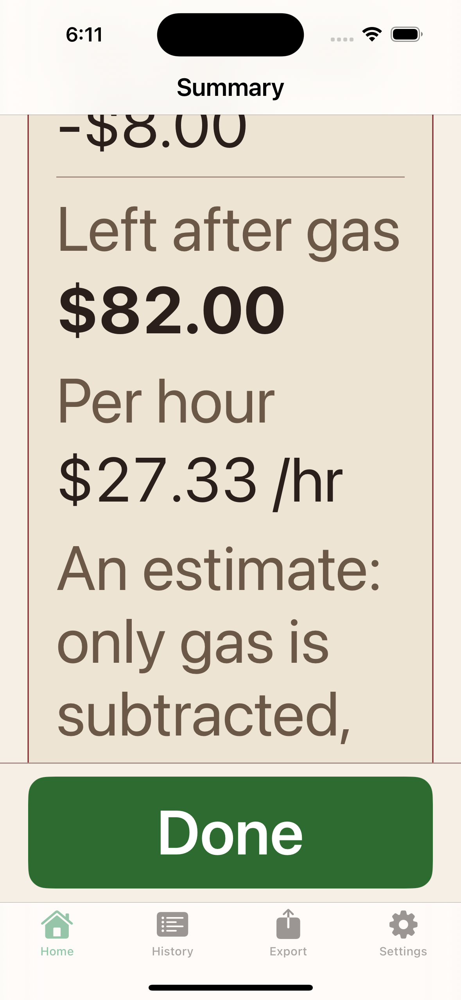</a></td>
<td align="center"><strong>13 es light no gas price</strong> <a href="13-es-light-no-gas-price.png">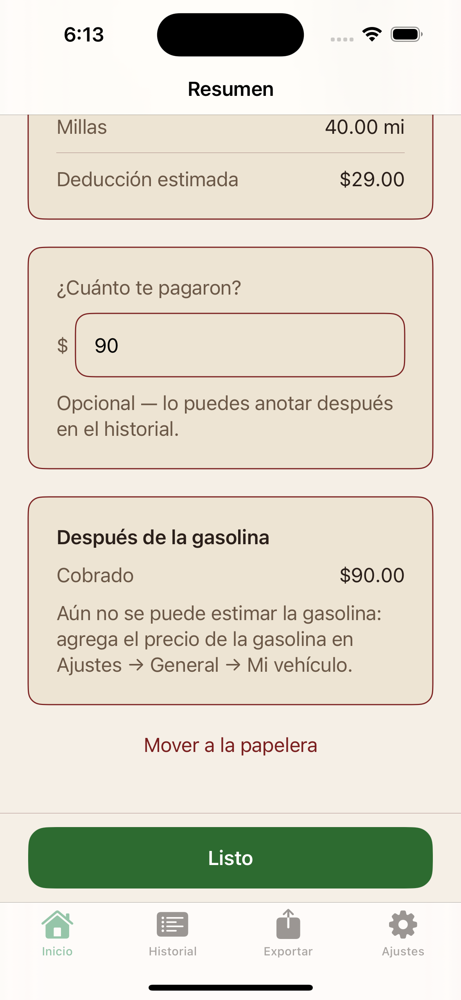</a></td>
<td align="center"><strong>14 en dark extras partial</strong> <a href="14-en-dark-extras-partial.png">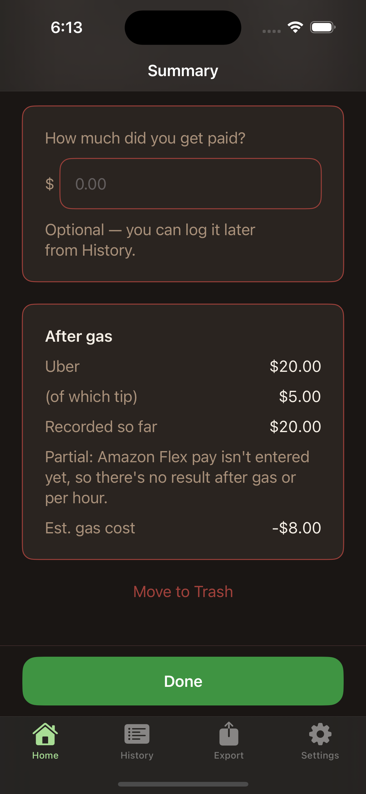</a></td>
</tr>
<tr>
<td align="center"><strong>15 en dark extras total recorded</strong> <a href="15-en-dark-extras-total-recorded.png">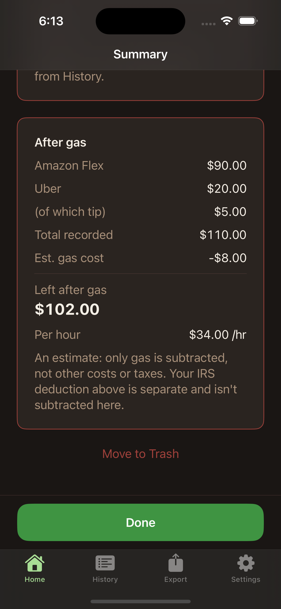</a></td>
<td align="center"><strong>16 en light zero pay negative</strong> <a href="16-en-light-zero-pay-negative.png">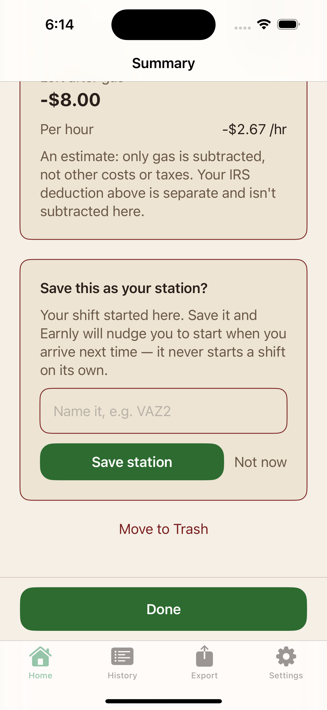</a></td>
<td align="center"><strong>17 en light station field keyboard</strong> <a href="17-en-light-station-field-keyboard.png">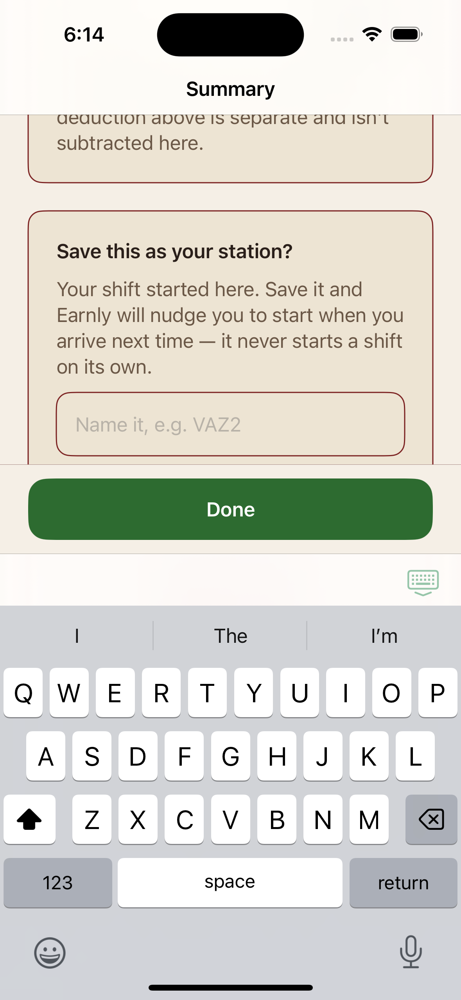</a></td>
</tr>
</table>
