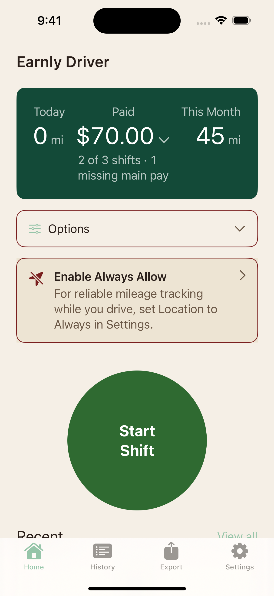
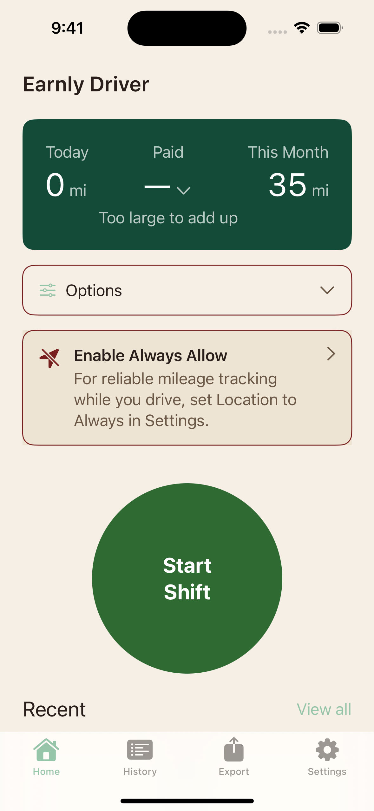
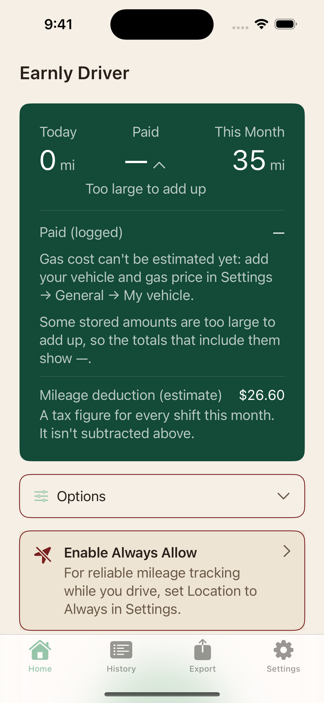
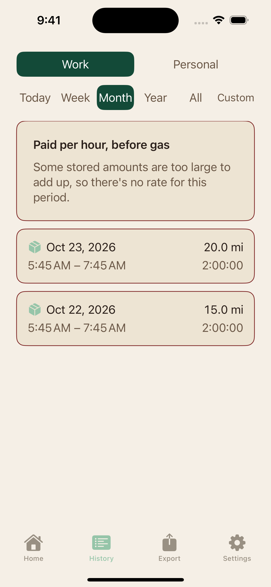
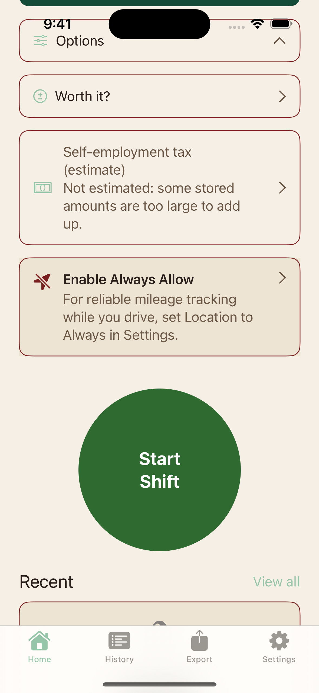

# Inicio y dinero: correcciones del 24 oct

[Volver al indice](../../README.md) · [Encargo](../../DESIGN-BRIEF.md) · [Cobertura](../../COBERTURA.md)

Correcciones R1-R3 del 24 oct; revision pendiente de remate ROI, no integrada.

Todas las capturas usan datos sinteticos. AX5/AXL son estados de texto grande; algunas imagenes son continuaciones desplazadas de una pantalla.

<table>
<tr>
<td align="center"><strong>01 home partial en</strong> </td>
<td align="center"><strong>02 home breakdown partial en</strong> </td>
<td align="center"><strong>03 se card partial en</strong> </td>
</tr>
<tr>
<td align="center"><strong>04 home partial es dark</strong> </td>
<td align="center"><strong>05 home too large en</strong> </td>
<td align="center"><strong>06 home breakdown too large en</strong> </td>
</tr>
<tr>
<td align="center"><strong>07 history too large en</strong> </td>
<td align="center"><strong>08 se card too large en</strong> </td>
</tr>
</table>
