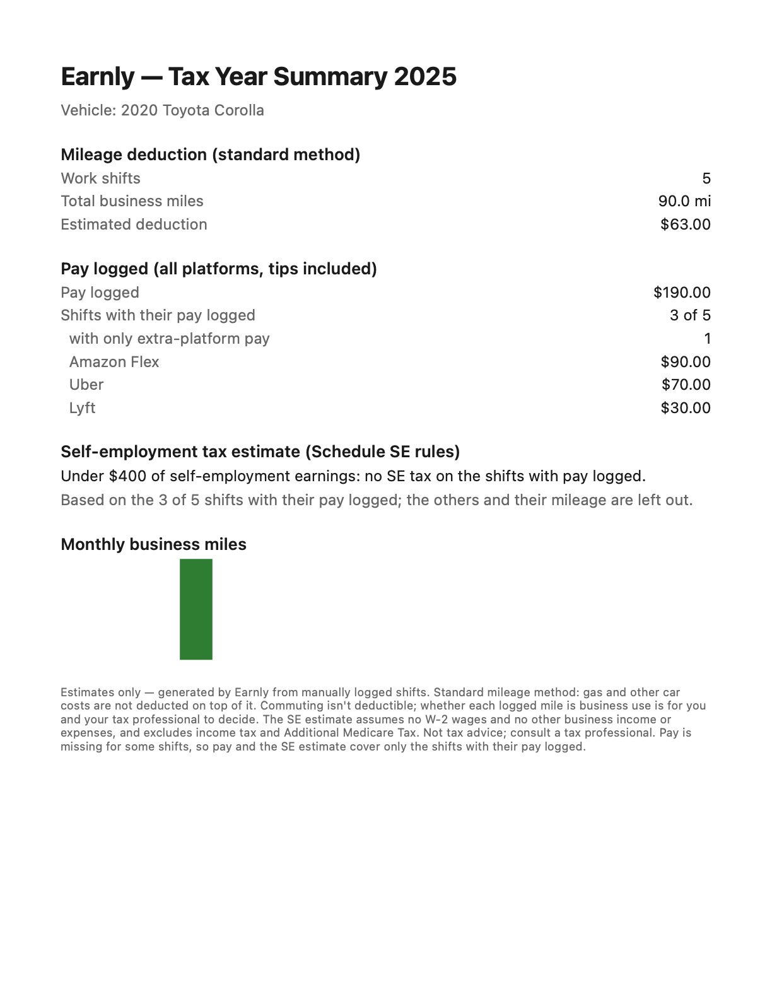
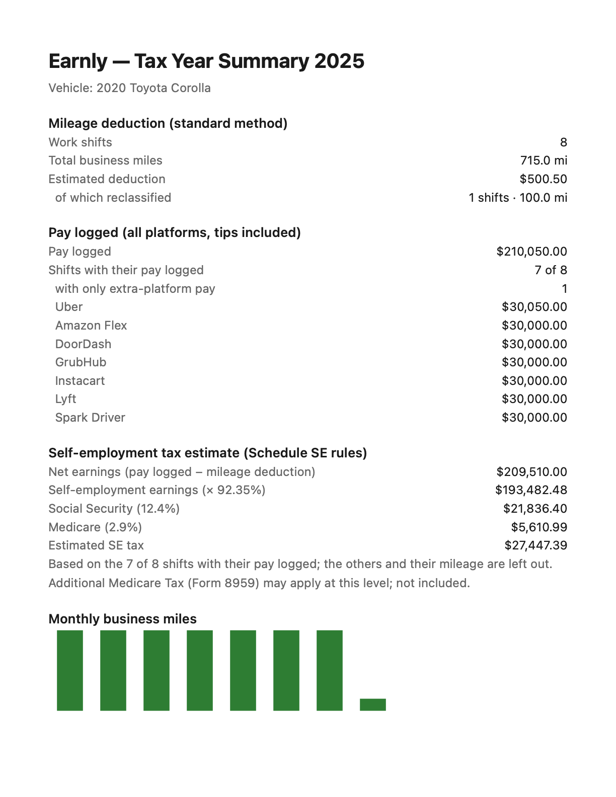

# Documentos ficticios: jerarquia y legibilidad

[Volver al indice](../../README.md) · [Encargo](../../DESIGN-BRIEF.md) · [Cobertura](../../COBERTURA.md)

Paginas de PDF sintetico, referencia visual; no declaracion fiscal.

Todas las capturas usan datos sinteticos. AX5/AXL son estados de texto grande; algunas imagenes son continuaciones desplazadas de una pantalla.

<table>
<tr>
<td align="center"><strong>ordinary 1p p1</strong> </td>
<td align="center"><strong>wide 2p p1</strong> </td>
<td align="center"><strong>wide 2p p2</strong> </td>
</tr>
</table>
